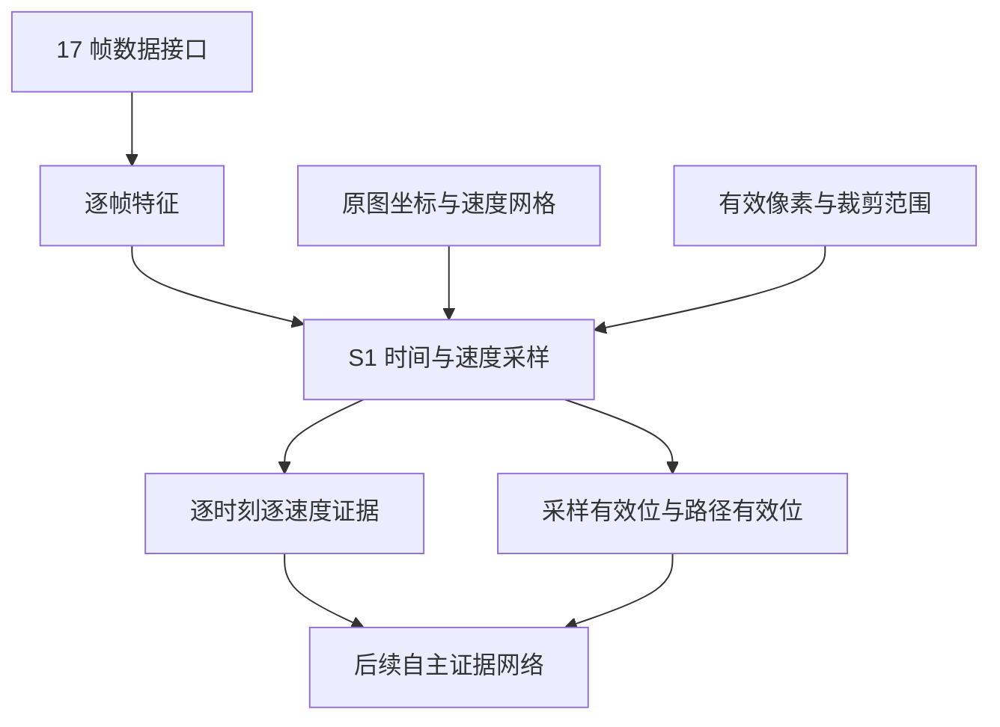

# S1：自主红外小目标视频检测的时间—速度采样器

**当前结论：S1 算子已实现，CPU 算子检查通过；完整 S1 验收仍待真实训练 batch、正式速度网格覆盖决定和 CUDA 资源测量。训练步数为 0，尚未进入 S2。**

本次基于仓库提交 `3ca39abb575e32f168fb771253ca68704bd7a669` 新增文件。S0 原有代码、配置、manifest 和报告均保持原样，S0 归档中的 10 项代码/配置摘要及 manifest 摘要已重新比对一致。当前提交号不同于历史 S0 报告中的提交号，不代表数据接口被修改；实际内容摘要是本次衔接检查的依据。

## 1. S1 在模型中的位置

S0 解决连续 17 帧与第 9 帧标签的对应关系。S1 解决：对中心帧位置 `p`，在每一个上下文时刻、每一个速度假设下，究竟读取哪个位置、读取什么数值、这个数值是否有效。

后续模型将把自主逐帧编码器输出交给本算子，再由自己的证据编码器、空间解码器和检测头完成检测。本阶段提供采样接口和正确性检查，不包含检测头或优化器。



图中的逐帧编码器及后续网络属于后续阶段。本次检查可直接用原始单通道图像或受控特征作为输入；没有调用 DeepPro-Plus 的权重、特征或检测结果。

## 2. 输入、输出和坐标约定

### 2.1 输入接口

```python
sample_clip_features(features, clip, queries_xy, velocities_xy,
                     query_chunk=256, velocity_chunk=8, source_hw=None)
```

| 输入 | 维度/类型 | 含义 |
|---|---|---|
| `features` | `[B,17,C,Hpad,Wpad]`，FP32 或 FP64 | 原生分辨率、stride=1 的逐帧特征，允许向特征反传梯度 |
| `clip` | S0 `ClipBatch` | 提供原始时间间隔、像素有效位、原图尺寸和裁剪原点 |
| `queries_xy` | `[N,2]` 或 `[B,N,2]` | 要计算证据的全图坐标，最后一维为 `(x,y)` |
| `velocities_xy` | `[My,Mx,2]` | 每个速度的 `(vx,vy)`，单位为原图像素/原始帧间隔 |
| `source_hw` | 可选 `[B,2]` | 实际加载的图像区域尺寸，不包含批次补齐；任何 crop 均应明确传入 |

低层接口 `sample_context(...)` 接受已去掉中心帧的特征及实际时间间隔，也可用于短序列的几何检查。

**S1 只保证对特征可微。时间、查询坐标、速度和图像几何属于固定输入；带 `requires_grad=True` 的几何张量会被明确拒绝。** 未来若研究可学习运动，需要另行定义并检查坐标梯度，不能从当前特征梯度检查推导出坐标学习正确。

### 2.2 采样规则

对每个全图查询位置与速度假设，读取：

\[
q_{t,v}=p+\tau_t v.
\]

第 9 帧的索引为 8，在 wrapper 中同时从特征、有效位与时间数组剔除。上下文时间严格保持：

```text
[-8,-7,-6,-5,-4,-3,-2,-1,1,2,3,4,5,6,7,8]
```

若使用图像块，先在全图坐标计算 `q`，再减去实际输入块的原点。不能把时间槽号当成原始帧间隔，也不能把 tile 内部坐标当成全图坐标。

插值直接在原生像素坐标上执行四邻点双线性加权。像素中心的约定与 `align_corners=False` 下的归一化公式等价，但实际实现不进行归一化再反变换，避免整数像素位置的舍入误差制造额外插值权重。

[坐标示意图](S1_sampling_coordinates.svg) 展示固定位置在 16 个上下文时刻、三种速度假设下的采样点。零速度的 16 个空间位置重合，但时间槽仍分别保留。

### 2.3 输出接口

| `SampledEvidence` 字段 | 维度 | 含义 |
|---|---|---|
| `values` | `[B,N,C,16,My,Mx]` | 每个时刻、每个速度假设的证据；无效项置零 |
| `sample_valid` | `[B,N,16,My,Mx]` | 这一次双线性采样的所有正权重支撑像素是否有效 |
| `velocity_valid` | `[B,N,My,Mx]` | 此速度在全部上下文时刻都有效，即沿时间轴求 `all` |
| `time_offsets` | `[B,16]` | 实际保留下来的时间间隔 |
| `queries_xy` | `[B,N,2]` | 完整查询顺序与全图坐标 |
| `velocities_xy` | `[My,Mx,2]` | 完整速度网格 |

本阶段不按时间平均，不选择“最佳速度”，不按已有检测分数筛选位置。后续计算均值或分解时必须同时读取有效位，不能把置零的缺失观测当作真实暗像素。

## 3. 三类边界分别处理

| 情况 | 处理 |
|---|---|
| 位移后离开真实图像 | 对应 `sample_valid=False`，数值为零，对特征的梯度为零 |
| 批次补齐或图像内明确无效的像素 | 只要正权重插值支撑触及这些像素，该采样无效 |
| 位置仍在真实图像中，但当前 tile 没加载所需邻域 | 抛出 `MissingHaloError`，要求修正输入范围或元数据 |

整数像素位置的零权重邻居不应影响有效性。无效像素即使被填入很大的数值，也不能改变合法观测或收到梯度。

对完整、异尺寸 batch，wrapper 按各张原图的 `original_hw` 判断真实范围。**所有裁剪输入，包括原点恰好为 `(0,0)` 的左上角 crop，都必须显式传 `source_hw`。** 缺省值表示完整原图；从 `pixel_valid` 猜测某个无效区域究竟是孔洞还是没有加载的裁剪区域是不可靠的。

## 4. 分块的三个范围

`Tile` 保存 `core_xyxy`、`query_xyxy` 和 `input_xyxy`，全部是全图坐标，右下边界不包含。

1. **core**：最终写回的像素。所有核心块覆盖全图恰好一次。
2. **query**：在 core 外增加空间解码器需要的邻域。
3. **input**：在 query 外增加运动位移、逐帧编码器/对比度算子与插值所需邻域。

每个轴在 query 外的保守输入余量为：

\[
h_a=\left\lceil\max_{t,v}|\tau_t v_a|\right\rceil
 +\max(r_\mathrm{encoder},r_\mathrm{contrast})+r_\mathrm{interp}.
\]

真正图像边缘按真实图像截断。人工块边界必须加载相邻真实像素。执行后续空间解码后，才用 `tile.core_slice_in_query` 裁出最终 core。

该规则要求逐帧算子为局部 stride=1 运算，且声明的感受野半径准确。依赖整张 crop 统计量的归一化不自动满足整图与分块等价。

## 5. 已运行的检查与证据

运行环境为 Python 3.12.14、PyTorch 2.7.0+cpu。原 S0 归档环境为 Python 3.11.12、PyTorch 2.7.0+cu128。本次没有在原项目 CUDA 环境执行。

正式机器记录为 [S1.json](S1.json)。本次 19 项 CPU 算子检查全部通过，检查包含：

| 检查组 | 已核对的行为 |
|---|---|
| 速度与时间 | 横纵顺序、正负/零/亚像素速度、实际时间间隔、12 组亮/暗运动点 |
| 独立数值参考 | 标量 NumPy 插值与生产实现逐项比较，含无效支撑与边界 |
| 17→16 接口 | 保留原顺序，剔除中心帧，中心帧不接收上下文路径的梯度 |
| 有效域 | 异形 batch、补齐污染、整数边缘、正权重支撑、全路径有效性 |
| 特征梯度 | 手工散射权重、双精度有限差分、无效与空查询的零梯度 |
| 分块 | query/velocity chunk 一致、核心覆盖、真实缺 halo 报错、整图与分块一致 |
| 空间邻域 | 固定局部编码与两层卷积解码下，整图输出与分块核心输出一致 |
| 非法输入 | 几何尺寸、裁剪范围、中心索引及非有限坐标错误被拒绝 |
| 精度契约 | FP64 输入不先损失到 FP32，固定几何不误开放坐标梯度 |

本地结果中的主要数值：

- 独立参考比较 540 个数值，最大绝对误差约 `6.33e-8`。
- 25 个核心块覆盖 31×43 图像的 1,333 个像素，所有像素恰好覆盖一次。
- 当前整图与分块采样用例最大差为 0；加入固定局部编码、解码的用例最大差也为 0。
- 改变 chunk 后前向输出逐值一致，反向梯度最大差约 `2.86e-6`，在预设 FP32 容差内。
- 对宽度 323 的整数坐标回归，323 个位置输出误差为 0，无效像素的非零梯度数为 0。

这些结果验证算子的数值和接口行为，不构成目标检测效果或研究创新性证据。

### 5.1 本轮实际修正的数值问题

早期实现采用归一化网格采样。在宽度 323 的回归中，每个样本仅将一个查询像素设为有效、值为 1，其余无效像素填入 `1e6`。归一化坐标往返的舍入使 83 个查询混入了无效邻居，独立复核最大误差约 15.26，且无效像素出现非零梯度。

修正为原生像素四角插值后，上述用例输出与无效像素梯度均精确符合契约。回归已纳入正式检查。这里的巨大填充值用于放大实现错误，不代表正常红外图像的数值范围。

### 5.2 资源记录的解释范围

CPU 测量使用 17 帧、9 通道、32×32 查询区、16 个上下文时刻和 5×5 速度网格。输出 `values` 的张量大小为 14,745,600 字节，约 14.06 MiB。前向和反向实测时间及进程高水位内存见机器记录。

这只是采样器的一次预热后单次测量，未包含后续模型；CPU 进程高水位不等于采样器独立峰值，更不等于 GPU 显存。query/velocity 分块减少部分工作张量的大小，但返回的完整证据张量仍需存储，不能据此宣称内存与查询数或速度数无关。

## 6. 为什么完整 S1 状态仍为 BLOCKED

这不是算子检查失败。按已经确定的阶段方案，S1 还有以下未满足项：

| 待完成项 | 当前状态 | 完成方法 |
|---|---|---|
| S0 真实 batch 接入采样器 | 当前副本缺所需 51 张图像和 3 张 mask | 在原数据目录运行同一检查，固定使用 S0 的三个训练样本 |
| 正式速度网格的范围与步长 | 当前 `[-2,-1,0,1,2]²` 只用于工程检查 | 基于训练来源的运动/尺度诊断，记录覆盖依据和不确定性，冻结正式配置 |
| CUDA 峰值显存及耗时 | 当前环境没有 CUDA | 在明确可用的 GPU 上，按正式网格和预先声明的预算实测 |

S0 的相邻单分量质心位移统计并不是真实目标速度标注，也不能证明 ±2 像素/帧已经覆盖数据。范围与步长需要分别检查：范围不足会缺少运动假设，步长过大则会使最远上下文产生较大的空间偏差。最大时间间隔为 8 时，步长为 1 的单轴最近格点误差可对应约 4 像素的端点偏差。

下一步应继续在 S1 内完成这些衔接和资源项。无需重跑未改变的整个 S0；检查器会验证 S0 摘要。无需使用开发集或测试集的检测性能来选网格。

## 7. 在原项目中复算

将本次新增文件应用到仓库后，在已经配置好的项目 Python 环境运行：

```bash
cd /home/ly/DeepProPlus_TLFP_Code
python experiments/irstd_independent_v1/checks/check_s1.py --device cpu
```

这会核验 S0 摘要、运行算子检查、尝试加载固定的三个训练样本并测量采样器。若真实数据存在，这一项应实际运行；CPU 运行不会自动给 CUDA 资源项记为通过。

先查看 GPU 占用，选定可用设备。下面仅以设备 1 为示例；检查脚本不会自动选择 GPU 或中止其他进程：

```bash
nvidia-smi
python experiments/irstd_independent_v1/checks/check_s1.py \
  --device cuda:1 \
  --output experiments/irstd_independent_v1/reports/S1_cuda.json
```

默认配置是工程配置，即使 CUDA 与真实 batch 均通过，仍会明确报告尚未冻结正式网格。正式配置应另存一个 YAML 文件，用 `--config` 传入，并填写训练来源的覆盖依据、正式网格、query 尺寸与显存预算。`formal_coverage_approved` 是人工审定记录，不能仅为了使程序返回 PASS 而改为 `true`；程序也不能用一个布尔值替代覆盖证据。

检查器退出码：`0=PASS`，`1=FAIL`，`2=BLOCKED`。`BLOCKED` 表示必要资源、数据或配置决定尚未完成。只有完整 S1 通过时，机器记录才输出 `next_allowed_stage: S2`。

## 8. 文件与后续边界

| 文件 | 责任 |
|---|---|
| `geometry/velocity_grid.py` | 固定速度网格、坐标顺序与输入检查 |
| `geometry/sampler.py` | 可微特征采样、有效支撑、S0 wrapper |
| `geometry/tiles.py` | 全图 core/query/input 与 halo 几何 |
| `geometry/__init__.py` | 采样公共接口 |
| `checks/check_s1.py` | 算子检查、状态汇总、可视化与运行入口 |
| `checks/s1_runtime.py` | S0 摘要、真实训练 batch 和资源测量 |
| `configs/s1_geometry.yaml` | 工程速度网格、分块和预设容差 |
| `reports/S1.json` | 本次实际运行记录与代码摘要 |

S1 完整通过后，S2 才实现自己的 FrameEncoder、视频基础聚合、SpatialDecoder 和 DetectionHead，并开始验证真实训练通路。S3 才接入时间—速度主效应与交互证据的核心建模。阶段顺序保持原方案，不因为当前算子已可运行就提前把所有网络文件写完。
