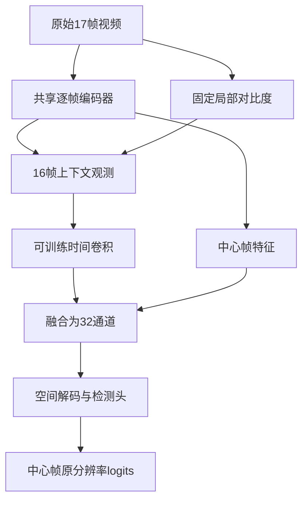

# S2 设计：建立可独立训练的红外小目标视频基础模型

**决定：进入 S2，第一项实现工作为 S2a。** S0、S1 的工程要求已满足，不重新打开已完成的阶段。本文件明确 S2 的网络、数据流和顺序验收；本轮没有实现或训练 S2，不能将设计完成记为 `S2 PASS`。

- 核对的仓库版本：`ec5e9f1c4dfd182b472c7b9277d0c7d7c273ce92`。
- S0：`PASS`，10/10 份代码与配置摘要一致，manifest 摘要一致。
- S1：`PASS`，9/9 份代码与配置摘要一致，正式 coverage 与 protocol 摘要一致，`pending_requirements=[]`，`next_allowed_stage=S2`。
- S2：当前版本尚无 `models/`、`losses/`、`engine/` 实现，本轮只新增这份设计文档。
- 当前环境核对的是已归档的运行结果与代码内容，没有重新执行用户原环境的真实数据或 CUDA 验收。

来源：[S0 正式记录][s0]、[S1 正式记录][s1]、[V1 分阶段方案][v1]。

## 1. S2 要解决什么

S2 建立自己的基础视频模型 M0，使原始红外视频能够经过自己的可训练模块，输出中心帧的原分辨率目标 logits，并完成真实短训练、保存恢复和整图预测。

本阶段要回答的是：**我们的特征编码、时间聚合、空间解码、检测监督和推理程序，能否组成一条真正可训练的独立路径？**

S3 再把 M0 的时间聚合器替换成时间—速度采样、证据分解和证据编码路径。FrameEncoder、空间解码器、检测头、数据契约与评价规则继续使用。这里的“继续使用”指代码与接口保持稳定；所有学习模块仍然参与训练，没有冻结旧模型检测头的安排。

| 阶段 | 本阶段主要工作 | 不能由该阶段直接推出的结论 |
|---|---|---|
| S1，已完成 | 正确读取不同时间、不同速度假设的证据 | 这些证据一定提高检测率 |
| S2，本次设计 | 自主视频模型能够真实学习并完整推理 | 时间—速度交互已经有效或创新已经成立 |
| S3，下一阶段 | 用核心证据结构替换视频聚合路径 | 只超过 M0 就证明交互机制有效 |
| S4–S5，后续 | 公平比较、机制诊断与独立确认 | 无条件推广到未测真实场景 |

按照 V1，**M0 采用固定图像位置上的简单可训练时间卷积**。S2 不必为了“用上 S1”就提前把 81 速度采样和交互分解放进 M0。[V1 的 S2/S3 约定][v1]

## 2. 正确使用 S1 的新证据

### 2.1 三类数值分别说明什么

| S1 结果 | 精确含义 | 对 S2/S3 的影响 |
|---|---|---|
| 98.33% | 在 5,856 个可拟合训练窗口中，选定网格对拟合直线的离散误差满足预设要求 | 保持正式 9×9 网格，不能把它解释成目标路径覆盖率或检测率 |
| 65.83% | 所选网格直线相对各时刻质心的误差，按中心帧框宽高归一化后，全部 16 个时刻两轴都在半框范围内 | 后续不能硬性要求一条路径在所有帧都有目标响应；应让网络利用部分时刻的证据 |
| 1,345.82 MiB | 68×68 查询区、9通道、16时刻、81速度的独立采样器前向/反向峰值 | S2/S3 仍要测完整模型，不能把这一数值当成整网训练显存 |

这些是合成训练数据上的几何代理统计和特定配置的工程测量，数据没有速度真值和逐目标 ID。[覆盖记录][coverage]、[资源记录][s1]

主报告的 65.83% 与独立参考中 `3629/5856≈61.97%` 采用不同判据：前者使用固定的中心帧框尺度；后者检查是否落入每个对应时刻的实际框，且最近格点并列规则也不同。二者不能互相替换或称为同一数值的复核。该差异不改变 S1 的正式验收状态。[覆盖记录][coverage]、[独立参考记录][s1]

### 2.2 几何有效与目标支持必须分开

- **几何有效**：采样坐标在真实图像内，所需插值像素存在且有效。
- **目标支持**：这个合法观测对“此处有目标”是否有帮助。

一条假设路径偏离目标、采到背景，仍然产生了有效观测。不能把这类时刻改成 `sample_valid=False`，也不能根据训练 GT 决定哪些路径保留，否则模型在训练时得到了推理时不存在的标签信息。

65.83% 支持的设计约束是**保留逐时刻信息，避免全时刻同时响应的硬门槛**。它没有证明注意力、门控或某一种交互编码必然有效，也不要求在 S2 另开一条新研究路线。

## 3. M0 网络结构：位置、输入与输出

### 3.1 总体数据流



模型入口只接收 `ClipBatch`。`Targets` 只传给损失或评价程序，不能进入模型的推理签名。

```python
prediction = model(clip)
loss = detection_loss(prediction, targets, clip.pixel_valid[:, 8])
```

输出保持 S0 契约：

```text
Prediction.logits:          [B,1,H,W]
Prediction.output_frame_id: 与 clip 的中心帧 ID 一致
Prediction.diagnostics:     默认只保留小型统计，关闭大张量导出
```

### 3.2 第一版的逐层规格

下表使用原生空间坐标；所有空间 stride 均为1。分块执行时，时间聚合与解码表中的 H/W 指 query 区域，最后才裁输出 core。

| 模块 | 运算 | 输出维度 |
|---|---|---|
| 输入 | 原始灰度 `/255` | `[B,17,1,H,W]` |
| FrameEncoder 1 | 共享 `Conv2d(1,8,3,padding=1)` + SiLU | `[B,17,8,H,W]` |
| FrameEncoder 2 | 共享 `Conv2d(8,8,3,padding=1)` + SiLU | `[B,17,8,H,W]` |
| ContrastChannel | 5×5 有效像素局部标准化对比度 | `[B,17,1,H,W]` |
| ContextInput | 8维学习特征+1维对比度，添加时间坐标和观测有效位 | `[B,11,17,H,W]` |
| TemporalConv 1 | `11→16`，核 `(3,1,1)`，时间 dilation=1、padding=1，SiLU | `[B,16,17,H,W]` |
| TemporalConv 2 | `16→16`，核 `(3,1,1)`，时间 dilation=2、padding=2，SiLU | 同上 |
| TemporalConv 3 | `16→16`，核 `(3,1,1)`，时间 dilation=4、padding=4，SiLU | 同上 |
| TemporalConv 4 | `16→16`，核 `(3,1,1)`，时间 dilation=1、padding=1，SiLU | 同上 |
| 时间读出 | 取零基索引8的隐状态 | `[B,16,H,W]` |
| 中心融合 | 时间特征16+中心学习特征8+上下文覆盖率1，共25维；`1×1 Conv 25→32` + SiLU | `[B,32,H,W]` |
| SpatialDecoder | 两层 `3×3 Conv 32→32,padding=1`，各接SiLU | `[B,32,H,W]` |
| DetectionHead | `1×1 Conv 32→1` | `[B,1,H,W]` logits |

第一版卷积均使用 bias，不加归一化参数。按以上层数和通道计算，理论可学习参数量为 **22,921**；实施时用程序计数确认。该配置是工程起点，不是最优容量结论。

首版不下采样，避免在数据接口刚通过后引入额外的目标缩小和标签坐标问题。所有学习模块从本模型的随机初始化开始共同训练。

## 4. 时间结构的两项具体约定

### 4.1 保留17个真实时间槽，中心观测置空

S1 输出是16个上下文时刻。M0 的普通时间卷积采用规则17槽，避免把 `−1` 与 `+1` 压成只相隔一个时间单位的位置：

```text
时间槽：   -8 -7 -6 -5 -4 -3 -2 -1  0 +1 +2 +3 +4 +5 +6 +7 +8
上下文位：  1  1  1  1  1  1  1  1  0  1  1  1  1  1  1  1  1
```

仅在构造上下文输入时，将中心槽的9维图像证据置零、观测有效位设为0。第9帧的8维学习特征通过独立中心支路进入融合。

附加两条通道分别为 `time_offsets/8` 和观测有效位。非中心槽的时间坐标来自已核对的输入；空间补齐位置的所有输入通道都归零。

时间卷积可以在中心槽生成由前后帧推导出的隐状态。**不能在每层之后继续用“中心观测为空”的掩码把中心隐状态清掉。** 中间层屏蔽的是空间无效区域，而不是禁止中心时间槽承载信息。

四层时间卷积的中心时间感受野为：

\[
1+2(1+2+4+1)=17.
\]

因此中心隐状态可以接收前后全部16帧的信息。这里没有“16帧都必须出现亮点”的硬性判断；是否利用某一帧，由可训练特征和检测损失决定。

### 4.2 M0 也必须检查物理帧号

当前 S1 的严格时序校验位于 `sample_clip_features(...)`。M0 不调用该采样函数，不能假定它自动继承这些检查。[当前采样接口][sampler]

S2 在统一 `model.forward(clip)` 入口新增输入校验，至少核对：

1. 恰好17帧、中心索引8。
2. 每个样本的物理帧号连续，与所属序列匹配。
3. 全部17个 `time_offsets` 精确等于 `[-8,...,0,...,+8]`。
4. `output_frame_id` 对应物理第9帧，batch长度一致。
5. 输入为原生尺寸；空间有效位、原图范围和 crop 元数据匹配。

保留 `+8→+7`、错中心 ID 和断帧的回归检查。通过新增 S2 校验入口完成，不改写已验收的 S0/S1 文件与摘要。

## 5. 边界、局部对比度与归一化

### 5.1 固定对比度

对每帧使用有效像素的5×5局部均值与方差：

\[
z=\frac{I-\mu_{5\times5}}
{\sqrt{\max(E_{5\times5}[I^2]-\mu_{5\times5}^{2},0)+\epsilon}}.
\]

第一版明确固定 `epsilon=(1/255)^2`，输入量纲为 `[0,1]`。局部统计使用有效像素数作分母，真实图像外和批次补齐的人工零值不参与统计；没有有效支撑的输出置零。运算采用 FP32。该通道不列为创新，所有后续正式比较版本使用相同定义。

### 5.2 每层恢复空间有效域

输入 padding 置零后，卷积偏置和边缘传播仍可能在 padding 区产生非零隐状态，随后重新传回真实边缘。因此：

- FrameEncoder 的每层卷积和激活后恢复空间 mask；
- 时间层、融合层与 Decoder 也屏蔽真实空间无效位置；
- 真实图像边缘统一零填充；人工 tile 边缘依靠足够 halo 提供真实邻域；
- 对比度统计使用有效像素，而非把人工填充值当观测。

S2a 要比较“单独处理每张原图”和“放入异尺寸 padded batch”的有效区域输出，不能只比较张量形状。

### 5.3 第一版不引入跨空间归一化

先使用 Conv+SiLU。普通 GroupNorm 会按组使用输入统计量，在训练和评价时均如此；改变 crop 的空间内容可能改变归一化结果。因此本设计不采用依赖整个 tile 空间统计量的归一化，以保持整图/分块可比性。[PyTorch 2.7 GroupNorm 文档][groupnorm]

若后续短训练出现具体优化问题，可检查只沿每个像素通道维的归一化方案，但必须明确实现维度、重新核对边界等价性，不能先叠加多个归一化模块。

## 6. 分块契约：S2 训练先用原图，推理支持分块

第一版 M0 优先使用 **batch=1 的完整原生图像训练**，不做目标裁剪或缩放。这避免刚开始就因各 tile 的正负像素数量不同而改变损失权重。能否满足资源预算，以完整 M0 实测为准。

模型仍保留确定性的分块推理接口。各部分空间半径为：

| 部分 | 空间半径 |
|---|---:|
| FrameEncoder | 2 |
| ContrastChannel | 2 |
| 纯时间卷积 | 0 |
| 1×1 Fusion | 0 |
| SpatialDecoder | 2 |
| Head | 0 |

因此 M0 总空间半径为4：

- `query = core` 外扩2像素，供 Decoder 使用；
- `input = query` 外扩2像素，供 Encoder/Contrast 使用；
- M0 在整数坐标取特征，没有运动位移或双线性插值，可用 `interp_radius=0`；
- 64×64 的内部 core 对应68×68 query、72×72原始输入，真实图像边缘按实际范围裁剪。

可复用 S1 的 `plan_tiles` 处理核心块和 halo；M0 的运动位移取零，不修改正式81速度配置。整图推理和分块推理调用同一模型计算路径，只改变查询区域、加载范围与写回。

S3 接入运动采样后，输入 halo 需要增加最大运动位移和插值支撑。不能照搬独立采样器的102×102特征输入尺寸当成原始图像输入尺寸。

若完整 M0 训练超过预定资源，先记录原因并调整调度。若后来引入分块训练，必须明确按完整图像计数归一化 BCE，或明确另定共同训练协议；Dice 的分子分母不能简单替换成各 tile Dice 的平均。S2 的工程短拟合记录不作为 S4 的公平性能比较结果。

## 7. 第一版损失

有效监督区域：

\[
\Omega_b=\mathrm{pixel\_valid}_{b,8}\land\neg\mathrm{ignore\_map}_b.
\]

先按帧分别计算前景和背景 BCE 的均值，再对存在的类别取平均。正常非空帧相当于前景、背景各占1/2；空帧只计算有效背景 BCE。这样也定义了“全前景”极端检查用例，不产生空分母。

非空帧再加 soft Dice，初始权重固定为0.5：

\[
L_b=L_{\mathrm{balanced\ BCE},b}
 +0.5\,\mathbf{1}(|Y_b\cap\Omega_b|>0)\,L_{\mathrm{Dice},b}.
\]

Dice 的分子分母均只在有效区域计算，平滑常数固定为1；最后对 batch 中的帧平均。空帧 Dice 项为0，但背景 BCE 仍有作用。全无有效监督像素的样本应报错，不算作一次正常优化。

这是 S2 工程初始配方，不宣称输出概率已经校准，也不把该损失与创新贡献混在一起。S4 正式比较时，各版本使用同一损失、样本曝光与优化配置。

## 8. 按三个小步实现，不一次性写完整训练系统

### S2a：模型前向、边界和真实梯度

**这是下一项实际代码工作。** 只实现模型、损失与必要检查，不先实现正式训练调度和全部 S3 文件。

新增文件顺序：

| 文件 | 当前要实现的职责 |
|---|---|
| `models/input_checks.py` | 模型统一入口的17帧、物理帧号、时间和ID校验 |
| `models/frame_encoder.py` | 共享逐帧编码、固定对比度、逐层空间mask |
| `models/video_baseline.py` | 时间输入、四层时间卷积、中心融合、M0组合 |
| `models/spatial_decoder.py` | 两层空间解码与检测头 |
| `losses/detection.py` | 有效区域平衡BCE与非空帧Dice |
| `checks/check_s2a.py` | 前向、梯度、边界、真实正负样本验收 |

包导出文件仅在需要时添加，不预先创建后续阶段空壳。

S2a 固定复用 S0 的真实训练样本 `Sequence1/00009`、`Sequence17/00009`、`Sequence2/00009`，覆盖有目标、空目标和不同尺寸。每张图可分别做 B=1 前向，异形合批仅用于补齐检查。

**S2a 通过条件：**

1. 只输入原始视频与本模型参数即可前向，Targets 不进入模型。
2. 返回正确中心帧ID和原分辨率 logits。
3. `+8→+7`、错ID、断帧等输入被拒绝。
4. 编码器、时间层、融合层、解码器和检测头获得有限的模块级非零梯度，一次优化后各模块确有参数更新。
5. 中心帧特征走空间分支；上下文各时刻的梯度连接和输入干预排除“代码实际上只看中心帧”的错误。
6. 真实空帧损失有限，并对背景预测产生监督。
7. 单图/异形batch、整图/tile的有效区域结果在预设 `atol=1e-5,rtol=1e-4` 内一致。
8. 遍历输出区域时没有漏块、重复写回或padding参与监督。

不要求每个参数在每个样本上都有非零梯度；检查模块整体连接与实际更新。用固定有界特征对时间路径做依赖检查，不能把一次上下文置零的输出变化解释成视频已带来实际收益。

### S2b：固定真实小子集短训练

S2a 通过后才增加短训练入口和评价实现。训练前生成、保存并冻结样本清单。

建议首轮固定配置如下，均为**未运行的设计参数**：

| 项目 | 设计值 |
|---|---|
| 随机种子 | 46 |
| 诊断训练中心 | 12个：8个非空、4个空目标 |
| 选取范围 | 仅 S0 train；按种子46的固定排序选择，分散序列和时间 |
| 输入 | 17帧完整原图，原生尺寸，无增强 |
| batch size | 1 |
| 精度 | FP32 |
| 优化器 | AdamW |
| 学习率 / weight decay | `1e-3` / `1e-4` |
| 主训练预算 | 400次 optimizer update |
| 诊断时点 | step 0，之后每50步；每次评价同一份完整12中心集合 |
| scheduler / AMP / 累积梯度 | 首轮关闭 |

样本清单记录每个 source、center、正负属性、原尺寸与摘要。正负类别内部用确定性哈希排序并轮转不同来源；不能在看到训练损失后换成更容易的样本。若某一来源分散偏好无法满足，记录实际来源分布，不伪造负样本或改用 dev/test。

必须分别报告总损失、前景项、背景项、Dice、空帧损失、每个模块的更新量，以及固定诊断集的目标级 TP/FP 和 FROC。评价规则按 S0 已冻结的峰提取、匹配、同分处理和空帧分母实现，不能沿用一个名称相近但匹配规则不同的旧实验指标。

首轮工程通过条件预先固定为：

- 400步内训练过程和梯度均有限；
- step400固定诊断集总损失相对step0至少下降20%；
- 前景项改善，不能仅靠把整图预测为背景获得通过；
- 同一诊断集 `Pd@1 FP/frame` 比初始化提高，空帧计入虚警分母；同时报告0.5、1、5三个工作点的完整计数。

20%是本轮工程门槛，不是论文指标；不在看到结果后修改它。若未通过，保留结果，先定位数据流、损失、优化或容量问题。状态停留在 S2b，不据此否定核心 idea，也不推翻 S0/S1。

### S2c：恢复训练、全部约定帧预测与资源闭环

S2b 通过后再补齐恢复和正式预测入口。

**保存恢复至少包含：**模型、optimizer、global step、Python/NumPy/Torch CPU/CUDA随机状态、数据顺序与游标、模型与训练配置、manifest及S0/S1记录摘要。后续若启用scheduler/AMP，还需保存对应状态。首版只在optimizer update边界保存。

分别核对：

1. 保存/加载后，相同输入的eval logits一致；
2. 从同一快照对相同下一批数据继续一步，参数更新与未中断路径一致。

第二项不能被第一项替代。验收分支的额外优化次数应单独记录，不混进400步主拟合预算。

**工程整图预测集合预先固定为：**训练来源 `Sequence1` 与 `Sequence17`，中心9至92，共168个输出中心。逐一核对ID、原尺寸、全部空间区域、缺失与重复；这只称为S2工程预测集合，不称为完整开发集或测试集评价。

**完整 M0 资源测量：**按实际训练配置，在训练来源最大面积样本上测前向、loss、反向和optimizer更新，包含Adam状态。第一版将完整M0的allocated峰值预算也预设为8,192MiB，作为本阶段单独的工程预算；是否通过必须重新测量。记录allocated、reserved、耗时、硬件与精度，不能引用S1采样器峰值代替。

只有S2a、S2b、S2c全部通过，才生成正式 `reports/S2.json` 的 `status=PASS`、`next_allowed_stage=S3`。设计文档、合成检查、一次前向和真实短训练是不同状态，分别记录。

## 9. S3 如何接入，以及最终创新怎样验证

冻结对外的聚合器接口：

```python
video_features = video_aggregator(
    frame_features,      # 自主共享编码器输出
    contrast,            # 同定义的固定对比度
    clip_geometry,      # 物理时刻、有效域、全图坐标
    query_region,
)                        # [B,32,Hq,Wq]

logits = detection_head(spatial_decoder(video_features))
```

S2 的 `video_aggregator` 内部是时间卷积、中心读出和融合。S3 将其内部替换为：

```text
S1采样 → 时间/速度主效应与交互分解 → 证据编码 → 中心融合
```

对外仍输出32通道。Decoder、Head、标签协议和预测入口不需要因核心证据设计而重写，参数继续参与训练。

M0 固定坐标时间卷积不沿运动路径取值，空间访问范围也小于 S3。因此“完整模型超过 M0”的收益会同时包含运动采样、可访问区域和证据编码的变化，不能单独归因为交互分解。

最终主要创新对照按 V1 放在同一采样张量 R 上：使用相同17帧、81种运动假设、有效观测、共享骨干和匹配训练预算，比较 `additive_only`、`raw_joint`、`interaction`。其中 raw_joint 与 interaction 的比较才直接检验显式交互表示是否比同信息的学习式读出更有价值。[V1 比较方案][v1]

## 10. 当前状态与下一项工作

| 项目 | 当前状态 |
|---|---|
| S0/S1 正式归档与内容摘要核对 | 已完成 |
| S2 网络结构与接口设计 | 本文已明确 |
| S2a 模型代码与真实前向/梯度 | `NOT_RUN` |
| S2b 固定小子集400步短训练 | `NOT_RUN` |
| S2c 恢复、168中心整图预测、完整模型资源 | `NOT_RUN` |
| S3核心网络与创新性判断 | 后续阶段 |

**下一项工作：按第8节先实现 S2a 的模型、输入校验、损失与检查入口。S2a通过后，再写S2b的短训练与评价；随后补齐S2c。**

S0中开发集缺少空目标中心、跨划分背景相似、测试集历史使用等限制继续保留，它们影响后续泛化结论，不作为重新阻止S2工程实现的条件。[S0报告][s0report]

[s0]: https://github.com/Arialliy/ly/blob/ec5e9f1c4dfd182b472c7b9277d0c7d7c273ce92/experiments/irstd_independent_v1/reports/S0.json
[s1]: https://github.com/Arialliy/ly/blob/ec5e9f1c4dfd182b472c7b9277d0c7d7c273ce92/experiments/irstd_independent_v1/reports/S1.json
[coverage]: https://github.com/Arialliy/ly/blob/ec5e9f1c4dfd182b472c7b9277d0c7d7c273ce92/experiments/irstd_independent_v1/reports/S1_grid_coverage.json
[sampler]: https://github.com/Arialliy/ly/blob/ec5e9f1c4dfd182b472c7b9277d0c7d7c273ce92/experiments/irstd_independent_v1/geometry/sampler.py
[s0report]: https://github.com/Arialliy/ly/blob/ec5e9f1c4dfd182b472c7b9277d0c7d7c273ce92/experiments/irstd_independent_v1/reports/S0_data_contract.md
[v1]: ../../../红外小目标视频检测_自主模型与分阶段实现方案_v1.md
[groupnorm]: https://docs.pytorch.org/docs/2.7/generated/torch.nn.GroupNorm.html
