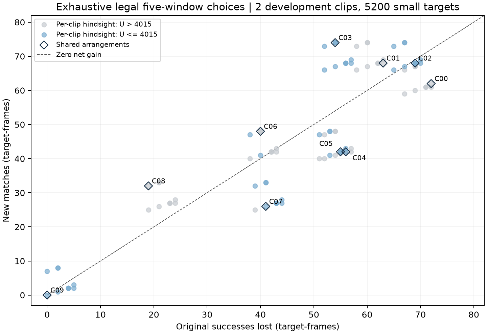

# 合法五窗组合的实际收益、丢失与背景成本

2026-10-11。固定原发布权重的既有概率图、两个已使用开发片段、11个候选起点、阈值0.5和原组件峰匹配。**全部合法五窗组合已穷举：共用安排最优720，逐片段事后选择最优721；保留原700个成功且零新增丢失时，逐片段最好707。** 现有对称安排已达到共用五窗最优，固定池内继续寻找另一种五窗安排的余量只有1个目标帧。

这是5200个几何小目标帧上的确定性可行性诊断，涉及两个开发片段；不是5200个独立试验，不是新方法成绩，也不是论文Pd/Fa。这里的“最优”限定于下面完整冻结的候选池与规则，不是DeepPro-Plus全部可能输入或改进方案的上界。

## 1. 实际比较的范围

- 片段：DJI_0026_2、DJI_0067_2，各160帧；几何小目标分别606、4594，共5200。背景匹配计数使用全部16297个有效标注。
- 候选起点：0、12、24、36、48、60、72、84、96、108、120；每窗连续40帧。
- 每段统一选择5个不同窗口，完整覆盖160帧，每片200窗口帧预算。枚举11选5的462个子集，只有10个合法。
- 每个组合重做逐像素max、`>=0.5`前景、8连通组件、确定性行优先峰选择和原一对一峰落框匹配。共实际评分22个“片段×安排”，包含全11窗参照；没有新增模型前向或训练。
- 主背景预算沿用两段池化未匹配组件 **U≤4015**。逐片741/3274仅作副标记。框外像素和面积分布只报告，不事后改成硬约束。
- 10种共用安排，以及由两片各10个实际结果组成的100种逐片选择全部枚举。后者使用标注事后选取，没有训练或评估可部署选窗器。

原规则及运行前哈希见[PROTOCOL.md](PROTOCOL.md)、[PROTOCOL_FREEZE.json](PROTOCOL_FREEZE.json)、[LEGAL_COMBINATIONS.json](LEGAL_COMBINATIONS.json)。自然窗口仍满足s=t−a，内容与当前帧位置没有在本轮分离；也不宣称同一在线延迟。

## 2. 全部10种共用五窗安排

新增、丢失均相对于原安排C09的700个匹配。U是对全部有效目标匹配后剩余的组件数。前景/框外像素在320帧上求和。

| ID | 起点 | 最终小目标匹配 | 新增 | 丢失 | 净增 | U | U预算 | 总组件 | 总前景像素 | 框外前景像素 |
|---|---|---:|---:|---:|---:|---:|:---:|---:|---:|---:|
| C00 | 0,12,48,84,120 | 690 | 62 | 72 | −10 | 4114 | 超出 | 7423 | 97771 | 38505 |
| C01 | 0,24,48,84,120 | 705 | 68 | 63 | +5 | 4100 | 超出 | 7452 | 99446 | 39026 |
| C02 | 0,24,60,84,120 | 699 | 68 | 69 | −1 | 3939 | 满足 | 7274 | 98314 | 38521 |
| **C03（S）** | **0,24,60,96,120** | **720** | **74** | **54** | **+20** | **3967** | **满足** | **7339** | **99357** | **38641** |
| C04 | 0,36,48,84,120 | 686 | 42 | 56 | −14 | 4102 | 超出 | 7369 | 98107 | 39249 |
| C05 | 0,36,60,84,120 | 687 | 42 | 55 | −13 | 4003 | 满足 | 7297 | 98951 | 39170 |
| C06（I2） | 0,36,60,96,120 | 708 | 48 | 40 | +8 | 4031 | 超出 | 7362 | 99994 | 39290 |
| C07 | 0,36,72,84,120 | 685 | 26 | 41 | −15 | 3979 | 满足 | 7237 | 97264 | 38170 |
| C08（I1） | 0,36,72,96,120 | 713 | 32 | 19 | +13 | 4026 | 超出 | 7370 | 100145 | 38548 |
| C09（O） | 0,36,72,108,120 | 700 | 0 | 0 | 0 | 4015 | 满足 | 7276 | 98381 | 38368 |

5/10种共用安排满足U预算。即使解除U约束，共用安排最优仍是S的720，故当前总匹配上限并非仅由U预算卡住。原O、S、I1、I2的匹配、峰、组件面积、框响应和逐帧统计均与历史结果精确一致。

原始表：[SHARED_COMBINATIONS.csv](SHARED_COMBINATIONS.csv)。逐片结果、全目标匹配和组件面积分位数见[scoring/METRICS.csv](scoring/METRICS.csv)；逐组件原始记录见[scoring/COMPONENTS.csv](scoring/COMPONENTS.csv)，完整面积频数见[scoring/COMPONENT_AREA_DISTRIBUTIONS.csv](scoring/COMPONENT_AREA_DISTRIBUTIONS.csv)。

## 3. 分片选择能多解决多少

| 方案 | 0026安排 | 0067安排 | 最终匹配 | 新增 | 丢失 | 净增 | U | 框外前景 |
|---|---|---|---:|---:|---:|---:|---:|---:|
| 原安排 | C09 | C09 | 700 | 0 | 0 | 0 | 4015 | 38368 |
| 共用最优 | C03 | C03 | 720 | 74 | 54 | +20 | 3967 | 38641 |
| **逐片事后最大净收益** | **C08** | **C03** | **721** | **73** | **52** | **+21** | **3935** | **38729** |
| **逐片事后零丢失最优** | **C08** | **C09** | **707** | **7** | **0** | **+7** | **3949** | **38474** |

100种逐片组合中50种满足U预算。721相对700为+0.404个百分点，相对现有S只多1个目标帧；新增涉及21个序列—轨迹，丢失涉及20个。零丢失的+7来自0026的2个轨迹，不能外推为选窗器能够普遍保护原成功。上述两种逐片选择还同时满足各片原U预算，但主选择规则一直是池化预算。

“五窗不能兼顾全部已有成功”不等于“五窗不能零丢失地增加任何成功”：707这组就是后者的反例。它也没有同时保住原O与S的全部774个不同成功对象。

预先登记的损失容限取舍如下，单位是相对O新增丢失的目标帧：

| 损失容限 | 满足U时共用最优 | 满足U时逐片最优 | 不限制U时共用/逐片最优 |
|---|---:|---:|---:|
| 0 | 700（+0/−0） | 707（+7/−0） | 700 / 707 |
| ≤7 | 700（+0/−0） | 707（+7/−0） | 700 / 707 |
| ≤35 | 700（+0/−0） | 707（+7/−0） | 713 / 713（+32/−19，U4026） |
| 不限 | 720（+74/−54） | 721（+73/−52） | 720 / 721 |

表中括号为新增/丢失，不是净增。框外前景从38368变为38641/38729/38474，不能因为U下降就称背景像素减少。原O与S未匹配组件面积均值为11.266与11.378，95%分位为41与45；组件数、面积、背景像素须一起阅读。

完整100对：[PER_CLIP_COMBINATIONS.csv](PER_CLIP_COMBINATIONS.csv)；全部16项选择：[TRADEOFF_SELECTIONS.csv](TRADEOFF_SELECTIONS.csv)；增益—损失—U的非支配全集：[PARETO_GAIN_LOSS_U.csv](PARETO_GAIN_LOSS_U.csv)；逐对象/轨迹：[SELECTED_OBJECT_RESULTS.csv](SELECTED_OBJECT_RESULTS.csv)、[SELECTED_TRACK_RESULTS.csv](SELECTED_TRACK_RESULTS.csv)。

图中灰色点超出U预算，蓝色点满足预算，菱形表示共用安排；所有点均来自既有开发标注的事后枚举。可编辑矢量图见[SVG](GAIN_LOSS_BUDGET.svg)。

## 4. 不能同时兼顾的证据，已经强于“没找到”

已建立[5200×11三态匹配矩阵](support/MATCH_MATRIX.csv)和[对应框响应矩阵](support/BOX_RESPONSE_MATRIX.csv)。−1/NA为未覆盖，0为覆盖未匹配，1为覆盖匹配；覆盖格直接与22份原逐窗评分归档核对。

| 变化对象组 | 只有1个已测成功窗 | 只有2个已测成功窗 | 合计 |
|---|---:|---:|---:|
| S丢失的原成功 | 36 | 18 | 54 |
| S依赖新加入成功窗的新增 | 41 | 32 | 73 |

其中有目标分别只能在36、72、108成功，也有目标分别只能在24、60、96成功。单是0067片段内部就同时存在这六种必要起点。再加上全160帧覆盖必须选择0与120，**兼顾相关对象至少需要8窗支持**。这与内容或位置谁是原因无关，是固定输出池内的可计算冲突。

穷举全部2048个候选子集，其中274个完整覆盖：同时支持原700和S新增74，共用最少8窗 `[0,24,36,60,72,96,108,120]`；分片最少为0026的6窗和0067的8窗。这里是单窗成功支持，不是宣称这些组合融合后可实际匹配774，更不是通过背景预算。

完整成功起点、覆盖数、slot、采样跨度、冲突和必要起点证人见[support/REPORT.md](support/REPORT.md)、[OBJECT_SUPPORT.csv](support/OBJECT_SUPPORT.csv)、[FORCED_START_WITNESSES.csv](support/FORCED_START_WITNESSES.csv)。只能描述12帧采样网格上的成功范围，不能把稀疏成功点等同于真实连续成功区间狭窄。

## 5. 858宽松界有效，还能收紧

全池框响应均低于0.5的目标帧确为4342，所以用户提出的858上界成立。在固定组件峰规则下，可以进一步证明：**任一max融合组件的确定性峰坐标，一定也是至少一个输入窗口组件的峰坐标。** 本层5200个框与所有有效GT均不重叠，因此同坐标峰不会被别的目标争抢，融合匹配必有单窗实际匹配支持。

所以固定池、0.5、max与当前峰匹配下，任意子集的匹配数≤809，即至少有4391例无法仅靠重选既有窗口检出。相对原700的全池理论净增上界为109（2.096个百分点），仍未考虑预算和可达性。858中另外49例虽有框内超阈值响应，却没有可匹配的单窗组件峰。

进一步施加五窗和覆盖规则，支持并集上界就是**共用720、逐片721**，而实际融合都达到了对应上界，也通过U预算。因此这两个数既是本次穷举找到的最好结果，也是冻结规则内已达到的严格最优值。

证明、半开框和平局条件、非重叠核对见[PEAK_UPPER_BOUND.md](support/PEAK_UPPER_BOUND.md)。根流程还逐对象检查了全部22个实际结果，无一出现本小目标层“融合匹配却没有单窗支持”；见[CROSS_CHECK.json](CROSS_CHECK.json)、[FUSION_VS_SUPPORT.csv](FUSION_VS_SUPPORT.csv)。一般重叠GT的一对一分配不满足此推论，也不能将809应用于官方Pd/Fa、改阈值、多峰输出、新窗或新权重。

## 6. 增加预算参照：支持多了，但代价没有消失

| 方案 | 每片窗口帧 | 单窗支持并集 | 实际匹配 | 新增 | 丢失 | U | 总组件 | 框外前景 |
|---|---:|---:|---:|---:|---:|---:|---:|---:|
| 原5窗O | 200 | 705 | 700 | 0 | 0 | 4015 | 7276 | 38368 |
| 共用最优5窗S | 200 | 720 | 720 | 74 | 54 | 3967 | 7339 | 38641 |
| 全11窗 | 440 | 809 | 792 | 101 | 9 | 5139 | 9018 | 48589 |

全11窗需要2.2倍窗口帧预算，U比原预算多1124，框外像素多10221；实际仍有17个受单窗支持却融合失配的对象，其中9个是原O成功。原O与S成功集合的774个对象只保住764个。它表明加窗可提供更多实际匹配，也表明简单堆窗没有同时解决计算、背景和输出损失。

没有对全部6—10窗子集重做实际融合，不能称全11窗是更大预算范围的最优。单窗支持的2048子集枚举不能替代这些未做的实际评分。融合失配仍保留为次级问题；共享五窗最优S恰好没有支持到融合的损失，不能用原5例或全11窗17例解释本轮五窗的主要上限。

逐对象失配清单：[SUPPORT_BUT_FUSION_MISS.csv](SUPPORT_BUT_FUSION_MISS.csv)；全11窗参照：[ALL11_REFERENCE.csv](ALL11_REFERENCE.csv)。

## 7. 持续低响应支线

已有23点全局阈值曲线中，O/S在U≤4015的点对4342低响应对象的恢复均为0；但这只是离散网格结论。O在阈值10⁻⁶能恢复1996例，U升到463853；S能恢复1977例，U470194。低绝对概率不等于完全没有可匹配信息，低阈值恢复也不等于可接受的检测方案。

粗网格最近的O/.4恢复8例、U4094；S/.4恢复7例、U4055。后者只比预算多40，所以在看过粗网格后登记了[0.41—0.49九点补充](LOW_RESPONSE_GRID_SUPPLEMENT.md)，以检查离散采样遗漏的小空间。它属于探索性追加，主五窗实验仍固定0.5。

**补充确实发现预算内的小收益，必须修正“低响应组无法靠降阈值恢复”的笼统判断：**

| 安排与阈值 | 总匹配 | 4342低组恢复 | 相对O/.5新增 | 相对O/.5丢失 | U | 框外前景 |
|---|---:|---:|---:|---:|---:|---:|
| O/.5 | 700 | 0 | 0 | 0 | 4015 | 38368 |
| S/.5 | 720 | 0 | 74 | 54 | 3967 | 38641 |
| **S/.44（探索性校准）** | **727** | **6** | **80** | **53** | **4011** | **39110** |
| S/.4 | 728 | 7 | 81 | 53 | 4055 | 39487 |

S/.44是O/S的23+9个已测阈值中、满足原池化U预算时的最好总体匹配，较原O净增27（0.519个百分点）；相对S/.5新增7且没有新增丢失。其中6个是低组恢复，另1个恢复了原O成功；这6个低组对象来自0067的5个轨迹，所选图框响应均接近0.5，没有恢复全窗响应<0.001的4170个主体。6/4342约0.138%，仍有4336个本低组未恢复。

S/.44逐片U为712/3299；0067超过其原3274副标记，但合计4011满足一直冻结的主预算4015。框外前景比原O多742，不能称背景全面改善。该点来自开发数据事后校准，不是独立验证成绩；不改变“固定0.5时共用720/逐片721”的最优性范围，反而再次说明该界不能跨阈值套用。

**针对用户关于误检的追问，必须用同一安排作阈值前后比较：S/.5→S/.44，匹配增加7，但U从3967增至4011（+44，约1.11%），框外前景从38641增至39110（+469，约1.21%），总组件从7339增至7409（+70）。** 它通过的是相对于原O设定的池化U预算，不代表相对于S/.5的误检没有增加。这里的U及框外像素是诊断指标，不是官方Fa。0.44仅用于检查低响应是否完全不可恢复，不能列为模型或数据方法提升；后续主比较继续固定0.5。

本地官方[test.py](../../official_deeppro/test.py:44)的`threshold_eval`默认确为0.5，同时在[Pd/Fa评估部分](../../official_deeppro/test.py:171)按多个阈值累计曲线。因此默认阈值和多阈值诊断是不同用途；本项目没有因追加诊断而变更既定主阈值。

完整结果及独立核查见[低响应报告](low_response/REPORT.md)、[补充曲线](low_response/supplement/THRESHOLD_CURVES.csv)、[补充验证](low_response/supplement/VALIDATION.json)。本轮停止于登记的九点，不宣称穷举了连续阈值或其他安排的调阈值空间。

缓存没有真实原始logit，本轮使用保存概率。当前支线回答的是具体阈值下能否转化为预算内实际匹配，尚未完成目标与困难背景在原始logit/特征上的可分性诊断，不能据此认定训练数据缺失或某个时序模块失效。

## 8. 由结果作出的路线选择

1. **结束当前固定池的五窗安排搜索。** 共用与逐片最优只差1；已有S已到共用严格上界。把这一有限空间作为对照，不优先开发复杂选窗器。
2. **保留成功窗口预算冲突为已验证的局部问题。** 五窗无法兼顾现有全部成功；但它没有确定内容/位置的因果机制。若继续该线，需要改变单窗可成功的条件或单位预算输出能力，并证明超过现有简单对照且保留原成功；仅用新选择规则重排同一池无法突破界。
3. **下一主诊断优先转向持续低响应目标能否与困难背景分开。** 其规模远大于选窗净增空间；已测简单校准可以预算内救回6个近阈值低组对象，应保留S/.44作为探索性简单对照，然后检查4336个未恢复对象，特别是4170个远低响应主体。此优先级是研究资源选择，不是已经证明应改模型或数据。
4. **融合/峰提取作为次线保留。** 已有实际反例，但当前五窗最优没有这类剩余损失。若改变输出规则，应重新定义并评估背景代价；809与721的旧峰规则上界也随之失效。

下一步的有限问题是：**在同一时间与计算预算下，哪些持续低响应目标已经具有能区别于困难背景的证据，为什么现有输出不能将其变成预算内的正确检测？** 先核清可分性与简单校准，再依据可见证据、训练覆盖及监督核查选择模型或数据路线。当前证据不支持直接宣布某个新模块有效，也没有否定整个时序稳定性研究方向。

本轮路线记录见[ROUTE_DECISION.md](ROUTE_DECISION.md)。历史错误审计和计划保持不变，所有新结论以本目录为后续入口。

## 9. 复算与验证入口

- 实际融合：[scoring/score_combinations.py](scoring/score_combinations.py)、[scoring/VALIDATION.json](scoring/VALIDATION.json)。
- 支持关系：[support/analyze_support.py](support/analyze_support.py)、[support/INDEPENDENT_VERIFICATION.json](support/INDEPENDENT_VERIFICATION.json)。
- 10/100组合聚合：[aggregate_combinations.py](aggregate_combinations.py)、独立[ROOT_AGGREGATE_AUDIT.json](scoring/ROOT_AGGREGATE_AUDIT.json)。
- 支持—融合联查：[cross_check.py](cross_check.py)、[CROSS_CHECK.json](CROSS_CHECK.json)。
- 完整交付索引：[MANIFEST.md](MANIFEST.md)；最终核对：[FINAL_VALIDATION.json](FINAL_VALIDATION.json)；文件指纹：[ARTIFACT_SHA256.json](ARTIFACT_SHA256.json)。

两个片段均为已使用开发材料，没有读取保留确认集或产生独立泛化证据。所有计数来自真实缓存复算；本轮没有新文献结论、训练提升或论文指标提升。
