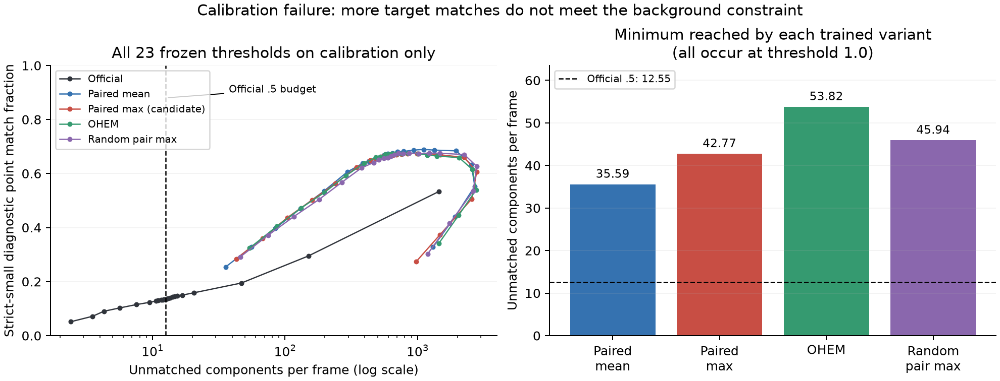

# 第一阶段结果：当前弱框监督候选未通过校准

日期：2026-10-10。**四组训练完整结束，但所有训练配置均未能满足预设的背景组件预算。当前版本不进入完整实验，没有取得已验证的方法提升。** 确认集尚未运行推理，因此不存在确认集性能或正式保护约束通过的结论。

## 1. 具体测试了什么

主候选是 `paired_max`：同一个目标、同一绝对当前帧，放入两个真实40帧窗口，对较差一路的正目标损失重点监督。网络结构、时间访问范围及官方五窗口最大值融合保持固定。三个控制是同样输入的 `paired_mean`、全局 OHEM 和随机重配 max；它们只改变额外正项的选择方式。

四组均从官方发布权重初始化，用同一冻结训练计划、seed 46、Adam、512次更新、相同裁剪和输入曝光。全网参数可更新，BN统计不更新；每组约230–234秒。真实容器全部退出0，64个参数张量均发生更新、36个BN缓冲逐张量不变、全部100个状态张量有限。见[训练独立审计](TRAINING_AUDIT.md)。

本次未获得作者生成的Gaussian mask及其确切生成参数，因此使用明确登记的框内最大logit正项与全部标注框外负项。它是**弱框监督微调试验，不是作者原训练配方的复现**；`paired_mean`是同预算弱框控制。原配方继续训练控制及完整官方Pd/Fa评估仍未完成。原论文将此数据的标签处理描述为由框生成粗略Gaussian标签，不能把公开矩形segmentation直接等同于作者mask。[DeepPro论文](https://arxiv.org/html/2506.12766v5)

数据固定为8个训练片段、2个校准片段和4个保留确认片段，每段160帧。新划分以源视频前缀隔离，选择仅用标注；JPEG、数组及原标注对应通过核查。训练片段中仍有相似拍摄场地，不能把14个前缀解释成14个地理独立场景。确认集原图和标注已用于完整性/场景核查，**未产生或查看模型确认结果**。见[数据选择](DATA_SELECTION.json)、[完整性记录](data/DATA_INTEGRITY.json)和[画面核查](data/VISUAL_SCENE_REVIEW.md)。

## 2. 决定性结果：没有可校准工作点

两段校准集共320帧、5,200个严格小目标帧。官方发布权重阈值0.5时有700个点匹配、4,015个未匹配组件。冻结协议用 `4,015/320=12.546875` 个未匹配组件/帧作为共同预算。

|配置|阈值0.5：小目标匹配/5,200|阈值0.5：未匹配组件|23点网格中最少未匹配组件|最少组件/帧|校准|
|---|---:|---:|---:|---:|---|
|官方发布权重|700|4,015|773（参考曲线）|2.42|主参照固定0.5|
|同帧配对 mean|3,502|190,427|11,388|35.59|失败|
|同帧配对 max，主候选|3,477|207,488|13,686|42.77|失败|
|全局 OHEM|3,506|215,384|17,221|53.82|失败|
|随机重配 max|3,480|214,719|14,700|45.94|失败|

所有曲线的最少未匹配组件都出现在阈值1.0；**官方主参照仍为0.5，没有把官方参考切换到1.0。** 四个训练配置的最少组件仍分别为预算的2.84、3.41、4.29、3.66倍。主候选在0.5的匹配数增多，但未匹配组件增至官方的51.68倍。这不能称为相同误报条件下的提升。

两个校准片段分别也出现该现象：主候选在阈值1.0时，`DJI_0026_2`有2,154个未匹配组件，官方0.5为741；`DJI_0067_2`为11,532，官方0.5为3,274。结果不是仅由其中一个片段单独造成。

图中每个点是预先固定的一个阈值；连线沿阈值顺序绘制，组件合并/分裂使数量不必单调。源数据见[全曲线](summary/CALIBRATION_CURVES.csv)，可编辑矢量图见[SVG](summary/figures/calibration_tradeoff.svg)。

这里的计数是确定性组件峰值与标注框的点匹配诊断，未匹配组件未逐一确认是否真实误报，**不是论文Pd/Fa**。这两个片段也是校准材料，不能据此声称独立测试集泛化。

## 3. 为什么阈值1仍有输出，为什么停止确认

冻结规则为 `probability >= threshold`。保存的FP32概率中存在恰等于1的像素：官方17,536；mean 151,049；max 197,497；OHEM 235,374；随机重配201,567。阈值1仍保留这些像素，不能临时改成零预测，或往网格增加一个新阈值来回避失败。

独立实现采用OpenCV 8连通、独立峰值选取和SciPy最大二分匹配，重算全部36,800个帧—阈值组合，六类逐帧计数及小目标匹配数全部一致；10份五窗口融合逐像素重建一致；原JPEG、数组、帧号及标签也对齐。见[校准失败独立审计](CALIBRATION_FAILURE_AUDIT.md)。

[冻结校准文件](summary/CALIBRATION.json)为四组记录 `calibration_failed` 与 `threshold=null`。按[训练前协议](PILOT_PROTOCOL.md)，没有可以送入确认集的工作点，因此停止这四组确认流程，保留确认数据。不把“确认未运行”写成“确认通过”或“确认无收益”。

这只否定当前冻结概率协议下的版本；它不证明任意连续阈值、不同数值表示或新的训练方法都不可能成功。

## 4. 回到原来的错误：响应恢复了多少，检出又损失多少

以下只使用原先选定的四段开发视频、同一1,417个目标帧及原分层，固定原始阈值0.5。**两组均未校准成功，所以这些不是等预算收益。** 24和42是内部干预定义的子集，不是独立测试样本，不能相加当成新的独立证据。

|原先固定的层|官方原融合匹配|mean：匹配（新增/丢失）|max：匹配（新增/丢失）|
|---|---:|---:|---:|
|全部1,417|549|1,216（678/11）|1,203（671/17）|
|97个强响应翻转|60|76（20/4）|71（17/6）|
|24个内部强抑制例|15|19（5/1）|19（5/1）|
|42个依赖额外贡献获得强响应例|28|33（7/2）|28（4/4）|
|502个所有已测窗口响应≥0.5|471|473（8/6）|470（9/10）|
|778个所有已测窗口响应<0.5|0|635（635/0）|631（631/0）|

主候选使24个抑制例的原低响应窗口全部达到0.9以上，但只有19个在该窗口得到点匹配；42个受益例的原高响应窗口也全部达到0.9以上，但只匹配31个。对42例的官方融合输出仍新增丢失4个，同时新增4个；“42例都强响应”不能解释成“42例都保住了检测”。

97个强翻转例中，主候选使93个在所有已测窗口的框响应都≥0.5，另4个仍翻转，没有通过全部降为低响应来取得这种一致性。然而整个1,417例仍有110例跨0.5，其中104例来自原778个持续低响应层；必须同时保留新出现的变化，不能只报告旧97例的改善。

保护集合按**官方在全部可用窗口均匹配，且原融合也匹配**定义，分母463，不能用502个“框响应都高”的例代替：mean新增丢失4/463（0.86%），max新增丢失8/463（1.73%）。主候选在这一未校准开发检查上超过原定1%保护容差。它不是确认集正式保护结论，但与“有利检出已保住”的说法不相容。

四段640帧的全部目标诊断中，官方未匹配组件16,114，mean为686,053，max为693,860。主候选背景组件约增至43.06倍，不能只展示上述目标匹配数。

逐片段、逐轨迹及共同匹配对象的峰位移、归一化中心误差变化均保存于[逐对象表](summary/development/OBJECTS.csv)、[逐序列表](summary/development/SEQUENCES.csv)、[轨迹表](summary/development/TRACKS.csv)和[汇总JSON](summary/development/DEVELOPMENT.json)。最长漏检仅在1,417个预定筛选观察内统计，被筛掉帧与源帧间隔会打断连续段，不代表完整轨迹的最长漏检。两组均为26条轨迹缩短、6条不变、1条变长；这些变化同样伴随大量背景组件。

在原模型与候选共同匹配的对象帧上，归一化中心误差平均变化为mean +0.0191（538例）、max +0.0289（532例），正值表示远离框中心；峰位移均值分别为1.180和1.229像素。这不是定位改善的证据，也不将框中心等同于真实目标中心。

另保存[内部/边界位置分层](summary/development/BOUNDARY.csv)：按原先固定A/B窗口对的两个slot均在8–31，或至少一个在区间外划分，每一原分层均保留。窗口对由原模型响应极值选定，这些只是描述性分层；内容与位置仍共同变化，不据此作新的位置因果归因。

## 5. 结果支持与不支持的解释

结果支持：当前发布权重的低响应并非都不可改变；当前弱框训练能提高很多框响应及诊断点匹配，但没有保住背景选择性，主候选也没有满足开发保护容差。四种额外监督都失败，不能从中挑一个当成已成功方法。

结果不支持：把失败单独归因于同帧配对、证明模型结构无解、证明所有778例属于上下文问题，或者宣称已有顶会顶刊方法不适用。没有本轮成功工作点，也未完整复现那些模型作同域性能排名。

共同实现用少数对象的最大logit正项、全部背景的均值负项，且缺少λ=0底损失控制。这提示应检验困难背景是否被平均值稀释、弱框峰是否对应真实目标、全网微调是否改变背景选择性；当前并未证明哪一项是根因。训练日志的后段正损失较低，不等于检测系统达到研究目标。详见[观察与假说分离](TRAINING_FAILURE_DIAGNOSIS.md)。

阶段取舍及下一步条件见[STAGE1_DECISION.md](STAGE1_DECISION.md)，实际测试的idea见[IDEA.md](IDEA.md)。
