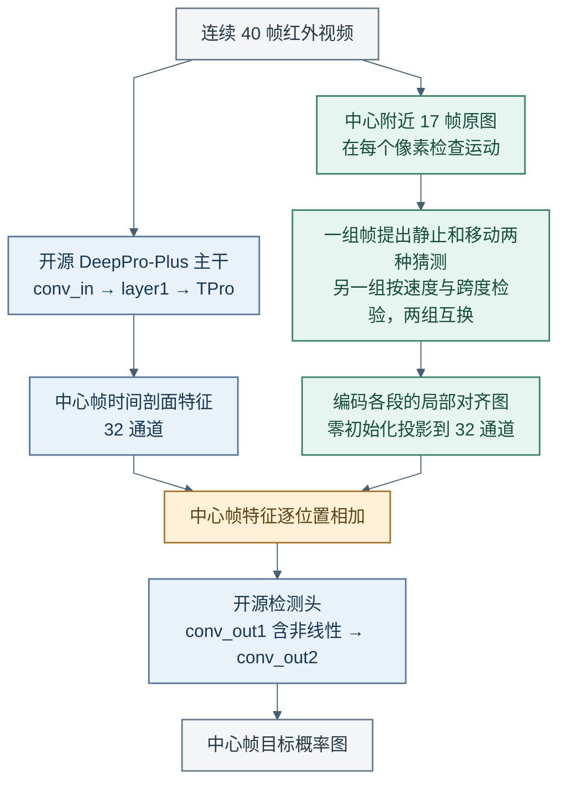

# D 版结构草图：让运动证据参与红外视频检测

**输入**为连续 40 帧红外视频。**输出**为其中一个时刻的目标概率图。第一版选零基索引 19 的一帧，运动分支读取索引 11 至 27 的 17 帧，原版和各对照都读取同一块 40 帧。这个设计使用未来帧，最终评价需计入这段等待时间。以下是拟议架构，尚未实现或训练这一版。

## 两个接口决定

| 问题 | 第一版的决定 | 理由 |
|---|---|---|
| 去哪些位置检查运动？ | 在待输出帧的原分辨率上逐个像素检查。图像坐标固定，运动候选在每个坐标单独提出。 | 一个真目标即使被原模型打了低分，仍能得到运动证据。位置的选取也不会预先看到检验组。 |
| 运动证据接在哪里？ | 在作者的 TPro 输出与 conv_out1 输入之间融合，只对选中的输出时刻注入运动特征，再复用原检测头。 | 此处还有一次通道混合和 ReLU；两路证据能共同决定哪些通道被激活。 |

## 数据流

## 一处像素的运动信息怎样产生

以道路热像中的一个像素为例。它可能是远处行人的一部分，也可能在护栏上。计算时不给模型它的标签。

1. **定位置，猜运动。** 逐帧独立计算局部背景归一化后的灰度，并保留冷热极性。取中心前后各 8 帧，分成互不重叠的发现组和检验组。在固定位置上，发现组提出两个假设：原位不动，以及有限速度网格中支持度最高的一种非零运动。可按有符号响应累积后的绝对值挑选，以允许暗目标。速度用像素/帧表示，不输入目标 ID 或真实速度。
2. **固定猜测，看附近的走法。** 在检验组中，以发现组给出的速度为中心，稍微改变水平和竖直速度，沿每一种走法对齐并平均目标周围的局部图像。保留中心与邻近像素，能看出紧致热斑和延伸亮边的形状。中心速度、扰动网格与尺度均预先固定；比较不同跨度时保留峰在同一坐标系中的真实位置。然后交换两组的职责，用同一套规则再测一次。
3. **把小图变成能用于检测的特征。** 建议第一版用 3×3 空间小图、5×5 速度扰动和三档时间跨度。共享的小型空间卷积读取每幅 3×3 小图；沿二维速度网格的卷积读取峰或脊；按固定的短、中、长顺序合并跨度通道，再用带非线性的通道混合学习它们怎样一起变化。每个方向的提议—验证先单独编码，再合并两个方向的同维向量，得到该像素的 8 维运动特征。反向发现的最优速度可能不同，因此交换两组时不能直接平均两张未对齐的速度图。编码器也接收候选速度和有效采样数。
4. **和原模型共同判断。** 令 F 为 TPro 在目标时刻输出的 32 通道特征，E 为新增的 8 通道运动特征。用逐像素的线性投影 P 将 E 映射为 32 通道，并计算 F′ = F + P(E)。作者原有的 conv_out1（32→8、归一化、ReLU）和 conv_out2（8→1）读取 F′，生成该帧的目标分数图。P 的权重和偏置从零开始，初次前向时沿用作者权重与推理态统计，输出应当和原版逐像素一致。

**为什么选这个融合点？** 若将独立运动特征直接加到 conv_out1 之后，后面只有一个线性层。用 w 表示最后一层，对原特征 f 和运动修正 e 有 w(f+e)+b = (wf+b)+we。这只能把一项运动分数叠到原分数上。提前到 ReLU 之前后，运动信息则可以让原特征中某个原本未激活的通道参与最后的判断。能否给真实目标带来收益仍属待验问题。[权重对应的模型快照](../../../sources/official_deeppro/log/sem_seg/RGB-T__2025-01-14_15-27__SoftLoUloss_DeepPro-Plus_DataL40/DeepPro-Plus.py#L25)

## 用一个数字例子看懂 C、D 的差别

下表只演示一个速度方向上的三个猜测。两组模拟观测长度相同，响应数值为人为构造的相对分数，真实模型还会读取局部图像。

| 情形 | 前一组的慢、原速、快 | 后一组的慢、原速、快 | 两组合并 | 两组在原速上的分数 |
|---|---|---|---|---|
| 甲 | 4，8，4 | 4，8，4 | 4，8，4 | 8，8 |
| 乙 | 7，8，1 | 1，8，7 | 4，8，4 | 8，8 |

两种情形的整段响应相同，固定原速看两组也相同。D 还看到乙从“偏慢的走法也说得通”变成“偏快的走法也说得通”。这说明联合表示可以保留一种在汇总时消失的关系。实际红外视频中，这种变化究竟来自杂波还是真目标机动，必须由数据回答。此例不能给甲、乙指定真实类别，也不能代替对包含空间小图的完整 C 版的比较。

## C 与 D 怎么做到公平

两个版本共用相同的 40 帧骨干、17 帧运动输入、全图位置、发现组速度、速度网格、编码器容量、特征融合位置和检测头。两者都输入**整段各速度的对齐小图**和**每个子集在固定候选速度处的对齐小图**。整段小图以 17 个原始时刻各计一次；短、中、长的子集存在重叠，不能直接把三者取平均作为整段图。

D 额外保留**每个检验子集在所有邻近速度下的对齐小图**。C 将这些额外单元标为缺失，保留两步检查的全部局部图像。两者可用同尺寸输入和显式可用标记；报告实际运行时的采样数、计算量和显存。这是参考 Heinze 两步检查建立的红外对照。下文中的“未参与拟合”专指 B 的原始观测没有参与本方向的速度选择。整段小图和原版 TPro 会使用两组帧，最终检测器综合全部证据。原文四格对照的另一轴是使用整段或只使用发现组**选速度**，固定的全图像素位置对四版相同。[方案比较稿](../红外小目标检测_运动假设演化_研究方案%20copy.md) · [Heinze 原文第 5.3 节](https://arxiv.org/pdf/1508.01599#page=30)

## 实现边界与验收

- **评分时刻。** 可沿用交通原型的镜像采样布局，短、中、长三档各取 4 个时刻；两组使用相同的绝对时间偏移、相反的符号，每档相对于中心的平均时刻为零。中心帧只作为定位参照，并可进入共同的整段检查；两路发现均只用各自的非中心帧。单帧归一化和提议不读另一组。不同跨度的采样并集较大，所以 C 与 D 的关键比较使用完全相同的一批原始观测。[现有原型的时间布局](../../motion_hypothesis_traffic_pilot_20261118/extract.py#L14)
- **全图计算。** 先实现单个中心时刻，按空间分块，给每块读取足以覆盖最大运动偏移、插值和局部小图的邻域。边缘按真实有效采样计数，证据不足的像素将运动修正置零，保留原版预测。各块只写回中央有效区。完整高维响应随算随编码，避免整幅图同时留在显存；尚无实时性结论。
- **监督与检查。** 正式训练种子固定为 46。训练目标来自目标帧位置标注。有真实掩膜时训练分割，有框时用框或中心弱监督并报告目标级指标。第一步以作者权重冻结、原骨干保持推理模式为基准，先核对零修正等价、全图空间覆盖，以及只改动检验组时发现组速度是否原样保留。随后才能用 C、D 判断新增信息的价值。
- **当前状态。** 现成的开源权重加载、窗口对应和旧原型可复用；已完成的临时实验只在作者提出的候选点上修正分数。本文提出的是全图、检测头之前的融合，性能尚未测量。[旧原型记录](../../motion_hypothesis_traffic_pilot_20261118/RESULTS.md)
