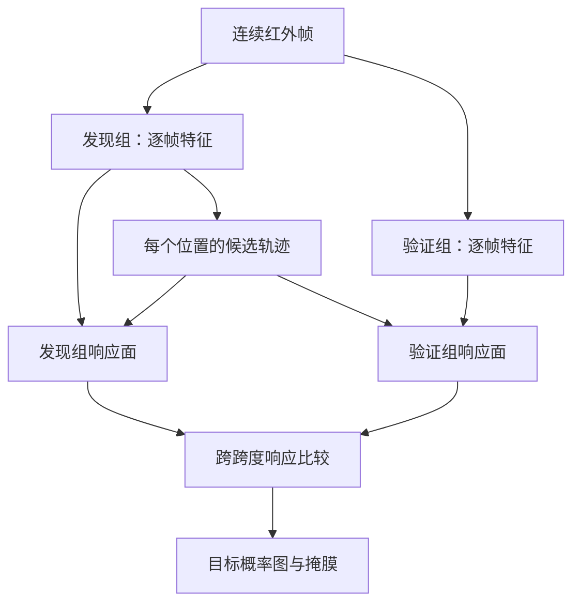

# 基于跨观测运动假设演化的红外小目标检测：研究方案

> **整理日期：2026-11-18**
>
> **研究方向：红外小目标视频检测**
>
> **文档性质：研究候选方案、文献排重与实验设计。**
>
> 本文根据本轮联网调研与讨论整理。当前证据包括原始文献、作者仓库、数据集说明和建模分析；尚未完成本方案的模型实现、训练或新实验。文中区分已知前作、研究假设和建议方案，不将“未检索到完整相同实现”等同于已经证明首创。

## 补充查新与当前判断（2026-11-18）

**当前建议：暂不将“速度响应面随跨度演化”确定为论文主线。** 下文记录原始候选设计。补查发现，Heinze、Metchev、Trollo 在 2015 年的暗弱小行星视频检测中，既比较了候选速度周围多个运动假设的叠加图和中心信号变化，也将速度固定，在多个较短的时间子集核验目标。原文图 7、第 5.3.1 节和图 8、第 5.3.2 节可直接对照。两项检验在原文分步进行。原文不能直接证明每个留出子集、每个跨度上各自的完整二维速度响应用于红外视频检测已经做过，但“猜偏运动再看、换一批帧再看”的总体直觉已有直接先例。[Heinze 等原文](https://arxiv.org/pdf/1508.01599)

若要评估剩余差异，先在真实交通视频的开发部分做候选级诊断。匹配同样大小、对比度、原版检测分和最优运动分的真目标与人工复核的虚警，包括角点或稳定热斑。在 A 组单独提出位置和速度，锁定后再读取 B 组。固定每个跨度使用的帧数，用同一批原始观测对比“周围速度的响应 + 分组后固定最佳速度的复现”与“各分组、各跨度均保留整张面”。对同一对候选看哪一个被排在前面，按视频报告差值。该诊断不能当成全图检测结果。若没有跨场景可复现的额外信息，按强创新要求应撤下本方向。无需速度真值，质心位移仅在身份可靠时用于事后核对。既有开源基线候选重评分没有显示增益。[本地开发结果](../motion_hypothesis_traffic_pilot_20261118/RESULTS.md)

## 推荐方向与核心命题

**建议将本轮主线定为：基于“运动假设演化表示”的红外小目标视频检测。**

核心问题是：

> **一个弱小目标，能否在不同观测帧中，反复支持同一种运动解释？随着观测时间跨度增加，这些运动解释的支持范围如何变化？能否利用这种变化，区分真实目标、结构性杂波和偶然形成的噪声轨迹？**

这是本轮文献检索后最建议推进的候选。**输入是红外视频，输出是目标位置与掩膜；现有公开数据可以支持训练和验证。**

创新性判断需要明确：**这个方案有形成独立方法的空间，但不能把“沿运动轨迹积累”“速度空间里出现峰”“利用多帧验证”单独当作创新。**这些都有前作。要争取的贡献，是一种完整的新检测表示，以及围绕它设计的推断方法。

本文依次说明最接近的文献、可以保留的区别、模型、数据集和实验方案。

---

## 一、核心 idea：把“运动解释如何成立”作为检测对象

### 1. 从一个例子开始

假设视频里有三个局部亮点：

- 一个是真实的弱小目标；
- 一个是云层边缘上的亮斑；
- 一个是噪声偶然形成的亮点。

如果分别尝试很多运动方向和速度，总能找到一些路径，使沿途累积的响应比较高。

问题在于：**“找到一条高分路径”所包含的信息还不够完整。**

还可以进一步问：

1. 只有一小片运动范围支持它，还是很多不同运动都同样支持它？
2. 换一组没有参与运动搜索的帧，这种支持还存在吗？
3. 把观测时间拉长，这个支持范围是稳定收缩、沿某个方向保持模糊，还是突然换到另一处？

这三个问题共同构成方法起点。

### 2. 一个有物理依据的区分方式

下面是理想情况下的预期，**属于要在真实数据中检验的研究假设，并非已经完成的实验结论**。

| 观测对象 | 不同运动假设下的响应 | 增大观测时间跨度后的预期变化 |
|---|---|---|
| 紧致的小目标 | 正确运动附近形成局限的响应区域 | 两个速度方向上的支持范围都变窄 |
| 局部近似直线的背景边缘 | 沿边缘切向存在很多近似等价的运动解释，表现为脊状响应 | 主要在一个方向变窄，另一个方向仍有歧义 |
| 偶然噪声 | 搜索后也可能出现很高、很尖的峰 | 换一组未参与搜索的帧，峰的位置和形态往往难以复现 |

直线边缘的运动歧义来自经典的**孔径问题**：局部边缘主要约束垂直于边缘的运动分量。因此，“点与边缘在运动可辨识性上不同”本身不是本方案新发现的理论。参见 [文献 1][1]。

**本方案要研究的是：把这种差别放到真实红外视频的“跨观测、跨时间跨度”过程中，是否能形成比单次响应更可靠的检测证据。**

这也有明确反例：背景中的紧致热斑、边缘端点和角点，同样可能形成局限的运动响应。因此，不能写成“二维尖峰一定是目标”。网络仍然需要学习真实杂波，并结合周围区域的支持结构。

---

## 二、为什么值得选择这个方向

### 1. 它有清楚的表示对象

普通视频输入可以写成：

$$
I(x,y,t).
$$

进一步构建：

$$
R(x,y,\delta v_x,\delta v_y,T,S),
$$

其中：

- $(x,y)$：当前检测位置；
- $(\delta v_x,\delta v_y)$：对候选运动施加的二维扰动；
- $T$：观测时间跨度；
- $S$：使用哪一组观测帧；
- $R$：这些观测对该运动解释的支持程度。

**模型学习的核心对象，是这些响应的形态及其变化。**这能产生一个独立的方法主线，而不必依附于某个已有骨干的注意力模块。

### 2. 问题覆盖常规视频检测

本方案直接面向复杂背景中的弱小目标检测，不需要先把研究范围限定成少见的停止、遮挡或重新出现事件。

机动、慢速、快速和近静止目标都可以进入同一套评估。它们会暴露方法的不同能力边界。

### 3. 数据需求比较现实

核心训练只需要：

- 连续红外视频；
- 目标 mask 或位置标注；
- 可按原始序列划分训练与测试的数据组织。

不依赖额外采集事件相机、精确光流、真实 PSF、曝光参数或同场景的无目标图像。

---

## 三、文献排重：哪些已经有人做过，还剩下什么

**不能用“没有搜到同名网络”来证明创新。**

### 1. 与本方案最接近的工作

| 文献 | 已经覆盖的内容 | 对本方案的约束 |
|---|---|---|
| **DeepPro / DeepPro-Plus**，*Probing Deep into Temporal Profile Makes the Infrared Small Target Detector Much Better* | 将红外小目标检测建模为时间剖面上的一维异常检测，分析时间显著性和相关性 | 必须有自己的建模变量；不能把时间剖面换一种采样方式就称为新方向。[文献 2][2] |
| **DPRN**，*Dynamic programming network for point target detection*，2023 | 速度空间划分、分段线性轨迹、正反向动态规划、累积响应扩散抑制 | 候选轨迹搜索与分段运动模型可以借鉴，但不能作为主创新。[文献 3][3] |
| **LiteFlowNet3**，ECCV 2020 | 从匹配代价体中处理对应歧义，利用置信度修正代价和运动场 | “保留完整匹配响应”“学习运动置信度”都已有先例。区别必须体现为目标存在性推断和跨观测演化。[文献 4][4] |
| **Multi-frame coherent enhancement for infrared dim targets via streak geometric consistency under low-SNR conditions**，2026 | 建立速度补偿误差、条纹几何和能量衰减的关系；在预定义局部区域内进行单目标运动估计与增强 | **最危险的近邻。错速造成拉长、时间跨度影响响应几何，都不能单独作为原创发现。**[文献 5][5] |
| **Infrared small dim target detection based on region proposal**，2019 | 使用候选位置序列的 self-cross validation，再进行时间背景预测与检测 | “用其他时刻验证候选”也不能笼统宣称首次。[文献 6][6] |
| **MIST / MISTNet**，TIP 2026 | 面向低信杂比和复杂运动的视频检测，利用运动补偿与信息筛选形成基线 | 复杂运动已经有专门基准；模型必须在该类数据上验证，不能只展示匀速点目标。[文献与资源 7][7] |

**阅读范围说明：**DeepPro、DPRN、LiteFlowNet3 已检查原文方法内容；2026 年条纹几何论文和 2019 年 region proposal 论文，本轮取得的是出版页面中的摘要、引言及方法摘录，全文抓取受限。因此，这两篇仍是正式立项前需要完整复核的重点，不能声称已经排除了所有公式层面的重合。

### 2. 可以保留的创新空间

要形成的完整方法是：

> **由部分观测提出运动假设；在未参与拟合的观测中，构建该假设附近的完整响应面；研究响应面随时间跨度的演化，并据此直接判断目标是否存在。**

这个组合里的每一项都有基础，但它们共同定义了一个具体的推断问题：

- 不默认局部区域里已经有目标；
- 需要在全图中识别目标是否存在；
- 需要区分真实支持与运动搜索后的偶然高分；
- 需要利用完整响应结构，不能只取最大值或一个置信度；
- 需要把跨观测、跨跨度的结构作为模型主要输入。

**本轮没有找到与上述完整检测建模相同的实现。这个结论足以支持做原型，但还不足以宣布“全球首次”。**

关于创新的参照标准：时间剖面在 2010 年的红外检测工作中已经出现；DeepPro 的价值在于进一步分析、验证并构建了明确的学习式检测范式。研究创新可以建立在已有物理现象上，关键是是否形成了新的、必要的推断方法。参见 [文献 8][8] 与 [文献 2][2]。

---

## 四、模型设计：第一版围绕这个表示展开

暂定论文题目：

> **基于跨观测运动假设演化的红外小目标检测**
>
> *Infrared Small Target Detection through Cross-Observation Hypothesis Dynamics*

先采用描述性题目，不急于确定网络缩写。

### 1. 输入与输出

第一版采用：

- **输入：17 帧连续红外图像；**
- **输出：中心帧的目标概率图和 mask；**
- **评估：目标检出率、虚警、分割质量及计算成本。**

17 帧是原型设置，后续需要比较不同长度。中心帧预测使用前后帧，因此这是带未来帧的设置，要报告相应时间延迟，并让对照方法拥有相同输入条件。

### 2. 第一步：保留全分辨率的弱信号

先用共享的浅层编码器提取每帧特征，同时保留一条固定的局部标准化响应：

$$
z_t(x,y).
$$

第一版可以用局部背景差和稳健尺度归一化产生这条响应，作为可解释的观测通道。

这里有两个设计目的：

- 避免在早期大幅下采样中丢掉小目标；
- 避免前端已经完成全部检测，导致后续新表示实际上没有作用。

固定响应与学习特征可以同时进入后续模型；它们的贡献需要分别消融。

### 3. 第二步：用一组帧提出候选运动

将输入分为两组，例如交错帧：

- $S_A$：用于提出候选；
- $S_B$：用于验证候选。

在**每个空间位置**保留少量运动候选，而不是先用高阈值检测出亮点，再只处理这些亮点。这样可以避免在进入新模型之前就筛掉弱目标。

候选轨迹记为：

$$
\gamma_j(t), \qquad j=1,\ldots,K.
$$

建议：

- 原型先保留 $K=4$ 个候选；
- 候选包含零速度；
- 使用短段轨迹组合，允许整段内发生机动；
- 候选生成可以采用已有的速度搜索或动态规划思想，不将其包装成创新。

**候选轨迹、尺度和扰动中心全部由 $S_A$ 确定。**

### 4. 第三步：用另一组帧测量完整响应面

围绕候选轨迹施加扰动：

$$
\gamma_{j,\delta v}(t)
=
\gamma_j(t)+(t-t_0)\delta v.
$$

然后只在验证帧上计算：

$$
R_{B,T}(x,j,\delta v)
=
\frac{1}{|S_B(T)|}
\sum_{t\in S_B(T)}
z_t\!\left(\gamma_j(t)+(t-t_0)\delta v\right).
$$

它回答的是：

> 候选轨迹附近，哪些运动解释能够被另一组观测支持？

**关键约束：不能在验证帧里重新挑出最佳轨迹、重新把峰移到中心，再声称“两个子集支持一致”。**否则验证又变成了一次新的拟合。

随后交换 $A/B$ 再计算一次，使全部观测都能参与发现和验证。

这里的“两组帧”不意味着统计上严格独立。实际红外噪声和背景可能存在时间相关性，实验必须增加分块、间隔划分等对照，检查结论是否只在奇偶帧划分中成立。

### 5. 第四步：把时间跨度变化纳入表示

在 17 帧输入中，可以考察中心附近的 5、9、17 帧窗口。

理想情况下，候选速度误差 $\delta v$ 在时间跨度 $T$ 后产生的空间偏移约为：

$$
\Delta x \sim T\,\delta v.
$$

如果目标有效宽度为 $s$，保持响应所允许的速度误差量级便是：

$$
\|\delta v\|\sim \frac{s}{T}.
$$

因此可以用无量纲坐标：

$$
q=\frac{T\,\delta v}{s}
$$

对不同跨度下的响应面进行比较。

**这是一种基于已有成像关系的归一化设计，不是新物理定律。**而且它描述的是匹配响应的几何宽度，不等于概率后验一定以同样速度收缩。

实施时还要防止两个问题：

- 尺度 $s$ 必须从发现组确定后固定，不能每个窗口按自己的峰宽重新缩放；
- 帧数、采样时刻和幅值会影响响应，模型需要接收这些信息；机制实验要增加“相同帧数、不同时间跨度”的对照。

### 6. 第五步：在假设空间中学习检测

每个位置的主要输入可以组织成：

$$
K
\times
\text{发现/验证响应}
\times
\text{时间跨度}
\times
q_x
\times
q_y.
$$

第一版在 $q_x,q_y$ 上使用 $7\times7$ 或 $9\times9$ 网格，在跨度轴上使用小型三维卷积。

网络需要学习：

- 支持区域是否紧致；
- 是否形成脊线；
- 多个峰是否随跨度发生不稳定跳变；
- 发现组的强响应是否在验证组消失；
- 周围背景是否也呈现大量相同的响应结构。

同时保留未经形态归一化的强度通道，避免把幅值信息完全抹掉。

**不能只计算熵、Hessian 特征值、峰旁比三个标量，再接一个 MLP。**那样很容易退化成普通运动置信度模块，无法体现完整表示的必要性。

最后由轻量空间解码器输出中心帧 mask。

第一版应分块计算响应张量，不必一次保存全图的所有候选与扰动。这个方案的计算成本可能高于轻量时间剖面网络，**目前不能承诺实时性**。

---

## 五、训练需要哪些标注

**核心检测训练使用现有 mask 即可，不必新增人工运动标注。**

训练可以包含两类监督。

### 1. 中心帧检测监督

使用现有目标 mask 训练概率图和分割结果。

### 2. 候选在验证帧中的支持监督

训练时，利用验证帧已有 mask，衡量候选轨迹是否经过真实目标区域。

例如，一条由发现组给出的轨迹，在验证组中是否持续落在标注目标附近。这可以形成候选支持标签。

这里的 mask 只在训练计算损失时使用，测试时完全不可见。

对于需要精确身份关联的辅助监督：

- 单目标或关联明确的短片段，可以由连续位置自动构造；
- 多目标关联不明确时，关闭该辅助项；
- 不把人工 tracking ID 作为模型运行的前提。

第一版也不建议强迫所有真实目标严格满足理想收缩公式。尺度变化、曝光、运动模糊和局部遮挡都会造成偏离。**几何关系用于构建表示，检测标签用于决定哪些真实变化仍然支持目标存在。**

---

## 六、数据集：形成完整验证链

| 数据集 | 已核实的条件 | 在本方案中的作用 | 必须注意的边界 |
|---|---|---|---|
| **IRDST 真实序列部分** | 官方页面列出 40,650 张真实帧、85 个场景，提供 mask、框、中心点，并单独提供序列版入口 | **真实场景主实验**，验证新表示是否对真实目标有效 | 必须使用连续序列版本；划分按原始序列或场景进行。[资源 9][9] |
| **MIST** | 120 段序列，官方 78 段训练、42 段测试；提供 mask、点、框；有复杂运动困难子集 | 检查快速运动、机动和低信杂比下的表现 | 由合成引擎将目标融入真实背景，不能替代真实数据结论。[资源 7][7] |
| **NUDT-MIRSDT** | 官方仓库明确为合成数据，包含 120 段序列，提供 mask 和点标注 | 与 DeepPro、DTUM 等方法对照，并进行受控噪声分析 | 使用发布清单核对实际训练测试集合，不把它作为真实泛化的唯一证据。[资源 10][10] |
| **DAUB 原始数据** | 原始数据论文列出 22 段实拍数据、30 条航迹、16,177 帧，并给出目标位置标注 | 作为第二个真实来源，进行目标级检测和跨数据集验证 | 原始位置标注适合目标级指标，不能把后处理生成的 mask 当作精确分割真值。[文献与资源 11][11] |

**推荐分工：IRDST 检验真实有效性，DAUB 检验跨来源泛化，MIST 检验复杂运动，NUDT-MIRSDT 做可比性和受控分析。**

数据方面还有三项必须提前落实：

1. 同一原始视频的相邻帧不能跨训练、验证和测试集合。
2. 所有方法使用相同的中心帧、有效时间上下文和边界处理规则。
3. 模型选择只用训练集内部划出的验证序列；不能用公开测试集反复调整窗口、速度范围和阈值。

本轮核查的是公开说明、标注类型和获取入口，**尚未实际下载并逐文件审计这些数据**。正式实验第一步需要固定文件清单和版本。

---

## 七、怎样证明它有创新价值

只证明模型超过 DeepPro，仍然不够。它可能只是用了更多空间信息或更多计算。

### 1. 新表示是否真的增加了判别信息

从真实视频中收集：

- 标注目标；
- 强基线的高分误检；
- 与目标尺度、局部对比度接近的背景候选。

尽量匹配以下条件：

- 最大累积响应；
- 单帧局部对比度；
- 空间尺度；
- 局部结构张量或 Hessian；
- 单个响应面的峰旁比、熵。

然后比较跨子集、跨跨度的完整响应。

**关键问题是：当这些常见判别量都相近时，响应演化是否还能区分目标和杂波？**

这项实验直接检验是否获得了额外信息，不能只展示几个容易区分的可视化案例。

### 2. 模型对照要拆开两个核心设计

| 对照 | 具体设置 | 回答的问题 |
|---|---|---|
| A | 同帧数的强视频检测网络 | 完整方案是否具备实际检测价值？ |
| B | 相同候选轨迹，只使用最大累积响应或加权融合 | 保留完整假设响应是否有必要？ |
| C | 最长窗口的完整响应面，使用同容量网络 | 单次完整响应是否已经足够？ |
| D | 多时间跨度响应，但运动搜索和评分使用同一批帧 | 单纯增加跨度信息能做到什么程度？ |
| E | 发现与验证分开，保留完整多跨度响应，不使用物理尺度归一化 | 跨观测验证是否有独立贡献？ |
| F | 完整方案，加入固定尺度下的响应演化建模 | 显式演化建模能否超过同信息的学习式对照？ |

其中，**E 与 D、F 与 E 是最关键的比较**。

此外，需要加入“结构张量／峰形统计＋检测头”的轻量对照。否则无法证明完整响应网络优于已有运动可靠性统计。

对照之间要尽量匹配参数、训练预算和计算量，并如实报告额外搜索与两次验证的开销。

### 3. 做能破坏机制的干预实验

建议至少有以下四项：

- **打乱时间跨度标签**：保留响应值，破坏其演化顺序；
- **打乱验证帧与候选的对应**：检查模型是否真正使用跨观测支持；
- **允许验证组重新选峰**：检验“固定假设再验证”是否确实优于重新拟合；
- **只保留最大值或峰形统计**：检查完整响应形态的必要性。

如果这些操作几乎不影响性能，就不能把“假设演化”写成核心贡献。

### 4. 指标重点放在低虚警下的检出能力

建议报告：

- 固定虚警水平下的目标检出率；
- 每帧误检数；
- IoU、nIoU；
- 按原始视频汇总的性能差值；
- 不同目标尺度、信杂比、速度和运动复杂度的结果；
- 参数量、显存、推理时间和输入延迟。

重复训练建议至少三个随机种子。统计不确定性应按视频或场景分析，避免把大量相邻帧当成独立样本。

---

## 八、必须正面解决的四个风险

### 1. 分开观测可能损失弱信号

一半帧用于发现，另一半用于验证，会减少每一步可利用的信号。

不能预设交叉验证一定更好。在噪声模型准确、背景简单的条件下，充分利用全部观测的经典检测器可能更有效。

**预期优势主要来自复杂杂波和运动搜索的不确定性，需要实验支持。**

### 2. 搜索多个候选仍然会产生多重比较问题

即使发现与验证分开，最终还会在全图、多个候选中选择结果。

不能声称这种设计自动带来严格虚警保证。阈值仍需要在验证集上确定，并与经过合理阈值校准的经典方法公平比较。

### 3. 正确轨迹不在候选集合里，后续无法补救

必须报告候选覆盖能力：

> 对真实目标，候选集合中是否存在一条足够接近真实运动的轨迹？

如果候选覆盖很差，优先改进候选搜索；如果覆盖很好而最终检测仍差，问题才主要在新表示与分类器。

高速、机动样本不能从实验中删掉。

### 4. 静止目标与稳定热斑可能不可区分

零速度是合法假设，所以模型在形式上不依赖目标必须跨像素运动。

但外观和时间行为都相同的静止目标与背景热斑，可能没有足够观测信息区分。**这个方案不应承诺解决所有静止目标问题。**

同样，完全没有目标观测的遮挡时段，也不能仅靠响应演化恢复真实检测证据。

---

## 九、下一步执行方案

建议把**最小模型实现和机制实验并行推进**，让第一轮工作就能回答模型价值，而不是长期停留在手工诊断。

### 第一阶段：固定数据与最小表示

完成：

- IRDST 序列清单、划分与评估代码；
- 17 帧数据读取和统一预处理；
- 全分辨率局部响应；
- 密集候选轨迹与验证响应张量；
- 真实目标和高分误检的响应可视化。

这一阶段同时核对两篇最接近前作的完整方法：

- 2026 年条纹几何论文：[文献 5][5]；
- 2019 年候选交叉验证论文：[文献 6][6]。

### 第二阶段：直接实现三个版本

优先完成：

1. **单次完整响应面检测器**；
2. **多跨度、同组观测的检测器**；
3. **完整的跨观测演化检测器**。

共享前端、候选、检测头规模和训练设置。这样最早的训练结果就有解释力。

### 第三阶段：真实数据与复杂运动联合验证

在 IRDST 上验证真实有效性，在 MIST 上检查机动和高速，在 DAUB 上检查跨来源表现。

随后补充重复训练、机制干预和计算成本分析。

### 决定是否升为论文主线的标准

需要以下三项证据同时成立：

- **性能证据：**真实序列上的关键对照有稳定收益；
- **机制证据：**打乱跨观测或跨跨度关系，收益明显消失；
- **独立性证据：**收益无法由更多帧、更多算力、单次峰形或更准运动解释。

若只超过普通骨干，却无法超过“同样完整输入的学习式融合”，就应降低对核心创新的判断。

---

## 十、研究判断

**建议保留并推进这个方向，按独立的视频红外小目标检测方法设计第一版。**

最值得研究的一句话是：

> **将真实小目标建模为一种能被不同观测反复支持、并随时间跨度呈现结构化变化的运动假设。**

当前能够支持它的是文献排重、明确的建模变量和可用数据条件；尚缺的是实际模型结果。

接下来的研究重点应落在**完整响应演化是否带来新的有效判别信息**，这也是决定它能否达到预期创新强度的关键。

---

## 十一、参考文献与官方资源

以下链接用于对应正文引用；“原文方法已检查”与“仅取得摘要／摘录”的阅读范围见第三节。链接可访问状态可能变化，正式实验应保存所用版本和获取日期。

1. **Xue et al. — The Aperture Problem for Refractive Motion. CVPR 2015.**  
   用于查阅孔径问题的背景及其约束含义。  
   [CVF 官方论文页面][1]

2. **Li et al. — Probing Deep into Temporal Profile Makes the Infrared Small Target Detector Much Better.**  
   本轮检查版本：arXiv:2506.12766v5，2026-03-27；包含 DeepPro-Plus 的扩展分析。  
   [原文 HTML][2] · [PDF](https://arxiv.org/pdf/2506.12766) · [作者代码](https://github.com/TinaLRJ/DeepPro)

3. **Dynamic programming network for point target detection. Journal on Advances in Signal Processing, 2023.**  
   DOI：10.1186/s13634-023-01038-7。  
   [出版社原文][3]

4. **Hui, T.-W., and Loy, C. C. — LiteFlowNet3: Resolving Correspondence Ambiguity for More Accurate Optical Flow Estimation. ECCV 2020.**  
   [ECVA 原文 PDF][4] · [官方论文页面](https://www.ecva.net/papers/eccv_2020/papers_ECCV/html/3400_ECCV_2020_paper.php) · [作者代码](https://github.com/twhui/LiteFlowNet3)

5. **Liu, Y., Xu, P., and Qian, W. — Multi-frame coherent enhancement for infrared dim targets via streak geometric consistency under low-SNR conditions. Infrared Physics & Technology, 159, 106912, 2026.**  
   DOI：10.1016/j.infrared.2026.106912。  
   [出版社页面][5] · [作者预印本入口](https://papers.ssrn.com/sol3/papers.cfm?abstract_id=6367406)  
   **阅读限制：**本轮取得出版页面摘要、引言与方法摘录；全文仍需复核。

6. **Zhang, K., and Li, X. — Infrared small dim target detection based on region proposal. Optik, 182, 961–973, 2019.**  
   DOI：10.1016/j.ijleo.2019.02.008。  
   [出版社页面][6]  
   **阅读限制：**本轮取得摘要、引言与方法摘录；self-cross validation 的完整实现仍需复核。

7. **Gao et al. — MIST: A Benchmark and Baseline for Multi-frame Infrared Small Target Detection in Complex Motion. IEEE Transactions on Image Processing, 2026.**  
   [作者官方仓库与数据说明][7]  
   官方仓库提供数据获取入口、训练测试清单及 MISTNet 实现。数据由合成引擎构建，目标融合进真实背景。

8. **Small target detection using cross product based on temporal profile in infrared image sequences. Computers & Electrical Engineering, 2010.**  
   DOI：10.1016/j.compeleceng.2010.05.004。  
   [出版社页面][8]

9. **IRDST 官方数据说明。**  
   对应论文：Sun et al. — Receptive-field and Direction Induced Attention Network for Infrared Dim Small Target Detection with a Large-scale Dataset IRDST. IEEE Transactions on Geoscience and Remote Sensing, 2023.  
   [作者实验室数据页面][9]  
   页面包含真实／仿真数据说明，以及单独的序列版本入口。

10. **NUDT-MIRSDT / DTUM 官方资源。**  
    对应工作：Direction-coded Temporal U-shape Module for Multiframe Infrared Small Target Detection。  
    [作者官方仓库与数据说明][10]  
    正式实验以仓库发布清单核对序列数量和划分，不自行补推未说明的集合。

11. **回丙伟等 — 地／空背景下红外图像弱小飞机目标检测跟踪数据集。中国科学数据，2020。**  
    文献 DOI：10.11922/csdata.2019.0074.zh。  
    数据 DOI：10.11922/sciencedb.902。  
    [原始数据论文 PDF][11] · [数据集 DOI](https://doi.org/10.11922/sciencedb.902) · [Science Data Bank 页面](https://www.scidb.cn/en/detail?dataSetId=720626420933459968)  
    本轮通过原始论文的检索索引核对数据规模与位置标注说明，未下载数据包。

[1]: https://www.cv-foundation.org/openaccess/content_cvpr_2015/html/Xue_The_Aperture_Problem_2015_CVPR_paper.html
[2]: https://arxiv.org/html/2506.12766v5
[3]: https://link.springer.com/article/10.1186/s13634-023-01038-7
[4]: https://www.ecva.net/papers/eccv_2020/papers_ECCV/papers/123650171.pdf
[5]: https://www.sciencedirect.com/science/article/pii/S1350449526005475
[6]: https://www.sciencedirect.com/science/article/pii/S0030402619301251
[7]: https://github.com/ShuCvlab/MIST
[8]: https://www.sciencedirect.com/science/article/pii/S0045790610000522
[9]: https://xzbai.buaa.edu.cn/datasets.html
[10]: https://github.com/TinaLRJ/Multi-frame-infrared-small-target-detection-DTUM
[11]: https://www.sciengine.com/cfs/files/pdfs/view/2096-2223/4624B3387DE74276A568C4188F4D0742.pdf
