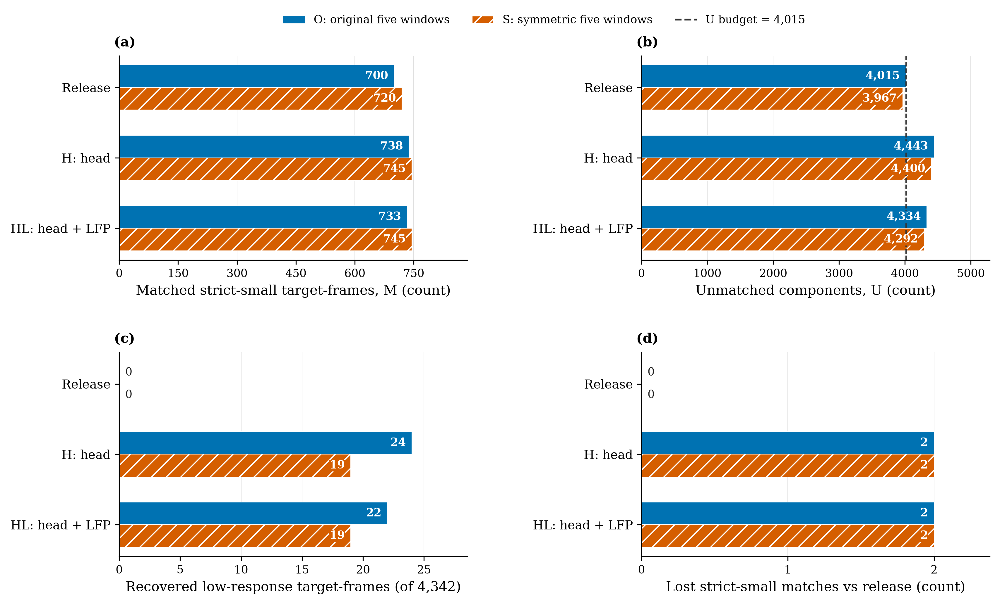

# H / HL 固定终点结果图

[矢量 PDF](final_results.pdf) · [数据来源和哈希](final_results.sources.json)

本图只读取最终 `evaluation/step_2048/SUMMARY.csv`，并核对同目录完成记录中的 SHA256。
H 为只训练原预测头；HL 为相同原预测头加空间 LFP。二者均为 seed 46，主终点固定 2048 步。
H/HL 分别有 273/373 个可训练参数；原网络非预测头参数和全部 BN 仿射参数、运行统计保持冻结。
数据为 2 个开发片段、130 条轨迹、5,200 个冻结严格小目标帧。
O/S 分别表示原五窗与对称五窗安排，阈值为 `>= 0.5`，全部坐标从零开始。
仅有单个 seed，因此不绘制误差条，不主张统计显著性或独立来源泛化。

四个面板依次表示：

- (a) 严格小目标实际匹配数 M。预测二值组件的最大响应点与有效标注框完成一对一匹配后，统计冻结严格小目标集合中的成功对象。
- (b) 全部有效标注参与匹配后，剩余的未匹配组件 U。虚线为冻结诊断预算 4,015，不是官方 Fa。
- (c) 冻结的 4,342 个“原模型在全部已测窗口中框响应低于 0.5”的目标帧中，当前配置实际匹配成功的数量。
- (d) 相对同一安排发布权重的严格小目标新增丢失，来自对象集合差，不是匹配总数差。该图不涵盖其他尺度对象的保持性。

| 配置 | 安排 | M | U | 低响应恢复 | 相对发布新增丢失 |
| --- | --- | ---: | ---: | ---: | ---: |
| release | O | 700 | 4015 | 0 | 0 |
| release | S | 720 | 3967 | 0 | 0 |
| H | O | 738 | 4443 | 24 | 2 |
| H | S | 745 | 4400 | 19 | 2 |
| HL | O | 733 | 4334 | 22 | 2 |
| HL | S | 745 | 4292 | 19 | 2 |

检测数上升、背景预算通过和原成功保持是不同要求，不能仅凭一个面板判定方法成功。
本图不替代框外前景像素、未匹配组件面积、保护集合、轨迹连续漏检及全部尺度对象的完整评价。
LFP 的独立贡献应比较 HL 与 H；相对发布权重的变化同时包含预测头适配的影响。
M/U 都是开发诊断计数，不是论文 Pd/Fa。

复现：在包含 Matplotlib 和 NumPy 的环境运行 `python3 experiments/head_lfp_joint_20261012/figures/plot_results.py`。
脚本通过自身位置读取包内结果，移动整个整理目录后仍可定位；不访问原项目宿主机路径。
未完成或哈希不一致的主终点结果会报错，不会输出占位图。
