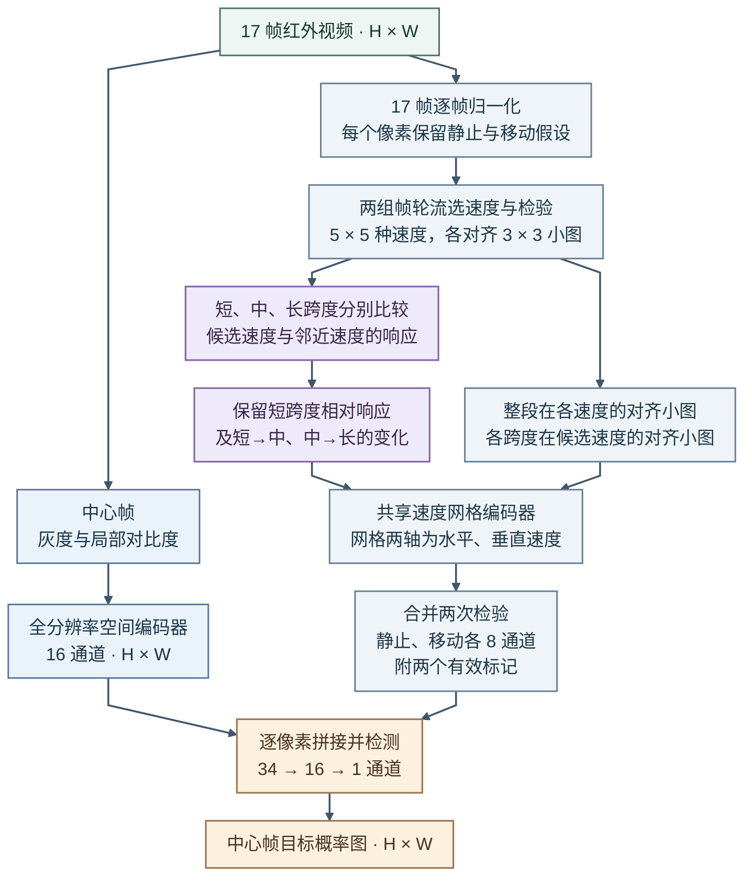

# 按观测跨度比较速度响应的红外小目标视频检测网络

**独立网络的结构设计稿。核心关系算子有单独的验收实现，整网尚未训练。** 面向民用道路、水面红外视频，用连续 17 帧预测中心时刻的全分辨率小目标热图。DeepPro-Plus 用于研究对照和理解时间剖面的设计思路。下述网络有自己的输入表示、特征提取器、速度比较层和检测头，所有可学习参数均独立初始化。[沿用的逐帧归一化、速度提议与采样代码](../../motion_joint_factorial/motion_evidence.py) · [沿用的选峰与框匹配入口](../../motion_joint_factorial/evaluate.py)

## 从检测问题到结构

在固定虚警预算下，我们希望把真实弱目标排在高分杂波之前。在历史诊断中，D 的全图局部峰经去重后，几何上最多可匹配 519 个框中的 514 个；每帧最多 1 个虚警时实际检出 16 个。这个差距定位了分数排序的困难，尚未证明它由某一种运动信息的缺失引起。[已有候选与身份诊断](../../motion_joint_followup/runs/identity_coverage.md)

设某个位置确有热斑，且沿某条运动路径能对齐。我们问两个具体问题：速度略偏时，对齐响应下降多少？观察更久时，这种下降是否加大，沿哪个方向加大？如果紧凑小目标与延伸亮边在真实视频中呈现不同的变化，网络可用它修正二者的排序。形状随跨度的变化是一条候选线索；训练允许稳定亮边、加速目标、短暂暗目标等呈现其他规律。

**核心层放在沿候选速度对齐之后、压缩速度维和生成检测分数之前。** 此时每个响应仍有具体的时间跨度和二维速度坐标。在这里做差，短、中、长三张图中的同一格对应同一个像素速度。

## 数据流

## 一个输出位置如何计算

设待评位置为 p，17 帧的时间偏移为 −8 到 +8，中心偏移为 0。下表用 N 表示批量、H/W 表示图像尺寸、P 表示一个空间分块内的像素数。速度轴和图像的空间轴各自保留。计算为所有 p 重复，推理时没有外部候选框或 Top-K 门限。

| 位置 | 输入 | 运算 | 输出 |
|---|---|---|---|
| 1　进入网络 | 原始灰度视频 [N,17,1,H,W] | 逐帧计算局部背景归一化的有符号对比度；另取中心帧原始强度并按固定输入尺度缩放 | Z [N,17,1,H,W]，中心帧强度 [N,1,H,W] |
| 2a　空间支路 | 中心帧强度、中心帧局部对比度，拼成 [N,2,H,W] | 三层 3×3 空间卷积，步幅均为 1，膨胀率依次为 1、2、4，均输出 16 通道并用 SiLU 激活，填充保持分辨率 | 外观特征 A [N,16,H,W] |
| 2b　运动支路入口 | Z 与每个待评位置 p | 一组帧提出零速度及一个非零速度，另一组固定候选做检查，再交换。两次交换分别编码 | 每个 p 得到 2 次交换 × 2 种运动假设，每个速度含水平和竖直分量 |
| 3　沿假设对齐 | Z、候选速度 v、5×5 个邻近速度扰动 δ | 在原始图像坐标 p+t(v+δ) 附近双线性采样 3×3 小图。在整段和短、中、长三个观测集内分别平均 | 每个 p、每次交换、每种假设得到 4×5×5×3×3；另存有效采样比例 |
| **4　核心比较层** | 短、中、长三组小图，候选中心速度固定 | 同一跨度比较中心速度与邻速；同一邻速比较短、中、长跨度，生成响应差异及其变化 | 每种假设 3×5×5 张量，即 3 张 5×5 二维速度图，附对应有效掩码 |
| 5　速度空间编码 | 三张关系图、三张掩码、整段及中心速度的小图 | 共享的小型二维卷积在速度平面上读取峰、脊及其方向，聚合为每个候选的描述向量 | 每次交换、每种运动假设得到 8 维；编码后合并两次交换，保留静止与移动两类各 8 通道 |
| 6　自己的检测头 | 外观 16 通道、静止证据 8 通道、移动证据 8 通道、两类可用标记 | 拼接为 34 通道，1×1 卷积 34→16、SiLU、1×1 卷积 16→1 | 中心帧 logits [N,1,H,W]，经 sigmoid 得到热图；需要点位置时再在热图上取峰 |

此模型是带 8 帧等待的视频检测器。中心帧外观支路保留小目标的空间细节，运动支路负责整条跨帧计算。5×5 表示一个像素位置上的二维速度网格，3×3 表示每条运动路径对齐后的局部图像，最终输出仍与中心帧等大。

## 核心比较层的定义

令 Pₛ(δ) 表示短、中、长某一组的有符号局部对比度小图，δ=0 是发现组提出的中心速度。第一版以小图中心像素对齐平均后的绝对值定义支持强度 Rₛ(δ)，允许热目标和冷目标。整段局部小图与中心速度处的有符号小图另外送入编码器，保留强弱和局部形状。

每个跨度使用同一公式，计算中心速度相对于每个邻速的响应优势。

$$
Q_s(\delta)=\frac{R_s(0)-R_s(\delta)}{R_s(0)+R_s(\delta)+\varepsilon}.
$$

第一版取 ε=0.1，单位为局部归一化后的对比度。一格 Q 为正，表示该跨度下候选速度支持更强；Q 为负，表示附近的另一种走法获得更强支持。小分母受到抑制。我们保留二维速度图，沿水平延伸的脊和沿其他方向延伸的脊可以产生不同特征。

送给后续网络的三个通道为短跨度的 Q、由短到中的变化、由中到长的变化。

$$
[\ Q_{短},\quad Q_{中}-Q_{短},\quad Q_{长}-Q_{中}\ ].
$$

短跨度的基准图很重要。只输入差分，会把“一直是尖峰”和“一直很平坦”的两种情况都编码为接近零变化。三张图在有效网格上可以重构各跨度的 Q。它们是已有观测的一种显式比较方式，不能凭做差这一操作主张产生了新的观测信息。

**读数例子。** 只取水平方向上的“稍慢、候选、稍快”三个格。某个候选在短跨度的响应为 (7,8,7)，长跨度为 (2,8,2)；另一个位置短、长均为 (7,8,7)。两处在候选速度上始终为 8。第一处在某一邻速的 Q 约由 0.066 增至 0.594，第二处约由 0.066 保持为 0.066。这就是核心层在交给网络前算清的差异。数字用于说明算子，不能据此给两个位置指定真实类别。

## 速度提议、边界及编码接口

- **先定速度再比较。** 初版在每轴 −2 到 +2 像素/帧的整数网格上搜索。除零速度外，在发现帧上取有符号对齐和的绝对值最大的非零速度，零速度另保留。每个方向至少有一半发现观测在图内才接纳移动候选，缺测按零贡献。候选附近每轴扰动为 −1、−0.5、0、0.5、1 像素/帧。短、中、长沿同一候选、同一扰动网格测量；逐跨度重选最佳速度会破坏同一格的可比性。速度仅为图像位移假设。
- **跨度可比。** 第一方向发现组取 −1、+2、+3、−4、+5、−6、−7、+8，验证组取上述偏移的相反数。三档验证子集分别取绝对偏移 {1,2,3,4}、{1,2,5,6}、{3,4,7,8}，每档四帧；第二方向交换发现与验证。整段行使用全部 17 帧一次，供共同外观与运动证据使用。无论亮度归一化还是选速度都不在发现前混合另一组的帧。这些组是在同一中心两侧取不同跨度，测的是跨度效应。
- **边界有明确定义。** 每个采样时刻要求整幅 3×3 小图在图内。整段和中心小图按实际有效数平均并附有效比例。计算某跨度的 Q 时，中心速度和当前邻速都需具备全部四次观测。比较两个跨度时，两张 Q 均有效才计算差值。缺测用零值加掩码表示。若某类假设在两次交换均没有可用的运动比较，其描述向量置零、可用标记置零，由检测头利用剩余输入判别。实现按空间分块，带上最大位移和插值所需的邻域。
- **速度空间怎样变回图像空间。** 对每个位置、交换和候选，整段小图的 9 个像素及有效比例占 10 通道，三张 Q/差分图与三张掩码占 6 通道，组成 [P,16,5,5]。在速度网格上运行 3×3 卷积 16→8（同尺寸填充）和 SiLU，展平为 200 维；再拼三个固定候选速度处的小图共 27 维、三个中心有效比例及 2 维候选速度，共 232 维，经共享的 232→8 线性层和 SiLU 得到该候选描述。按有效交换数平均两次交换的 8 维描述，静止和移动候选分开，按原像素位置写回图像。不同交换的移动候选速度允许不同，合并发生在候选编码之后。最终检测头对运动证据可以赋予正权或负权。

## 训练目标与第一项结构验证

初版只需要中心帧小目标位置标注。使用真实小框时，将框内最高分作为该框的目标分，在当前训练图的预测中选取位于目标和忽略框外的高分局部峰作为困难背景。用目标/背景二元分类损失学习检测，再对同帧目标分和困难背景分加排序损失，直接鼓励目标排在高分背景前。训练阶段重新挖掘背景峰，种子固定为 46。逐帧编码器、速度网格编码器和检测头共同训练；速度提议和几何采样规则为固定算子。框监督评价采用目标级定位指标。

首先对**同一新网络**做结构检验，保持输入、速度提议、整段与固定速度小图、可用掩码、空间支路、检测头及训练预算一致。依次给速度编码器输入三个零通道、三张原始响应强度图、三张显式关系图。前两项分别检查额外响应有无价值，以及增益是否能由直接输入原始响应得到。若要单独归因为跨跨度做差，再用 [Q短,Q中,Q长] 与差分编码作等容量比较。每个版本独立训练，确认各通道在时间和速度上对齐、输入变化能够传到输出；还要在真实目标与高分背景上检查响应关系是否有区分度。

当前尺寸与训练策略是第一版设计选择，并无这版模型的实测性能。上轮已用于身份或结构诊断的十二帧继续作为开发分析记录。后续评价结构变化所带来的收益需要另留视频。[旧原型与已有诊断](../../motion_joint_followup/DIAGNOSIS.md)

## 逐步实现与验收

下表中的接口名用于约定后续代码边界。标为拟建的部分仍属设计。代码正确、信息在真实数据上有用、整网提高检测质量，各自需要不同的证据。

| 步骤与代码边界 | 通过条件 | 失败时先查哪一部位 |
|---|---|---|
| 0　研究前提诊断（拟建），训练与原开发来源的标注、图像与响应图 → 目标/困难背景配对 | 同一视频内优先配对局部对比度、候选速度处响应强度及距边界距离接近的真目标与高分背景；真目标按标注面积分层，困难背景剔除目标与忽略框。列出每个来源的配对数、可用比例及短长跨度差异。预先定下汇总量，例如各邻速长短 Q 差值中最小方向均值（沿同方向的非零扰动取均值），同时保留二维图便于检查。真实支持要求不同训练/开发来源上能重复区分两类；样本太少则记证据不足。 | 先查配对后是否仍有足够困难背景、是否主要靠亮度或边界区分，再查固定速度网格能否覆盖观测到的位移。若几何正确但真实区别不重复，优先重新审视假设。 |
| 1　输入与几何（复用），`prepare_window`、`extract_evidence` | 17 帧的零偏移对应第 9 帧；已知亮/暗点的 x/y 速度可找回；按真实 t 的双线性采样对齐；只改检验帧，该方向提出的速度不变；边缘能输出有效比例。既有 16 组几何检查与独立数值对照可复用。[上轮核查](../../motion_joint_followup/runs/geometry_flow.json) | 查时间偏移的符号、水平/竖直坐标顺序、t 与速度的乘法、逐帧归一化与边界规则。 |
| 2　跨度比较（首个新算子），`span_relations.py` 接上一步的 patches 和 valid → 三张关系图、三张掩码 | 对表述中的人工例子算出预期相对响应；热/冷反转结果相同；中心速度落后于邻速时允许负值；平坦与始终尖锐的面可区分；在全有效位置从三个通道可重建三个 Q。掩码无效处有限、可识别；用已核验采样器的真实接口跑通。[算子](../span_relations.py) · [运行检查](../check_span_relations.py) | 先查中心速度格 (2,2) 和 3×3 补丁的中心 (1,1) 是否混淆；对照先按时间求有符号均值再取绝对值的顺序，并查差值方向和两端有效性。 |
| 3　空间支路（拟建），`encode_center` → 16×H×W | 不同 H/W 保持原分辨率；中心帧固定、只改其他 16 帧时输出应相同；将整幅图分块处理并保留卷积所需边缘，内部与整图一致。 | 查是否选中 t=0、是否错误对时间做归一化，卷积步幅、填充与分块上下文是否正确。 |
| 4　速度编码与坐标回写（拟建），`encode_hypotheses` → 静止证据、移动证据及可用标记 | 比较层交给卷积的是二维速度轴。将玩具速度面转置应能在编码前中间张量看见相应转置。固定权重和证据，交换两个发现/检验方向并同步交换速度和掩码，结果相同；静止与移动假设保持两个槽位。分块与整图的回写一一对应。 | 查 vx/vy 与 H/W 是否错作同一组维度、是否提前混合跨度或交换方向、速度值是否与相应小图对齐、分块是否把像素写错位置。 |
| 5　独立检测头（拟建），`forward(X)` → 单通道中心帧 logits | 任意支持的图像尺寸输出 [N,1,H,W]；运动全部缺测时输出有限，能通过外观支路前向与反传。用小批带标签样本核对空间支路、速度编码器、检测头均在优化器内并有任务梯度；所有学习参数均来自本模型。 | 查 34 通道的拼接顺序、无效证据是否同时屏蔽偏置、是否有错误的冻结或 detach、训练入口是否误对 logits 使用两次 sigmoid。 |
| 6　监督和检测评价（拟建训练入口，复用现有评价） | 先验证一对目标与困难负峰的排序损失，其对两分数的梯度分别推动目标向上、负峰向下；检查训练只用训练标注，挖掘负峰时排除所有目标和忽略区域。用已归档分数图复现原匹配；在统一虚警预算下分别报告净检出、逐来源和身份交换。 | 优先查弱框监督位置、困难负峰是否由当前模型产生、分组数据是否泄漏；计数异常时查峰去重、阈值同分处理及一对一匹配。只有正确性通过且在独立来源有稳定收益，才支持效果主张。 |

第一版几何与关系算子为确定性计算。特征提取、速度图编码、检测头才是需要训练的模块。实现顺序可以先执行已知输入的数学与接口测试；这类通过结果与第 0 步的真实数据研究判断分开记录。
