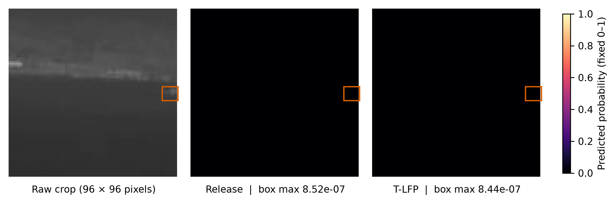
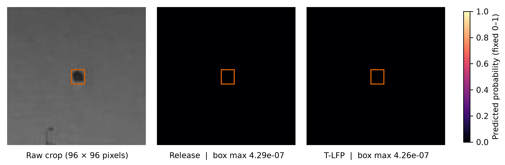

# 最新：H与H＋LFP

H/HL均为seed46、2048步固定终点。S安排两组M均为745，U分别4400/4292，仍超过4015；LFP相对H未增加匹配总数。下方S/T-LFP历史图使用512步，二者不可混为同一实验。

[结果](../experiments/head_lfp_joint_20261012/RESULTS.md) · [判定](../experiments/head_lfp_joint_20261012/DECISION.md) · [PNG](../experiments/head_lfp_joint_20261012/figures/final_results.png) · [PDF](../experiments/head_lfp_joint_20261012/figures/final_results.pdf)

# 实验可视化

[浏览器查看全部图片](index.html) · [完整实验报告](../results/tlfp_pilot_20261012/REPORT.md)

前一轮S/T-LFP结果的可视化：2个开发片段、5,200个严格小目标帧、130条轨迹；阈值固定为 ≥0.5。S-LFP／T-LFP均为 seed 46、512步终点，只有一个seed，没有误差条或显著性主张。O是原五窗安排，S是对称五窗安排；S-LFP是空间模型名称。

严格小目标匹配集合保持不变：O为700、S为720；冻结的4,342个全窗低响应目标帧恢复为0。这些图保留S/T-LFP未通过的结果。非严格小目标仍有检出丢失，见完整报告。

## 定量图

- [检出与背景组件总数 PNG](main_results.png) · [PDF](main_results.pdf)

- [背景成本变化 PNG](background_deltas.png) · [PDF](background_deltas.pdf)

- [训练过程中的分支变化 PNG](training_diagnostics.png) · [PDF](training_diagnostics.pdf)


详细定义、数据来源与训练日志口径见[captions.md](captions.md)。

## 低响应目标局部图

两组局部图按各片段第80帧中“冻结低响应集合的最小轨迹ID”选择。均使用96×96原图裁剪，原图固定0–255显示，概率图共享0–1色标，没有逐图增强。极低响应在此色标下接近黑色；这不证明原输入不存在信息。粗框不代表精确目标形状或中心。0026的目标靠近原画面右边界，保留原位置；图周白边只是绘图区留白，不是补造的图像像素。




框内最大概率：发布权重 8.521e-07，T-LFP 8.442e-07。两个预测均未恢复该目标；此例不能代表全体目标的物理可见性。 [PDF](zoom_DJI_0026_2_080_track_400006.pdf)




框内最大概率：发布权重 4.290e-07，T-LFP 4.256e-07。两个预测均未恢复该目标；此例不能代表全体目标的物理可见性。 [PDF](zoom_DJI_0067_2_080_track_7700051.pdf)


## 完整画面对照

以下整帧只展示O安排。预先固定两个片段的第0、80、159帧，没有按T-LFP输出挑选案例。每组从左到右为原红外图、发布权重、T-LFP；绿色标注框表示实际匹配，橙色标注框表示漏检。彩色框是严格小目标的真实标注框，不是模型预测框；绿色加号为匹配峰。浅蓝轮廓是所有预测前景的0.5等值线，可能对应其他尺度目标，不能直接称为误检。

- [DJI_0026_2 · 第 0 帧 PNG](frame_DJI_0026_2_000.png) · [PDF](frame_DJI_0026_2_000.pdf)

- [DJI_0026_2 · 第 80 帧 PNG](frame_DJI_0026_2_080.png) · [PDF](frame_DJI_0026_2_080.pdf)

- [DJI_0026_2 · 第 159 帧 PNG](frame_DJI_0026_2_159.png) · [PDF](frame_DJI_0026_2_159.pdf)

- [DJI_0067_2 · 第 0 帧 PNG](frame_DJI_0067_2_000.png) · [PDF](frame_DJI_0067_2_000.pdf)

- [DJI_0067_2 · 第 80 帧 PNG](frame_DJI_0067_2_080.png) · [PDF](frame_DJI_0067_2_080.pdf)

- [DJI_0067_2 · 第 159 帧 PNG](frame_DJI_0067_2_159.png) · [PDF](frame_DJI_0067_2_159.pdf)


## 来源与重绘

- [固定选样规则](QUALITATIVE_SELECTION.json)、[原始输入SHA](QUALITATIVE_EXTRACTION.json)、[逐图元数据](QUALITATIVE_RENDER.json)。
- [定量数据来源](QUANTITATIVE_SOURCES.json)、[渲染自查](QUANTITATIVE_RENDER_CHECK.json)、[独立定量图审核](QUANTITATIVE_REVIEW.json)。
- `data/` 保留6帧选定原图、发布／T概率和对应标注明细。仅这些样本被收录，不等于全量训练数据。
- PNG为300dpi；统计图PDF为矢量图元，真实画面PDF的图像为栅格，文字和标注框为矢量。

在具备NumPy、Matplotlib的环境中运行下列命令即可用包内数据重绘，不使用GPU，也不需要原实验数据目录：

```bash
python3 visualizations/scripts/build_quantitative.py
python3 visualizations/scripts/plot_qualitative.py
python3 visualizations/scripts/build_gallery.py
```

`scripts/extract_qualitative.py`是首次提取样本的来源记录；重绘无需再次运行它。当前绘图复用已验证Docker环境，执行命令见[QUALITATIVE_EXECUTION.json](QUALITATIVE_EXECUTION.json)。图片仅辅助查看已完成实验，评价结论仍以全量结果表为准。
