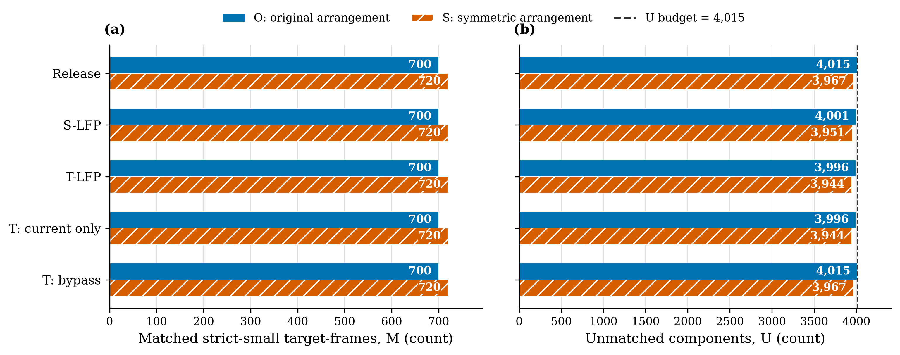
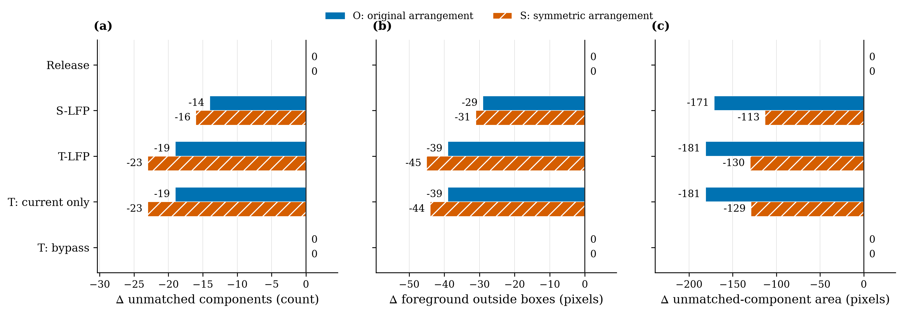
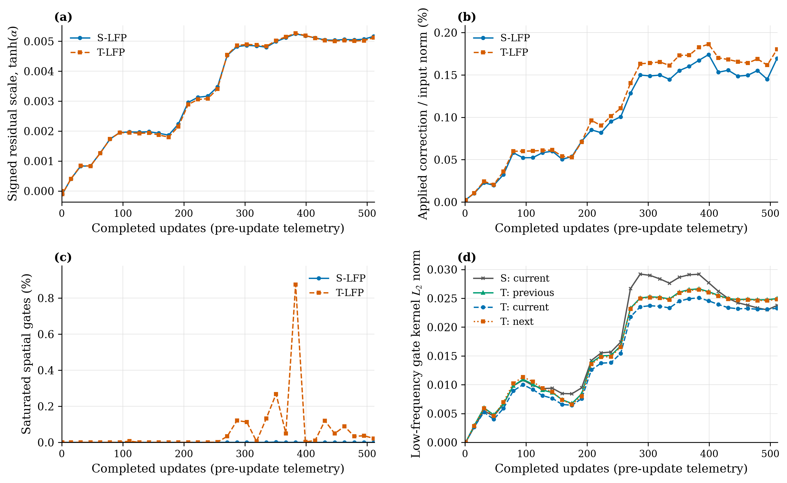

# 定量可视化说明

三张图从 `../results/tlfp_pilot_20261012/` 的已有 CSV/JSON 读取。没有新增训练、推理或重新评分。
覆盖 2 个开发片段、5,200 个严格小目标帧、130 条轨迹；阈值固定为 `>= 0.5`。
S-LFP 与 T-LFP 均为 seed 46、512 步终点。仅有一个 seed，因此没有误差条或显著性主张。
O 表示原五窗安排，S 表示对称五窗安排；图中的 S-LFP 表示空间模型，二者不同。

## 1. 检出与背景组件总数



[矢量 PDF](main_results.pdf) · [逐图数据来源](main_results.sources.json)

左图 M 为“组件最大响应位置与标注框完成一对一匹配”的严格小目标帧计数；右图 U 为全部有效标注匹配后剩余的组件数。
匹配时全部有效标注参与，M 再限制到冻结严格小目标集合。它们不是论文 Pd/Fa。
坐标从零开始，虚线为冻结诊断预算 U=4,015。
T 当前帧替换与 T 关闭分支来自同一 T 终点权重，不是另训的模型。
所有配置的严格小目标匹配数在 O/S 下分别为 700/720；
T 的冻结低响应集合实际恢复为 0/0，集合共 4,342 个目标帧。
因此，背景组件的小幅下降不能表述为持续漏检已被恢复。

## 2. 相同安排下的背景成本变化



[矢量 PDF](background_deltas.pdf) · [逐图数据来源](background_deltas.sources.json)

每个数都是“该配置减同安排发布权重”的绝对变化；负值表示该项记录的成本下降。
三图依次为 U（组件个数）、框外前景像素（像素数）、未匹配组件总面积（像素数），分别使用各自单位和坐标范围。
发布权重在 O/S 下的三项基数依次为
4015/3967、
38368/38641、
45232/45136。
这张差值图用于辨认小幅变化；不能把较长的负条误读为相对于上述基数的大幅改善。
仅展示严格小目标 M 不涵盖全部对象的保持性；完整表中仍有非严格小目标匹配丢失，应结合实验报告阅读。

## 3. 训练遥测



[矢量 PDF](training_diagnostics.pdf) · [逐图数据来源](training_diagnostics.sources.json)

(a) 有符号残差尺度 tanh(alpha)；(b) 实际施加修正与输入特征的范数比（百分比）；
(c) sigmoid 空间门控小于 0.01 或大于 0.99 的位置比例（百分比）；
(d) 低频门控权重的各时间位置核 L2 范数，含 S 的当前核和 T 的前一帧、当前帧、后一帧核。
每组只有 34 个已保存遥测样点；标记表示真实记录，线段只连接记录点，没有平滑。
日志记录的是该步优化器更新之前的前向与参数状态，因此横坐标为 `日志 step - 1`，最后一个遥测点是已完成 511 次更新的状态，
不是第 512 次更新后的检查点参数。训练遥测说明参数及运算有变化，不是检出恢复曲线，也不提供机制有效的因果证明。

## 复现绘图

在具备 Matplotlib、NumPy 的 Python 环境中，从整理目录执行：

```bash
python3 visualizations/scripts/build_quantitative.py
```

脚本以自身位置定位包根目录，允许移动整个整理目录；数据路径不依赖原实验目录。
默认生成 300 dpi PNG 和保留矢量文字/图元的 PDF。英文图内标签对应此中文图注，便于展示或论文排版。
原始结果、列名、SHA256 与图脚本记录在各 `*.sources.json`。
