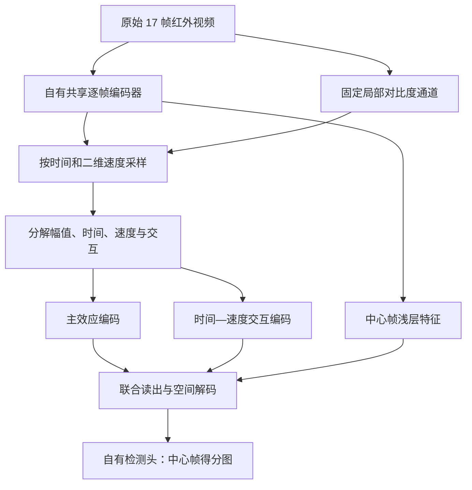

# 红外小目标视频检测：自主模型研究与分阶段代码设计方案

**版本：V1.0｜日期：2026-11-18**

**本轮交付性质：研究与实现方案。** 已核对现有实验代码和归档记录，并复核相关原始文献及数据集发布说明。本文提出的新模型尚未实现、训练或获得性能结果；各阶段的验收状态均应从 **NOT_RUN** 开始，不能把设计完成写成实验通过。

---

## 0. 先明确我们这次要做什么

### 0.1 项目目标

设计一张**从原始红外视频直接输出中心帧目标得分图的独立网络**。自己的逐帧编码器、视频证据表示、核心推断模块、空间解码器和检测头共同训练。

DeepPro-Plus 的用途是：

1. 理解它怎样从检测问题推导时间剖面表示及网络结构；
2. 跑通公开方法的数据、训练和评价流程；
3. 作为正式实验中的外部比较方法；
4. 参考已验证的工程处理，避免重复出现坐标、时间索引和评价错误。

**新模型主路径不依赖 DeepPro-Plus 的层、预训练权重、TPro 特征缓存或预测分数。** 之前“冻结骨干＋小修正分支”的 A–D 实验保留为历史证据；它不再充当新模型的结构基础。

自主模型不要求每个卷积或插值算子都是新发明。我们需要的是：**研究问题由自己的表示和主要计算路径解决，网络结构能被具体假设解释，贡献能通过公平对照检验。**

### 0.2 本方案固定什么，暂不固定什么

| 现在固定 | 在对应阶段通过前不提前锁死 |
|---|---|
| 红外小目标视频检测任务 | 正式速度网格的范围和分辨率 |
| 原始多帧输入、中心帧密集输出 | 最终通道数、块数与训练预算 |
| 网络拥有自己的全部学习模块 | 是否扩展到更长序列或在线因果模式 |
| 在早期聚合前保留时间与运动假设两个轴 | 复杂运动数据需要的高效搜索实现 |
| 工程通过与科研有效分开判断 | 显式交互结构能否成为论文核心贡献 |
| 每阶段只实现该阶段的模块和验收入口 | 后续阶段的完整实现细节 |

整体数据流需要提前清楚，具体实现按阶段落地。**先确定模块契约，不先写完一套大系统再整体推翻。**

### 0.3 对当前负结果的处理

现有代码中的 D 是受约束的适配器实验：原骨干及检测头冻结，只训练运动编码器和投影。训练采用五个来源、二十个监督中心帧和固定三百步更新。诊断表明采样和梯度通路生效，但没有稳定的低虚警增益。[项目模型][p_model]、[训练协议][p_protocol]、[诊断报告][p_diagnosis]

这些结果对**那个具体版本**有效，不能删除，也不应解释成“已经证明总体 idea 没价值”或“已经证明只需修代码”。本方案建立新的自主模型协议，使用新的模型名称和运行目录。

---

## 1. 研究问题：我们究竟希望网络解决什么

### 1.1 问题陈述

红外小目标与背景热斑、边缘端点等干扰可能在局部外观上相似。加入时间信息以后，单个亮度变化曲线或沿某条候选轨迹的累积强度，也可能无法可靠区分两者。

我们要研究：

> **当单独的时间变化和整体的速度响应形状都不足以区分目标与杂波时，“哪些时刻支持哪些运动解释”这一联合关系，是否仍提供可学习的检测证据？**

这不是预先断定所有已有方法都丢弃联合信息，而是为我们的模型定义一个可以比较、可以失败的研究命题。

### 1.2 一个便于理解的例子

某个候选位置有两组观测：

- 两组在各个时刻的总体亮度相近；
- 两组对整段视频中各个速度的平均支持也相近；
- 但第一组在相邻时刻支持相邻的运动解释，第二组的高响应在不同速度之间无规律地出现。

如果只保留时间曲线和整段速度图，两组可能很相似；保留完整“时间 × 速度”关系后，网络才有机会判断其区别。

**这里不把第一组直接标成目标、第二组直接标成背景。** 真实机动目标可能表现复杂，背景也可能持续运动。是否有类别判别价值必须由真实数据确认。

### 1.3 本轮主张的能力范围

第一版面向常规多帧红外小目标检测，重点评价目标检出与虚警抑制。

- 零速度假设包含在模型中，允许利用静止位置的观测。
- 目标可以在窗口内改变运动状态；模型保留逐时刻支持关系，不强制整段只有一个最佳速度。
- 核心训练不需要真实光流、速度标签、遮挡标签或逐目标 ID。
- 没有对应分层数据时，不把“解决静止、遮挡、停走转换”写成已验证贡献。
- 若真实目标与背景在可见外观和时序观测上完全相同，模型不能凭表示变换创造区别。

### 1.4 拆成两个研究假设

**H1：信息假设。**

保留时间与速度的联合观测，能够提供超出两个轴分别汇总后的信息价值。

**H2：结构假设。**

在输入信息相同的条件下，显式分离“时间主效应、速度主效应及其交互”，比普通的完整证据体编码更容易学到稳定的低虚警判别规则。

H1、H2 必须分别检验。H1 成立不自动意味着 H2 成立，更不意味着已经达到强创新要求。

---

## 2. 文献边界：哪些内容不能当作我们的原创

| 前作 | 与本方案直接相关的内容 | 对研究表述的约束 |
|---|---|---|
| DeepPro / DeepPro-Plus | 以固定空间位置的时间剖面建模检测，使用可学习时间相关结构；Plus 加入有限空间信息 | 时间编码和利用长时序本身不是我们的创新。[论文][r_deeppro] |
| Heinze 等，2015 | 在邻近速度网格上生成候选的局部堆叠图，利用错误速度下的形态核验真假，再进行分段复核 | 多速度搜索、错误速度响应、分段验证都有明确先例，不能只说它做了简单累积。[原文 §V.3.1–V.3.2][r_heinze] |
| Liu 等，2026 | 在给定局部区域内利用速度失配的条纹几何进行弱目标运动估计与增强 | 错误速度下的结构携带信息不是新物理发现；任务差别需要说明，但任务差别本身不充分。[期刊页面][r_streak] |
| DTUM | 将方向相关运动信息编码进多帧红外检测网络 | 不能声称首次把方向或位移假设放入神经网络。[作者仓库][r_dtum] |
| DPRN，2023 | 在速度空间中组织分段轨迹与动态规划累积 | 速度空间、分段运动建模、双向积累不能独立列为原创。[论文][r_dprn] |
| MISTNet | 对复杂运动建模多尺度对应并筛选有效信息 | 必须认真检验运动覆盖和复杂运动表现，不能只验证匀速合成亮点。[作者仓库][r_mist] |

**本轮核实范围：**DeepPro、Heinze、DPRN 的原文及相关方法说明已核对；Liu 等的期刊摘要和方法说明可读，但不把有限全文可见性说成已完整复现。数据集说明来自作者或实验室发布入口。这里不是穷尽性“首创认证”。

### 可以争取、但尚未成立的贡献

1. 将时间—运动假设的联合支持作为独立视频检测网络的主要表示；
2. 将单轴主效应和交互分开编码，形成可明确消融的推断结构；
3. 在相同观测、相近容量和训练条件下，证明这种结构改善真实视频的低虚警检测。

双向中心化属于已有数学分解，移位采样、卷积、注意力读出也都是常见算子。**论文贡献必须由具体检测问题、结构必要性和实验结果共同成立，不能通过给算子重新命名获得。**

---

## 3. 数据先行：正式模型不能建立在不满足任务的数据上

### 3.1 建议的数据路线

| 数据 | 核实的性质与标签 | 在本项目中的位置 | 使用前必须确认 |
|---|---|---|---|
| IRDST 的真实连续序列版 | 官方页面提供真实/合成区分，以及 mask、框和中心点；另有序列版入口 | **真实主评测候选**，用于验证实际场景收益 | 下载的是连续序列版；实际序列、帧对应、划分和包内许可 |
| NUDT-MIRSDT | 作者明确为合成数据，120 个序列；发布协议使用 80 个训练、20 个测试；提供 mask 和点标签 | **优先恢复的训练与可重复对照数据** | 按官方列表使用；额外未分配序列不自行补成新划分 |
| MIST | 合成引擎将目标融入真实背景；有 mask、框和点；官方 78 个训练、42 个测试 | **复杂运动补充评测** | 不把真实背景等同于真实目标视频；测试与 Hard 子集不用于调参 |
| 现有 VT-Tiny-MOT 小框子集 | 本项目采用的连续热像和原始框标注 | 数据加载、整图推理、历史回归与框监督兼容检查 | 不冒充标准像素 mask 基准，不改变历史划分 |

来源：[IRDST 官方页面][r_irdst]、[NUDT-MIRSDT 官方说明][r_dtum]、[MIST 官方说明][r_mist]、[项目数据记录][p_data]。

官方 IRDST 总库统计与某个下载包的实际统计不是一回事。数据文件名中出现“val”也不自动意味着可以反复调参：MIST 作者将对应的 42 个序列称为测试集。

### 3.2 当前实际可用性

原项目有 NUDT-MIRSDT 完整下载与校验的历史记录。本轮 GitHub 审查副本没有对应完整原图和 mask，也没有旧训练所需的全部原始数组与权重。[历史数据记录][p_data]

因此：

- 当前可以设计与审查接口；
- 真实数据验收要在用户原项目目录恢复或核对数据后执行；
- 不将“发布入口存在”写成“当前可以直接训练”；
- 新网络不依赖旧权重，旧权重缺失不构成它的前置条件；真实图像和标签可读才是前置条件；
- 本轮没有完成 IRDST 或 MIST 的全量下载。

### 3.3 默认监督与输出语义

正式主协议优先采用有真实像素标注的数据：

- 输入连续红外视频；
- 训练监督是中心帧真实目标 mask；
- 输出中心帧逐像素目标 logits，用于分割和目标级检测。

现有交通框数据只能进入单独的 `bbox_center` 模式：由真实框生成中心热图监督，评价目标定位。**框派生热图不是真实分割 mask，不报告其像素 IoU 来替代标准 mask 指标。**

两种模式可以共用网络主体，但数据协议、损失和评价记录必须分别命名。首轮先完成一种正式模式，不同时搭建所有任务分支。

### 3.4 划分规则

1. 按原视频/场景来源划分，不按相邻帧随机划分。
2. 有官方 train/test 列表时优先遵循；只在官方训练部分内划开发序列。
3. 无官方划分时，S0 完成来源核对后固定 train/dev/test 清单。
4. 历史交通子集的原始划分保留。已经参与诊断的原确认视频不能再当新模型的盲测。
5. 统计实际监督中心帧、目标、无目标帧、来源和可用标注，不拿整个数据目录的帧数代替训练曝光。
6. 代码仓库开源许可不自动等于数据可任意再分发；数据使用范围按下载包说明核对。

---

## 4. 总体网络：主要计算发生在哪里

暂用描述性名字：**时间—速度交互证据检测网络**。代码类名可用 `HypothesisEvidenceDetector`，暂不围绕缩写组织论文。

### 4.1 输入和输出

工程原型输入：

$$
I \in \mathbb R^{B\times17\times1\times H\times W}.
$$

中心帧索引为零基的 8。其余 16 帧作为上下文。

输出：

$$
L \in \mathbb R^{B\times1\times H\times W}.
$$

`L` 是原分辨率中心帧 logits。网络输出不依赖外部检测器先提出空间候选。

这是使用前后帧的离线双向设置。若帧率为 `fps`，中心输出需要等待后续 8 帧，即约 `8/fps` 秒；不能称为严格因果在线检测。

### 4.2 总体数据流



**核心模块的位置：在逐帧特征之后、任何时间/速度不可逆汇总之前；其输出是检测特征，而不是对旧模型得分进行补丁修正。**

### 4.3 模块契约总表

下表将送入空间解码器的查询位置展平为 `N=hq×wq`；该区域包含输出 core 所需的 decoder 邻域。最终写回区域为 `hc×wc`。`V=My×Mx` 是二维速度网格大小；`Te=16`。下表的二维特征尺寸 `h,w` 均指查询区域，经过空间解码后再裁为 core。

| 模块 | 输入 | 输出 | 是否学习 | 目的 |
|---|---|---|---|---|
| 数据归一化 | `[B,17,1,H,W]` | 同形状 | 否 | 保持所有帧相同的量纲 |
| FrameEncoder | 归一化帧 | `[B,17,8,H,W]` | 是 | 保留小目标分辨率，提取局部结构 |
| ContrastChannel | 原始归一化帧 | `[B,17,1,H,W]` | 否 | 保留可解释的局部明暗响应 |
| HypothesisSampler | 特征、坐标、时刻、速度网格 | `R:[B,N,9,16,My,Mx]` | 坐标固定，对特征可微 | 保留每个时刻对每个运动解释的观测 |
| EvidenceDecomposer | `R` 和有效速度掩码 | `μ、A、Bv、J` | 无学习参数 | 将单轴主效应与交互分开 |
| MarginalEncoders | `μ、A、Bv` | `[B,N,24]` | 是 | 保留幅值、时间变化、整体速度形状 |
| InteractionEncoder | `J`、时刻、速度坐标、掩码 | `[B,N,16]` | 是 | 在压缩前学习完整交互结构 |
| Fusion | 上述 40 维、中心特征 8 维、覆盖率 1 维 | `[B,N,32]` | 是 | 联合判断不同证据 |
| SpatialDecoder | `[B,32,h,w]` | `[B,32,h,w]` | 是 | 使用邻域结构抑制重复杂波 |
| DetectionHead | 解码特征 | `[B,1,h,w]` | 是 | 直接输出本模型预测 |

这些通道数是第一版可执行起点，不是最优性能结论。正式参数量、FLOPs、显存和速度在实现后实测。

---

## 5. 表示设计：不先把有可能有用的关系平均掉

### 5.1 共享逐帧编码器

第一版使用两个 stride=1 的 `3×3` 卷积块，输出 8 通道。可采用通道维归一化和 SiLU，保持所有帧使用同一组权重。

设计要求：

- 首版不进行空间下采样；
- 首版不在这个模块里提前混合时间；
- 使用固定训练统计归一化，或只依赖当前像素通道的归一化；
- 避免每个推理块单独计算不同的整块均值/方差，破坏整图与分块一致性。

本模块提供局部边缘、亮点和邻域结构，不承担独立的单帧最终检测任务。

### 5.2 可解释对比度通道

可增加一个固定局部对比度量：

$$
z_t(p)=
\frac{I_t(p)-\operatorname{Avg}_{5\times5}I_t(p)}
{\sqrt{\operatorname{Avg}_{5\times5}(I_t^2)(p)-
(\operatorname{Avg}_{5\times5}I_t(p))^2+\epsilon}}.
$$

均值和方差在当前帧内计算，方差数值截断到非负。`ε` 与数据归一化量纲一致，在配置中记录，不能把旧 8-bit 数据的常数不加核对地照搬到其他量纲。

将其与 8 通道学习特征拼接，得到 9 通道采样来源。固定通道只是工程起点和机制观察入口，不列为创新。

### 5.3 时间—速度采样

对中心位置 `p=(x,y)`、相对时刻 `τt` 和速度假设 `v=(vx,vy)`：

$$
q_{t,v}(p)=p+\tau_t v,
$$

$$
R_{c,t,v}(p)=
\operatorname{Bilinear}
\left([F_t,z_t]_c,\ q_{t,v}(p)\right).
$$

速度单位固定为**原图像素/原始帧间隔**。若使用真实秒时间，必须统一改成像素/秒，不能混用。

- 坐标按 `(x,y)` 存储，图像按 `(H,W)` 存储；
- 若今后有特征步长 `s`，采样坐标为 `q/s`，不能忘记位移单位变换；
- 第一版采用规则二维速度网格，包含零速度；
- 不先取唯一最佳速度；
- 不使用 DeepPro 分数过滤空间位置；
- 不在这里做时间均值或跨度均值；
- 对所有输出像素执行同一个算子。

### 5.4 为什么交互分解排除中心帧

中心时刻 `τ=0` 时：

$$
R_{t_0,v}(p)=[F_{t_0},z_{t_0}](p),
$$

它对所有速度都相同。如果中心行也参与双向中心化，会出现确定性重复：该行的交互项等于速度主效应的相反数。因此所谓“交互支路”可以通过这一行再次读出整个速度主效应。

**第一版输入仍为 17 帧，但仅其余 16 帧进入交互分解；中心帧走自己的空间特征支路。** 这消除一个明确重复通道，不代表交互项与其他分支在统计上独立。

### 5.5 非匀速目标并非自动被排除

若目标位置近似：

$$
x(\tau)=x_0+v_0\tau+\tfrac12a\tau^2,
$$

则通过中心位置的速度假设在时刻 `τ≠0` 匹配目标时满足：

$$
v_{\mathrm{support}}(\tau)
=\frac{x(\tau)-x_0}{\tau}
=v_0+\tfrac12a\tau.
$$

因此，机动目标可能在时间—速度空间形成移动的支持带。这里是**相对中心位置的割线速度**，不是瞬时光流。

这个推导解释为何保留两轴有研究价值，不证明该结构只会由真实目标产生；网格覆盖不足时也无法保证保留目标证据。

### 5.6 速度网格由数据与资源共同决定

`5×5` 网格、每轴 `[-2,-1,0,1,2]` 可用于工程验收，**不是正式数据已经足够覆盖的结论**。

若速度步长为 `Δv`、最大时间偏移为 `τmax`，单轴最近格点误差对应的最大空间偏差约为：

$$
e_{\max}\lesssim |\tau_{\max}|\Delta v/2.
$$

该关系只能帮助选择网格，不能替代实测目标宽度与运动覆盖。范围不够和步长太粗是两个不同问题。

S0–S1 应在训练来源检查目标尺度、可靠的图像位移统计和采样开销，再冻结正式配置。可由单目标 mask/中心或可靠 ID 得到位移诊断；多目标关联不明确时不伪造速度真值。

MIST-Hard 的官方说明包含超过 7 像素/帧的目标，因此不能用 ±2 的工程默认范围宣称覆盖它。[官方说明][r_mist]

若所需字典在资源预算下不可执行，先在采样器层面解决覆盖和计算问题，保持上层接口不变；不通过删除高速样本掩盖问题，也不提前承诺实时性。

---

## 6. 首选核心结构：单轴主效应与时速交互分开学习

### 6.1 具体分解

对一个位置、一个通道，先省略空间与通道下标。在合法速度集合 `Kp` 上定义：

$$
\mu=\operatorname{mean}_{t,v}R_{t,v},
$$

$$
A_t=\operatorname{mean}_{v}R_{t,v}-\mu,
$$

$$
B_v=\operatorname{mean}_{t}R_{t,v}-\mu,
$$

$$
J_{t,v}=R_{t,v}-\mu-A_t-B_v.
$$

因此：

$$
R_{t,v}=\mu+A_t+B_v+J_{t,v}.
$$

在共同有效支持上：

$$
\operatorname{mean}_{v}J_{t,v}=0,\qquad
\operatorname{mean}_{t}J_{t,v}=0.
$$

四部分分别回答：

| 分量 | 含义 |
|---|---|
| `μ` | 整体响应幅值 |
| `A(t)` | 各时刻相对总体水平的变化 |
| `B(v)` | 各速度相对总体水平的支持形状 |
| `J(t,v)` | 单独时间变化与速度形状相加仍无法解释的关系 |

**这不是产生新信息，而是对原有信息施加明确的结构分工。** 代数上的零边际不等于统计独立，更不等于目标专属信号。

**数值实现约定：分解和均值累加使用 FP32。** 即使采样与卷积采用混合精度，也先将响应转换为 FP32 再计算主效应与差值，避免小交互被相近大数相减的误差淹没。转换不应切断梯度；零边际与重构检查也在 FP32 下执行。显存统计要计入这部分临时张量。

### 6.2 分解必须真正影响计算路径

错误做法是把四部分分开后立刻相加，再送进同一个编码器；这只是重构原始 `R`。

建议分别编码：

1. `μ` 经过小型幅值编码器；
2. `A(t)` 经过时间编码器；
3. `B(vx,vy)` 经过速度平面编码器；
4. `J(t,vx,vy)` 保留完整两轴，经过时速交互编码器；
5. 在各自完成非线性编码后，与中心帧特征融合，进入自有空间解码器。

不能把 `||J||` 大直接当成目标。噪声可以产生很大的交互，稳定目标也可能具有较弱交互。

### 6.3 有效观测与边界：第一版采用可精确验证的规则

一般不规则 `M(t,v)` 下，分别计算带掩码均值再双向中心化，不自动满足上述零边际性质。

第一版采用：

$$
K_p=\{v:\ \text{该速度在全部 16 个上下文时刻都有合法采样}\}.
$$

这样，同一个位置的所有时刻共享同一个有效速度集合。对 `Kp` 做分解，填回规则网格时携带 `velocity_valid` 掩码。

规则：

- 无效速度不参加均值、注意力归一化或最终读出；
- 越界零填充不当成真实暗背景；
- 画面边缘仍输出预测，不删除边缘来降低虚警；
- `|Kp|=1` 时 `J=0` 是正常退化，保留时间与中心空间信息；
- 极端无合法上下文时显式标记覆盖不足，由自有中心特征支路输出；
- 同一边界规则用于所有比较模型；
- 目标被遮挡不等于采样无效。这里的 valid 表示图像观测和坐标是否存在，不使用目标可见性真值做推理掩码。

这一完整轨迹有效规则会舍弃某些边界位置的部分合法速度观测。应报告其覆盖分布，不能声称它利用了所有可用证据。更一般的带权加性拟合可以作为后续局部改进，不在首版同时展开。

空集合 `|Kp|=0` 的运算必须显式定义：分解分量、视频分支最终读出和覆盖率均返回零；均值不除零，全部无效的 masked softmax 不计算成 NaN，再由中心特征参与最终融合。这个规则与 `|Kp|=1` 的正常退化分别测试。

### 6.4 一个必要的可辨识性检查

考虑两个数学观测矩阵：

$$
R_1=
\begin{bmatrix}1&0\\0&1\end{bmatrix},
\qquad
R_2=
\begin{bmatrix}0&1\\1&0\end{bmatrix}.
$$

它们具有相同的行均值和列均值，但交互项不同。该检查说明代码没有把联合关系提前抹掉。

**这个矩阵例子不代表一真一假，也不证明自然红外视频上有收益。** 它只属于 S3 的算子验收；真实判别价值由 S4–S5 判断。

---

## 7. 第一版各学习模块的可执行结构

### 7.1 主效应编码

- `AmplitudeEncoder`：`Linear(9,8)`，读入 `μ`；
- `TemporalEncoder`：输入 `A:[B,N,9,16]`，加入实际时间坐标，用两个轻量一维卷积块编码，读出 8 维；
- `VelocityEncoder`：输入 `Bv:[B,N,9,My,Mx]`，加入速度坐标和有效掩码，用两个二维卷积块编码，读出 8 维。

得到 `[B,N,24]`。时间、速度坐标用于说明物理位置，不在分解前作为假“响应通道”参与均值。

### 7.2 时速交互编码

输入：

```python
J:              [B, N, 9, 16, My, Mx]
time_offsets:   [B, 16]
velocity_grid:  [My, Mx, 2]
velocity_valid: [B, N, My, Mx]
```

建议起点：

1. 点式通道投影，将 9 通道映射到 16 通道；
2. 第一个轴向残差块：时间核 5、dilation 1，速度平面核 3×3；
3. 第二个轴向残差块：时间核 5、dilation 3，速度平面核 3×3；
4. 每个块包含通道混合和非线性，保持时间与速度轴；
5. 在两个交互块之后，使用带掩码的学习式读出，输出 16 维证据特征。

两层时间核的理论感受野为 17 个索引位置，可覆盖 16 个上下文槽位；真实时间坐标仍需输入，因为去掉中心帧后存在一个时间间隔差异。

普通卷积、轴向分解和学习式池化都不单独计为创新。这里研究的是**它们被放在什么表示上，以及哪些信息被分开学习**。

### 7.3 融合、空间解码和检测头

拼接：

- 幅值、时间、速度主效应：24 维；
- 交互证据：16 维；
- 自有中心帧浅层特征：8 维；
- 有效速度覆盖比例：1 维。

共 49 维，映射到 32 维。再恢复空间布局：

```python
query_features: [B, N, 32]
spatial_features = reshape(query_features)  # [B, 32, h, w]
```

使用两个 `3×3` 空间卷积块，然后 `1×1` 检测头输出 logits。

中心帧特征用于定位与补充外观，不额外接一个独立单帧得分相加分支。网络是否忽视视频证据，要通过正式消融和输入干预检查。

### 7.4 训练路径

$$
\text{检测损失}
\longrightarrow
\text{检测头、空间解码器、各证据编码器}
\longrightarrow
\text{可微采样}
\longrightarrow
\text{自有逐帧编码器}.
$$

所有学习模块进入优化器。速度坐标生成与均值分解没有学习参数，但不应阻断特征梯度。

**不能把旧采样器覆盖整个函数的 `@torch.no_grad()` 原样套到新网络的可学习特征采样上。** 旧实现的目标是固定观测；新模型需要梯度穿过采样回到自己的编码器。

---

## 8. 计算设计：在写完整网络前解决显存与分块契约

### 8.1 不构造整幅巨型证据体

以 `B=1、C=9、Te=16、V=25、H=512、W=640` 为例：

$$
9\times16\times25\times512\times640
=1,179,648,000
$$

个数。单个 FP16 证据体约 **2.36 GB，约 2.20 GiB**，尚未计入交互副本、激活、梯度和优化器。

这是按张量尺寸计算的内存估计，不是实测显存。

### 8.2 第一版资源策略

- 训练从 `64×64` 或 `96×96` 输出核心块开始；
- 输入块额外读取运动和空间卷积需要的 halo；
- batch 从 1 开始，资源验收后再确定；
- 速度采样可分组生成，避免巨大坐标临时数组；
- 联合编码可使用 activation checkpoint；
- 推理逐空间块生成完整得分图，写回不重叠的核心区域；
- 速度范围、时间长度和计算量一起报告。

对于 `64×64` 查询区域，上述 `C=9、Te=16、V=25` 的 FP16 原始体约 **28.1 MiB**。若最终输出 core 为 `64×64`、decoder 半径为 2，内部 tile 通常需要 `68×68` 查询区域，对应约 **31.8 MiB**。这仍未包含梯度、FP32 分解和其他激活，实际峰值必须实测。

**只把速度循环拆开，并不能自动消除反向传播激活。** 如果所有分块计算图都保留下来，内存仍会累积。空间块训练和必要的 checkpoint 是设计的一部分。

### 8.3 halo 推导

保守采用：

$$
r_{\mathrm{halo}}
\ge
\left\lceil\max_t|\tau_t|\max_v\|v\|_\infty\right\rceil
+\max(r_{\mathrm{stem}},r_{\mathrm{contrast}})
+r_{\mathrm{decoder}}
+r_{\mathrm{interp}}.
$$

第一版两个空间 3×3 stem、局部 5×5 对比度、两个空间 3×3 decoder，对应半径分别约为 2、2、2；插值额外留支撑。最终由实现实际感受野核对。

- 不沿用旧网络硬编码的 halo；
- tile 原点、全图尺寸和当前块尺寸都要显式传递；
- 真正的图像边界与人为 tile 边界不能混淆；
- 在非边界区域，整图与分块输出应在浮点误差内一致；
- 对全图统计有依赖的归一化应统一计算，不能各块自算。

采样器的 query 区域不是只有最终输出 core：还必须包含 SpatialDecoder 需要的邻域。中心帧特征也按同一 query 网格取值；证据融合、空间解码完成后才裁出 core。真正图像边界按统一 padding 处理，不把图像外位置生成成假观测；人为 tile 边界则从相邻真实区域读取所需上下文。

---

## 9. 软件边界与接口：先让每个部件可独立替换

### 9.1 新项目位置

在用户规范项目目录下新建：

`/home/ly/DeepProPlus_TLFP_Code/experiments/irstd_independent_v1/`

这是**计划中的执行位置**，本轮没有在用户训练机器创建该目录。历史目录和可能存在硬链接的归档文件保持不可变。[项目执行约定][p_agents]

### 9.2 模块文件表

| 文件/目录 | 职责 | 首次实现阶段 |
|---|---|---|
| `configs/task.yaml` | 任务、帧数、标注模式、坐标单位 | S0 |
| `contracts.py` | ClipBatch、Prediction、SceneMeta 等契约 | S0 |
| `data/manifest.py` | 来源、划分、连续帧和标注索引 | S0 |
| `data/dataset.py` | 读取 clip、同步增强、返回中心标签 | S0 |
| `geometry/velocity_grid.py` | 速度网格与物理单位 | S1 |
| `geometry/sampler.py` | 可微双线性采样与 valid | S1 |
| `geometry/tiles.py` | 坐标原点、halo、整图写回 | S1 |
| `models/frame_encoder.py` | 自有逐帧编码器 | S2 |
| `models/video_baseline.py` | 最小自主视频模型 M0 | S2 |
| `models/spatial_decoder.py` | 自有空间解码与检测头 | S2 |
| `models/evidence_parts.py` | μ、A、Bv、J 分解 | S3 |
| `models/evidence_encoder.py` | 主效应与交互编码 | S3 |
| `models/hypothesis_detector.py` | 完整自主模型与比较模式 | S3 |
| `losses/detection.py` | 按真实标签计算检测损失 | S2，S4固定正式版 |
| `engine/train.py` | 统一优化、恢复、记录 | S2 |
| `engine/predict.py` | 同一模型的整图/分块推理 | S2 |
| `evaluation/` | 原生 benchmark 指标与自定义 FROC 分开 | S0定义，S2接通 |
| `checks/check_s0.py ... check_s5.py` | 每阶段最小必要验收入口 | 按阶段创建 |
| `reports/` | 阶段记录、协议和结果 | 按阶段生成 |

不在 S0 一次性创建全部后续实现或空壳。先完成该阶段规定文件。

### 9.3 数据与模型契约

```python
# 概念性接口；不是已完成的可运行实现。
ClipBatch:
    frames:          FloatTensor[B, T, 1, H, W]
    time_offsets:    FloatTensor[B, T]
    pixel_valid:     BoolTensor[B, T, 1, H, W]
    center_index:    int
    output_frame_id: list[str]
    scene_meta:      list[SceneMeta]

Targets:  # 只传给损失/评价，不传给运动采样或模型推理
    label_type:      "mask" | "bbox_center"
    target_map:      Tensor[B, 1, H, W]
    ignore_map:      BoolTensor[B, 1, H, W]
    objects:         list

Prediction:
    logits:          FloatTensor[B, 1, H, W]
    output_frame_id: list[str]
    diagnostics:     dict  # 默认关闭大张量导出
```

`SceneMeta` 至少包含原始图像尺寸、块的全图原点、有效核心区域、序列来源和真实帧编号。

### 9.4 前向流程伪代码

```python
def forward_tile(video_with_halo, time_offsets, center_index, scene_meta):
    # 所有学习模块均属于本模型。
    features = frame_encoder(video_with_halo)
    contrast = local_contrast(video_with_halo)

    # query 包含 decoder 邻域，并限制在真实全图范围内。
    query_grid = make_query_grid(
        scene_meta.output_core,
        expand=config.decoder_radius,
        clip_to_global_image=scene_meta.image_hw,
    )
    center_features = gather_on_query_grid(
        select_center(features, center_index), query_grid, scene_meta
    )
    context_indices = indices_except_center(features, center_index)
    context_features = select_frames(
        concat_channels(features, contrast), context_indices
    )
    context_time_offsets = select_times(time_offsets, context_indices)

    responses, velocity_valid = hypothesis_sampler(
        context_features,
        time_offsets=context_time_offsets,
        query_grid=query_grid,
        velocity_grid=config.velocity_grid,
        scene_meta=scene_meta,
    )

    parts = decompose_on_common_valid_support(
        responses, velocity_valid
    )

    # 三个正式比较版本仅改变 joint_input 的信息形式。
    joint_input = choose_joint_input(
        mode=config.evidence_mode,  # additive_only / raw_joint / interaction
        responses=responses,
        parts=parts,
    )

    marginal_features = encode_marginals(
        parts, context_time_offsets, config.velocity_grid, velocity_valid
    )
    joint_features = encode_joint(
        joint_input, context_time_offsets, config.velocity_grid, velocity_valid
    )

    features_2d = fuse_and_reshape(
        marginal_features, joint_features,
        center_features, velocity_valid, query_grid=query_grid
    )
    logits = detection_head(spatial_decoder(features_2d))
    return crop_to_output_core(logits, scene_meta)
```

训练调用这条前向路径；整图推理只是对它做确定性的 tile 调度和拼接，不另写一套“缓存点模型”。

### 9.5 缓存规则

可缓存：

- 原始解码帧；
- 标签与索引；
- 不依赖模型参数的时间/速度坐标；
- 数据清单和校验值。

正式训练中不长期缓存：

- 自有可训练编码器的旧特征；
- 与旧参数绑定的响应体；
- 用旧模型一次性选好后永不更新的全部困难背景。

否则名义上“联合训练”会实际变成固定特征训练。

---

## 10. 分阶段实施与验收

### 10.1 总表

| 阶段 | 只完成什么 | 通过的含义 | 失败时保留什么 |
|---|---|---|---|
| S0 | 数据、任务、标签、指标契约 | 数据和任务定义可信 | 文献、旧记录及明确的问题陈述 |
| S1 | 时间—速度采样、有效性与分块 | 几何和覆盖正确 | S0全部成果 |
| S2 | 可独立训练的自主视频基础模型 | 新项目能够真实训练并整图检测 | S0、S1 |
| S3 | 交互分解与核心网络接入 | 新结构计算、梯度和接口正确 | S0–S2 |
| S4 | 正式训练与公平对照 | H1/H2 获得或未获支持 | 已通过的全部工程模块 |
| S5 | 新留出来源确认 | 泛化结论获得或未获支持 | 所有代码及正负实验记录 |

**S0–S3 是工程验收；S4–S5 才判断研究价值。** 不在每一阶段都要求超过 DeepPro，也不把玩具样本拟合成功写成创新成立。

---

### S0：先把数据和任务接正确

#### 只写这些代码

`contracts.py`、`data/manifest.py`、`data/dataset.py`、`checks/check_s0.py`。同时写任务和评价协议。

#### 具体任务

1. 在原项目路径核对真实图像、标签和官方列表。
2. 生成明确来源的 train/dev/test 清单。
3. 固定输入 17 帧与输出中心帧的对应关系。
4. 固定原图坐标、像素单位和标注模式。
5. 列出可用输出中心帧，包含预定义的无目标帧。
6. 统计实际训练曝光、目标宽度和可可靠估计的运动范围。
7. 读取一个真实 batch，并保存少量原图/标签叠加检查。
8. 记录数据缺失和不可判定项，不用目录说明代替文件可读性检查。

#### 验收条件

- 每个标签对应正确原始帧；不存在 index/image_id 混用；
- 窗口不跨序列，不跨帧号断点；
- `center−8≥0` 且 `center+8<sequence_length`；
- 不通过 Python 负索引绕到片尾，不重复末帧伪造观测；
- clip 所有帧使用一致空间变换；
- 标签不进入推理输入；
- 同源数据没有跨 train/dev/test 混入；
- bbox 与 mask 指标语义清楚；
- 正式数据文件可读。

#### 交付

`reports/S0_data_contract.md`、固定 manifest、真实样例检查和 `reports/S0.json`。

**失败只修数据与索引；没有真实数据时状态为 BLOCKED，不能标 PASS。**

---

### S1：只把采样、掩码和覆盖做好

#### 只写这些代码

`geometry/velocity_grid.py`、`geometry/sampler.py`、`geometry/tiles.py`、`checks/check_s1.py`。

输入可以先是原始单通道或固定特征；此阶段不加入检测头。

#### 验收条件

1. 横纵坐标、正负速度、零速度和亚像素位移正确。
2. 明确 `align_corners` 与归一化坐标约定。
3. 使用独立数值实现核对一批采样值。
4. 对可学习 features 做梯度检查；不是只看输出可计算。
5. 越界位置正确标记，零填充值不参与有效均值。
6. 完整轨迹有效速度集合与独立枚举一致。
7. 改变 query chunk 大小不改变坐标顺序和输出。
8. 全部输出像素被覆盖，不能只处理高分候选。
9. tile halo 足够，人工块边界不冒充图像边界。
10. 小图整图/分块结果一致。
11. 记录真实峰值显存与时间，验证所选正式网格可执行。

参考数值门槛可先取 FP32 下 `atol=1e-5, rtol=1e-4`，具体应按独立计算和动态范围确认后写入验收记录；不为让结果通过而事后任意放宽。

#### 交付

算子、最小必要检查、坐标可视化、资源记录和 `reports/S1.json`。

**移动亮点测试通过只证明几何正确。若显存失败，先修改计算调度，不同时更改检测假设。**

---

### S2：建立自己的可训练视频基础模型

#### 模型 M0

原始视频进入自有 FrameEncoder，再经过简单的可训练时间卷积聚合器，接自有 SpatialDecoder 与 DetectionHead。

- 所有学习模块都训练；
- 不加载 DeepPro 权重；
- 不读取 DeepPro 特征或得分；
- 输入输出与最终模型相同；
- 时间聚合器输出固定 `[B,32,h,w]`，为 S3 的替换留下稳定接口。

这个阶段的基础视频模型是训练与工程支点，不预设为论文创新。

#### 只增加这些代码

逐帧编码器、简单视频聚合器、自有解码与检测头、基本损失、训练/保存/恢复/整图预测入口。

#### 验收条件

1. 模型可以仅凭原始视频和自己的参数执行推理。
2. 编码器、时间层和检测头均获得有限梯度，参数有实际更新。
3. 在预先固定的小型真实训练子集上可明显降低整体损失并改善目标/背景区分。
4. 小子集检查包含真实背景和负帧，不只包含目标裁剪。
5. 保存恢复后的同输入输出一致；继续训练状态完整。
6. 同一个 forward 支持训练和最终输出，不再用两套不一致逻辑。
7. 整图预测完成约定全部帧、全部空间区域。
8. 固定训练诊断集记录 loss 和低虚警排序，不以不同 minibatch 的四个 loss 点判断收敛。
9. 计算预算可执行。

#### 交付

M0、真实短训练记录、完整预测样例、资源统计和 `reports/S2.json`。

**失败时先修数据、优化器、归一化或解码器；S0/S1 不推翻。小子集拟合成功不代表泛化。**

---

### S3：接入核心结构，替换视频聚合路径

#### 本阶段改变的位置

用 HypothesisSampler、EvidenceDecomposer 和各证据编码器，**替换 M0 的时间聚合器**。保留稳定的数据接口、FrameEncoder、SpatialDecoder 和输出协议。

这不是给 M0 的最终分数添加一个分支；完整模型的主要视频特征来自新的时间—速度证据路径。

#### 只增加这些代码

`evidence_parts.py`、`evidence_encoder.py`、`hypothesis_detector.py` 与 S3 验收入口。

#### 验收条件

1. `R=μ+A+Bv+J` 在共同有效支持上成立。
2. `J` 两轴均值为零，退化 `|Kp|=1` 时正确返回零交互。
3. 中心帧没有进入交互体，且自己的空间特征支路可用。
4. 相同行/列均值但不同交互的输入不会在接口处被压成相同数据。
5. 分解后没有立即相加还原再交给单一编码器。
6. 完整检测损失的梯度进入各证据编码器和 FrameEncoder。
7. 无效速度、边缘退化与不同块大小行为一致。
8. 只做一次预定的短真实训练链路检查，确认损失和参数更新正常。
9. 实测显存和时间在 S1 约定预算内。
10. 完整模型和比较模式能够共用同一个输出与评价入口。

#### 交付

完整新模型的可运行版本、结构/梯度检查、短训练记录与 `reports/S3.json`。

**通过后进入正式训练，不继续无穷追加浅分类器或玩具 probe。** 若失败，只修核心模块或其连接；已经通过的自主基础模型仍然可用。

---

### S4：一次完整、可解释的正式训练比较

#### 固定四个版本

| 版本 | 主要信息/结构 | 回答的问题 |
|---|---|---|
| M0：自主视频基础模型 | 原始视频的普通时间聚合 | 新路线有没有实际净收益？ |
| Msep：仅主效应信息 | 使用 `Rsep=μ+A+Bv`，没有真实交互残差 | 联合信息是否必要，即 H1？ |
| Mraw：完整观测的普通联合编码 | 联合支路读取原始 `R` | 显式分解是否必要，即 H2？ |
| Mint：完整分解模型 | 联合支路读取 `J`，主效应另行编码 | 本方案的最终候选 |

为形成更强的控制，Msep、Mraw、Mint 使用同构的主效应分支、中心支路、联合编码器及检测头，参数分别训练，不跨模型共享更新。它们只改变联合编码器读入的是 `Rsep`、`R` 还是 `J`。

这样 Msep 的联合编码器仍可训练地处理主效应组合，不靠将整个分支置零人为减少其有效容量。它是明确的受控信息对照，不代表所有非联合方法的理论上限。

**“相同观测”指相同原始视频、采样坐标、标注和训练规则。** 三个版本分别联合训练后，FrameEncoder 的参数以及响应体 R 的数值可以不同。因此，这组主实验比较整套学习方案，不能描述成固定同一数值 R 的纯信息干预。若另做固定响应体诊断，应单独标注其范围，不替代自主模型的正式训练结果。

#### 训练协议

- 所有新模型从相同规则初始化，全部自己的学习层可训练。
- 数据来源、监督帧、增强和模型选择规则一致。
- Msep/Mraw/Mint 使用同样的速度范围、时间上下文、空间输出与训练预算。
- 正式训练采用多个预定 seed，例如 `46/47/48`；不选择一次最高分作为结论。
- mask 模式首版可用 BCE 与 soft IoU/Dice 的共同检测损失；具体选型在正式训练前固定，不临时只给 Mint 改损失。
- 训练中定期从**当前模型**预测中刷新困难背景，所有版本采用相同规则与预算。
- 各模型产生的困难背景可以不同，因此公平要求是挖掘规则、预算及数据来源相同，不声称每一步困难负样本逐值相同。
- 困难背景只从训练数据挖掘；GT 区域及 ignore 区域排除。
- 将当前模型新产生的高分背景纳入训练，不只沿用原 DeepPro 选出的固定负峰。
- 保留随机背景、无目标窗口和目标窗口，避免只训练容易定位的正裁剪。
- 使用固定训练/开发诊断判断预算是否充分，不能把三百步或某个大步数自动当作充分训练。
- 若需要统一扩大预算，所有比较版本使用预定相同规则，完整记录。

#### 评价

主研究问题仍关注相同虚警预算下的检出。正式协议在 S0/S4 固定：

1. 自定义目标级 FROC：明确候选提取、去重、匹配与 FP/frame 分母；
2. mask 数据按官方评价程序报告其原生指标；
3. 官方 Fa 可能按误报像素归一，不能与 FP/frame 混成一个数；
4. 固定开发阈值迁移和在评测集扫阈值得到的描述性 FROC 分开；
5. 同时报告 0.5、1、5 FP/frame 等事先固定工作点、完整曲线与逐视频差值；
6. 所有预定负帧和边缘区域都进入评价；
7. 报告实际 TP/FP，而不仅报告百分比。

#### 研究判据

- **Mint 稳定优于 Msep：**H1 获得支持，但还需看 Mraw。
- **Mint 也稳定优于 Mraw：**支持显式分解结构 H2。
- **Mraw 与 Mint 相近，但均优于 Msep：**支持保留联合信息；不能宣称显式分解必要。
- **只超过旧 DeepPro 或 M0，未超过 Msep：**可能是基础模型/训练改善，不能归因于联合交互。
- **训练集都拟合不好：**先定位工程或优化问题，不直接判科研无效。
- **训练拟合充分、开发仍无稳定增益：**核心假设缺少支持，不继续盲目加模块。

稳定性看独立来源、重复训练波动和实际效应，不靠相关逐帧框数制造显著性。最小有意义增益可在开发集噪声水平明确后预先规定，不能为了接受结果事后调整。

#### 局部回退

若有明确证据支持一个局部修改，例如采样覆盖不足或融合读出失效，可以记录理由后修订该模块，并保留原结果。

若没有具体原因，停止把“显式交互分解”作为主贡献。数据接口、几何算子、自主基础网络、训练和评价系统全部保留，不重写整个项目。

---

### S5：新留出来源确认与论文结论

锁定模型、参数、阈值、输出帧清单、代码和评价规则后，再进行新留出来源确认。

#### 要求

- 新来源没有参与结构、速度网格、阈值或训练预算选择；
- 原确认视频已经用于分析的部分，只作为历史回归；
- 真实主评测优先使用核实后的 IRDST 序列真实部分；
- 合成结果和真实结果分别报告；
- 逐视频/逐来源结果与汇总同时给出；
- 数据足够时按来源估计不确定性，不把连续帧当独立试验；
- DeepPro-Plus、DTUM、MISTNet 等外部对照采用明确的数据和输入长度协议。

对 DeepPro-Plus 的发布权重和重新训练版本分别命名。其原始输入长度若不同，明确报告；若改为与本模型相同长度，按新长度重新训练或正确适配，不强行加载尺寸不兼容的参数，也不把两种设置混称完全公平。

#### 通过意味着什么

只有公平对照和新来源确认都支持结论，才可以围绕对应机制形成论文主张。模型独立是工程事实；强创新与检测收益是需要证据的研究结论。

若根据确认结果继续修改，该数据已转成开发信息；下一次最终确认需要新的留出来源。

---

## 11. 每阶段怎么记录，避免“没有验收就往下写”

每阶段记录至少包含：

```json
{
  "stage": "S1",
  "status": "NOT_RUN",
  "gate_kind": "engineering",
  "code_commit": null,
  "data_manifest_hash": null,
  "implemented_scope": [],
  "checks": [],
  "artifacts": [],
  "remaining_limits": [],
  "failure_owner": null,
  "next_allowed_stage": null
}
```

状态可用：`NOT_RUN / RUNNING / PASS / FAIL / BLOCKED`。

执行原则：

1. 只为当前阶段写必要代码和验收入口；
2. PASS 必须有实际输入、版本和结果记录；
3. 工程检查只对实现作结论，不替代研究结果；
4. 失败定位到模块，再重验受影响接口；
5. 已通过模块保持稳定，不顺手重写；
6. 新阶段只依赖已有明确契约；
7. 不把“通过阶段”变成重复询问许可；已授权实现时，满足条件即可继续；
8. 涉及研究问题、数据划分或评价定义的实质改变，先写明理由并形成新协议版本，不能悄悄改旧结果。

---

## 12. 哪些旧成果复用，哪些退出新模型主路径

| 现有成果 | 新项目如何处理 |
|---|---|
| 已验证的坐标、双线性采样及有效性计算 | 提炼为几何工具，重新检查可微性与新接口 |
| 全图覆盖、取峰、去重与一对一匹配代码 | 可移植到独立评价模块，保留语义与独立复核 |
| 逐来源划分与原子保存/校验思路 | 继续使用，避免数据和结果混淆 |
| 原时间跨度平均观测 | 保留为历史比较或摘要控制，不作为新核心唯一输入 |
| DeepPro 权重与官方实现 | 放在外部 baseline 入口，仅用于复现和比较 |
| TPro 特征缓存、冻结原检测头、旧 adapter | 不进入自主模型前向或训练 |
| 旧 A–D 权重与负结果 | 保留，只读，作为研究过程证据 |
| 训练/开发/确认来源记录 | 保留用途历史，避免重新宣称盲测 |

已有几何检查节省的是重复排错成本，不代表新核心已经通过研究验证。

---

## 13. 本次之后真正应该开始的第一项代码工作

**下一次开始实现时，先做 S0。**

具体只完成：

1. `task.yaml`：写清输入、输出、标注模式、时间单位和正式数据路线；
2. `contracts.py`：固定 batch、target、prediction、scene meta；
3. `manifest.py`：读取真实数据并生成按来源划分的清单；
4. `dataset.py`：返回真实 17 帧 clip 和对应中心标签；
5. `check_s0.py`：检查时间、坐标、标签、来源隔离和真实文件可读性；
6. 输出 S0 记录和少量可检查样例。

S0 通过后，下一项代码工作是**可微时间—速度采样器 S1**。到 S2 才写自己的完整视频基础模型；到 S3 才接入交互分解和核心网络。

本轮不宣称这些阶段已经完成，也不先输出一个所有文件齐全但未经逐步验收的“完整网络”。

---

## 14. 当前决策与可保留成果

**研究方向继续，执行方式改为自主模型的分阶段建设。**

第一版的核心候选是：从原始视频构建逐时刻运动假设观测，将幅值、时间主效应、速度主效应和交互分别编码，再由自己的空间解码器与检测头完成检测。

这个设计的优点是研究问题、网络位置、输入输出和可证伪对照一一对应。它还没有获得性能或强创新证明。若核心结构失败，撤下对应的研究主张；已经通过的数据、几何、基础网络和训练评价工程仍继续使用。

---

## 参考文献与代码依据

### 原始文献与官方数据来源

- **R1**：DeepPro / DeepPro-Plus，*Probing Deep into Temporal Profile Makes the Infrared Small Target Detector Much Better*。本轮核对 arXiv v5。https://arxiv.org/html/2506.12766v5
- **R2**：Heinze, Metchev, Trollo，2015，*Digital Tracking Observations Can Discover Asteroids Ten Times Fainter than Conventional Searches*。重点 §V.3.1、§V.3.2。https://arxiv.org/html/1508.01599v1
- **R3**：Liu, Xu, Qian，2026，*Multi-frame coherent enhancement for infrared dim targets via streak geometric consistency under low-SNR conditions*。DOI：https://doi.org/10.1016/j.infrared.2026.106912
- **R4**：DTUM 与 NUDT-MIRSDT 作者仓库。https://github.com/TinaLRJ/Multi-frame-infrared-small-target-detection-DTUM
- **R5**：Fu, Wei，2023，*Dynamic programming network for point target detection*。https://link.springer.com/article/10.1186/s13634-023-01038-7
- **R6**：MIST / MISTNet 作者仓库与数据说明。https://github.com/ShuCvlab/MIST
- **R7**：IRDST 官方实验室发布页面，包含序列版入口。https://xzbai.buaa.edu.cn/datasets.html

### 本项目代码与历史证据

本轮审查仓库：https://github.com/Arialliy/ly 。固定提交：`73dc0315b6aa27918d15cb0ec604fd2dce223760`。

- **P1**：`experiments/motion_joint_factorial/model.py`：冻结主干/检测头和旧运动修正结构。
- **P2**：`experiments/motion_joint_factorial/PROTOCOL.md`：既有训练数据、预算与对照协议。
- **P3**：`experiments/motion_joint_followup/DIAGNOSIS.md`：身份、几何、干预和读出诊断。
- **P4**：`experiments/motion_joint_design_audit/EXPERIMENT_AUDIT.md`：时间混合、训练拟合和结论边界。
- **P5**：`data/README.md`：历史数据归档及实际使用范围。
- **P6**：`AGENTS.md`：原项目目录和历史文件保护约定。

[r_deeppro]: https://arxiv.org/html/2506.12766v5
[r_heinze]: https://arxiv.org/html/1508.01599v1
[r_streak]: https://www.sciencedirect.com/science/article/pii/S1350449526005475
[r_dtum]: https://github.com/TinaLRJ/Multi-frame-infrared-small-target-detection-DTUM
[r_dprn]: https://link.springer.com/article/10.1186/s13634-023-01038-7
[r_mist]: https://github.com/ShuCvlab/MIST
[r_irdst]: https://xzbai.buaa.edu.cn/datasets.html
[p_model]: https://github.com/Arialliy/ly/blob/73dc0315b6aa27918d15cb0ec604fd2dce223760/experiments/motion_joint_factorial/model.py
[p_protocol]: https://github.com/Arialliy/ly/blob/73dc0315b6aa27918d15cb0ec604fd2dce223760/experiments/motion_joint_factorial/PROTOCOL.md
[p_diagnosis]: https://github.com/Arialliy/ly/blob/73dc0315b6aa27918d15cb0ec604fd2dce223760/experiments/motion_joint_followup/DIAGNOSIS.md
[p_data]: https://github.com/Arialliy/ly/blob/73dc0315b6aa27918d15cb0ec604fd2dce223760/data/README.md
[p_agents]: https://github.com/Arialliy/ly/blob/73dc0315b6aa27918d15cb0ec604fd2dce223760/AGENTS.md

