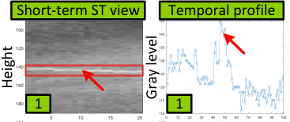
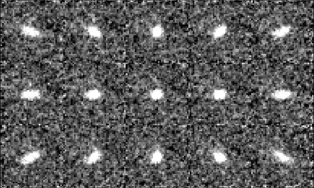
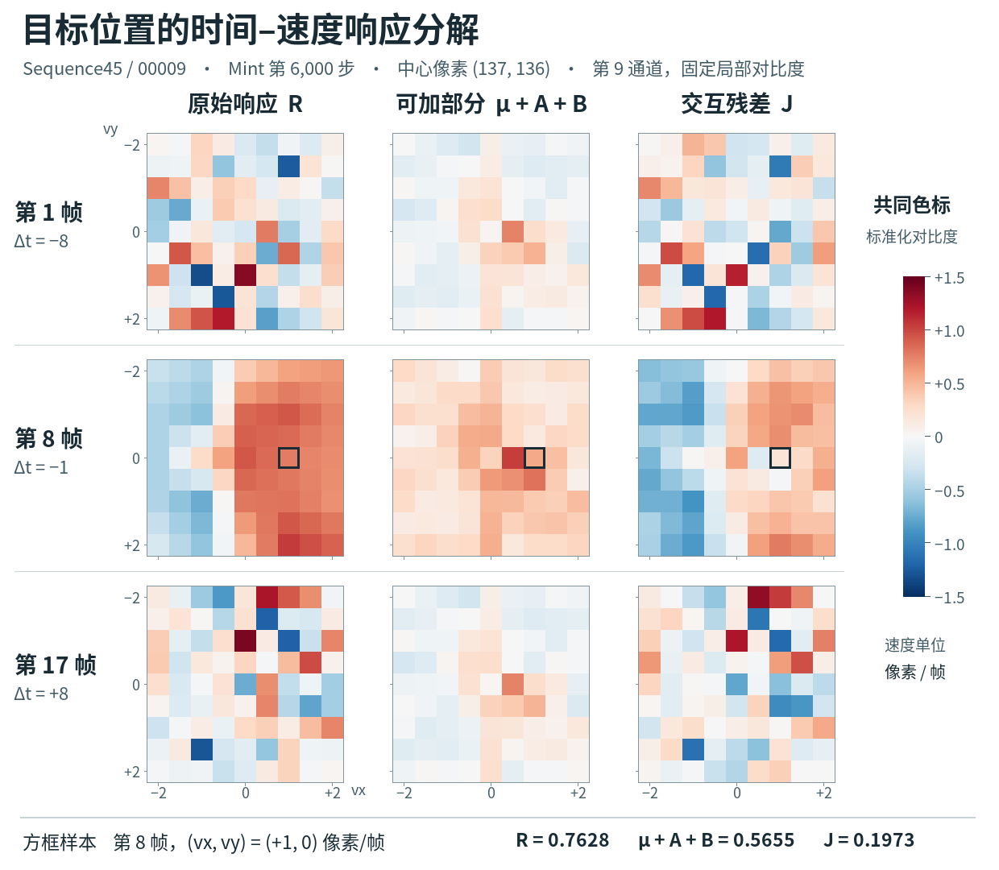
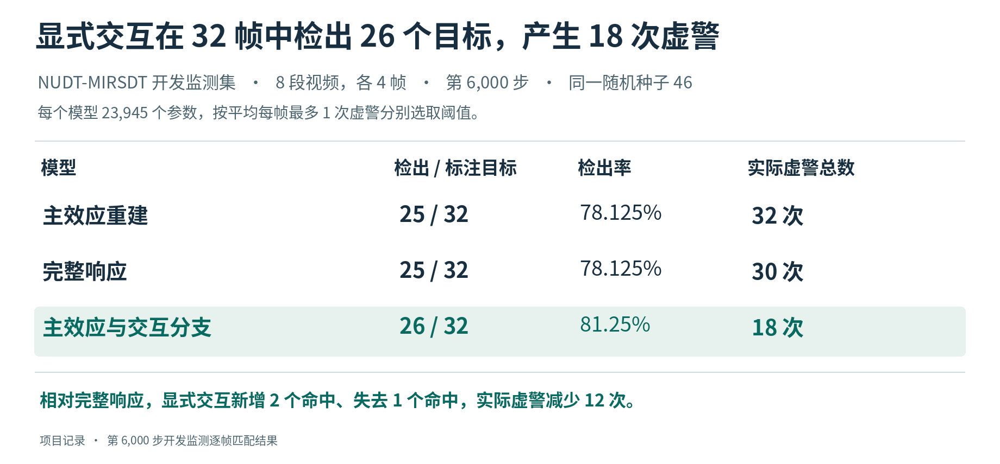
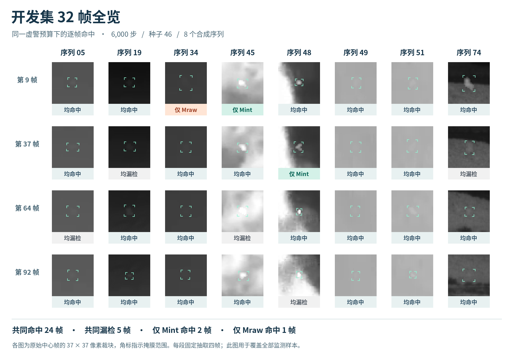
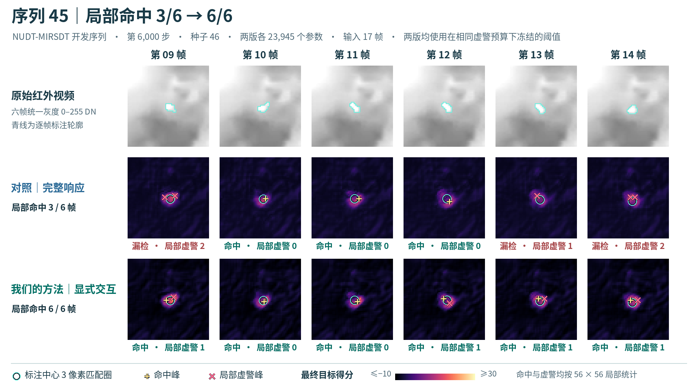
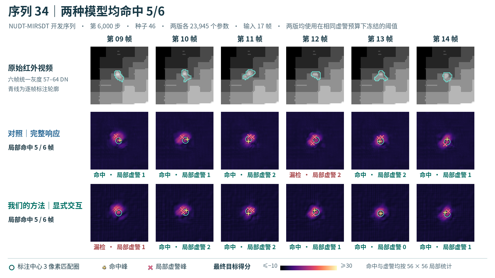
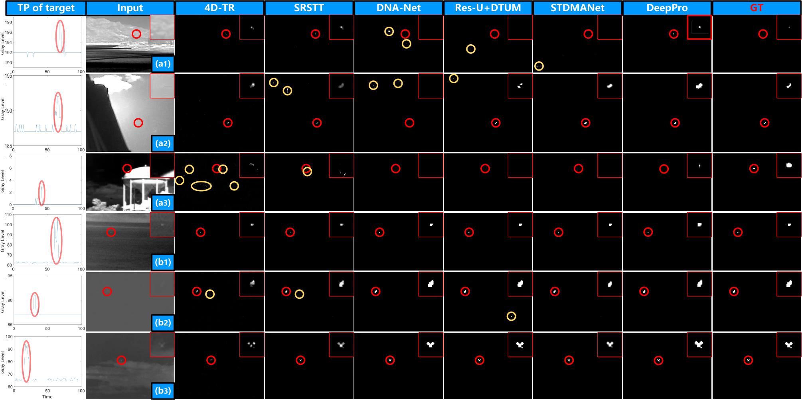
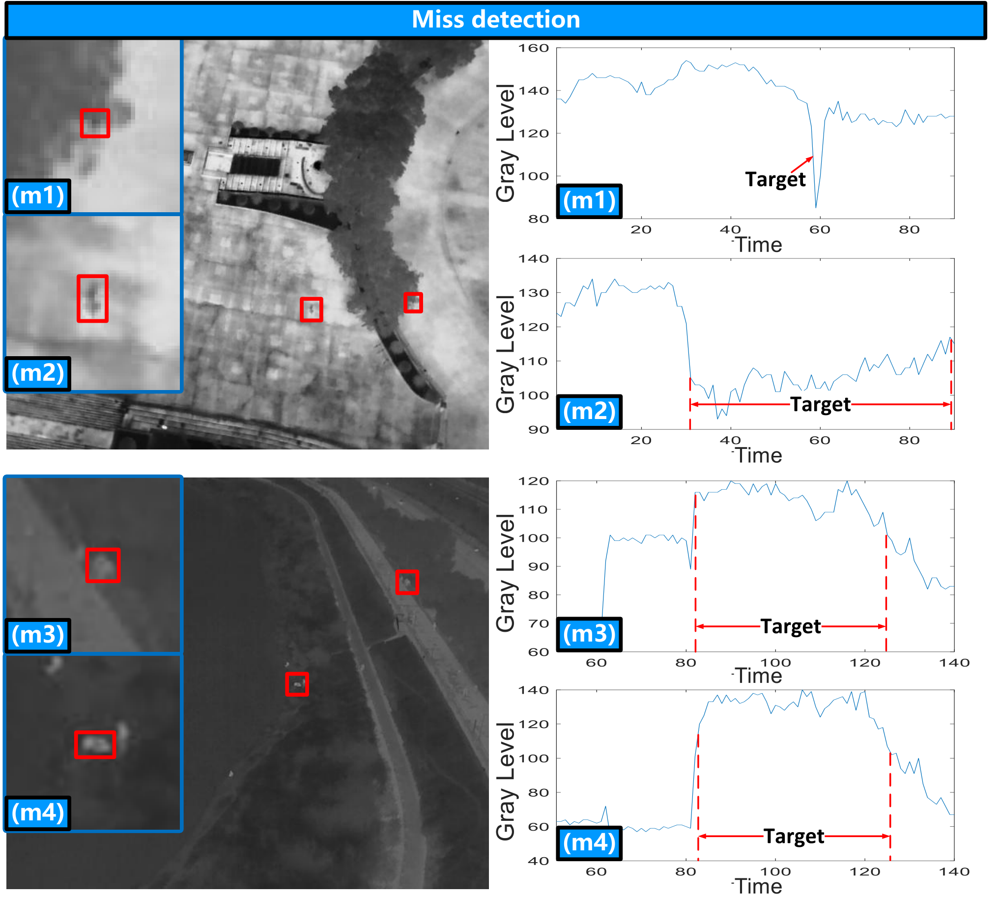

# 哪些时刻支持哪种运动？红外视频小目标检测的研究进度

六页实验汇报已替代此版大纲，包含第 12,000 步完整开发结果。[当前 PPT 与配图](../实验汇报_精简版/outline.md)

研究生组会，12 页主讲约 10 分钟，另有 2 页备查。用一个像素上的实测读数介绍本组的方法，再用同参数模型比较整帧检出。正式面板固定在种子 46、第 6,000 步，案例补充展示两个开发视频的连续帧。第 11 页保留为序列 45 的组会样张。

## 01　这个亮点能凭什么认出来？

- 先展示公开合成序列 02 的第 9 帧，再放大宽 9、高 11 像素的标注框。让听众先找目标，然后给出轮廓。
- 我们想回答，当单帧看不清时，前后哪些帧支持同一种运动解释？如果保留这种对应关系，在相同虚警预算下能多找回几个目标？全图与局部对读借鉴文献中的展示方式。[Li 等图 12](https://arxiv.org/html/2506.12766v5#S4.F12)

## 02　文献给了我们两种观察方式

- 左图看时间。DeepPro 在固定空间位置观察灰度随帧的变化。引用图 1(d,e) 第一例，短时空窗口和时间剖面并排，有助于指出单看某一帧容易错过什么。[Li 等，DeepPro，图 1](https://arxiv.org/html/2506.12766v5#S1.F1)
- 右图看运动。Heinze 等将同一个小行星候选按相邻速度叠加，速度匹配程度改变叠加图的清晰度和拖痕。多速度核验已有先例，红外检测中的 DTUM 也使用了方向信息。[Heinze 等，图 7](https://arxiv.org/html/1508.01599v1#S5.F7) · [DTUM 作者项目](https://github.com/TinaLRJ/Multi-frame-infrared-small-target-detection-DTUM)
- 用两篇论文的原图局部，保留出处、图号和“局部”标记。回到本组的疑问，按时间看和按速度看，如果各自提前平均，会丢掉什么？

## 03　两组观测均值相同，强响应出现的时刻不同

- 并列画两张“2 种速度 × 4 帧”的表。每帧一个高值、一个低值，取值固定。两例高响应的顺序分别为“甲甲乙乙”和“甲乙甲乙”。
- 每帧的平均值相同，每种速度在四帧内的平均值也相同。完整表仍然保留“哪一帧更支持哪种速度”。标为人工示意，两种排列都可能来自目标或背景。[研究假设与示意](../../../红外小目标视频检测_自主模型与分阶段实现方案_v1.md)

## 04　怎样从 17 帧原图得到中心帧的检测图？

- 网络读 17 帧，给第 9 帧的每个像素打分。中心帧外观单独送往融合层。在前后 16 个时刻，逐一按 81 种候选速度取特征，得到时间与速度的响应表。
- 示意图保留两条输入路径。视频分支读总体强弱、时间效应、速度效应和交互，随后融合中心帧信息，由空间解码器和检测头输出最终目标得分图。速度假设用于确定采样坐标。[总体架构与数据流](../../../红外小目标视频检测_自主模型与分阶段实现方案_v1.md) · [整网实现](../../../experiments/irstd_independent_v1/models/hypothesis_detector.py)

## 05　走进模型，看一个真实位置怎样分离出交互

- 用第 6,000 步模型读取序列 45 第 9 帧，在标注质心取整后的原图位置 (137, 136) 查看局部对比度通道。每张小图的 9 × 9 个格子是 81 种不同的候选速度。
- 指一个具体格子。第 8 帧、假设每帧向右移 1 像素时，取样点为 (136, 136)。原始响应 **+0.7628**，总体强弱与两个单轴效应之和 **+0.5655**，余下的 **+0.1973** 实际进入交互编码器。
- 三列分别标“原始响应”“可加部分”“交互残差”，使用同一色标。图只展示 16 个时刻中的 3 个，模型使用全部 16 × 81 格。[张量、权重与读数核验](../连续帧补充分析/核心表示/核心表示_来源与核验.json)

## 06　用等参数对照区分两种可能的收益

- 三个自主模型各有 **23,945 个参数**，共享相同设计的中心帧和主效应分支。画出送入联合编码器的三种内容，标“分别汇总后重建”“直接读整张响应表”“单独学习时刻与速度的交互”。
- 第一对照用“直接读整表”与“分别汇总”比较，回答保留对应关系有没有检测价值。第二对照中，两个模型都保留完整信息，比较“单独学习交互”和“直接读整表”，回答显式分工有没有额外收益。
- 项目名称 Msep、Mraw、Mint 仅作括注，供对照代码。M0 在固定位置聚合时间信息，是整条方法的基础参照。[三种编码模式](../../../experiments/irstd_independent_v1/reports/S3_evidence_model.md) · [正式运行配置](../../../experiments/irstd_independent_v1/configs/s4_protocol.yaml)

## 07　只改变对应关系，联合分支会有反应吗？

- 两组人工输入保持所有时间均值和速度均值相同，交互排列相反。用同一初始化，读取两组输入在融合前产生的联合特征，并列出最大绝对差。
- “分别汇总后重建”为 **0**，“直接读整表”为 **0.02172**，“单独学习交互”为 **0.00357**。后两种分支能区分这对输入。这是人工干预下的结构检查，检测收益由开发视频上的标注来判定。[干预与特征读数](../../../experiments/irstd_independent_v1/reports/S3_evidence_model.md)

## 08　用同一把尺比较最终目标得分

- 8 段开发视频，每段固定抽第 9、37、64、92 帧，共 32 张中心帧，每帧各有 1 个标注。三个模型都用种子 46、第 6,000 步的权重，输出整帧最终目标得分图。
- 演示一个峰怎样计数。预测峰距标注质心至多 3 个原图像素可一对一匹配，剩余过阈值峰计入虚警。主预算为平均每帧至多 1 个虚警，每个模型在各自分数尺度上选择预算内检出最多的阈值，平局取较少虚警。
- 让听众先辨认“阈值”“预算”和“实际虚警数”，再读下一页的结果。[匹配与评价口径](../../../experiments/irstd_independent_v1/reports/S0_data_contract.md) · [S4 运行配置](../../../experiments/irstd_independent_v1/configs/s4_protocol.yaml)

## 09　在 32 帧监测面板上，显式交互多命中 1 帧

- 同一虚警预算下，“分别汇总”为 **25/32，32 次虚警**，“直接读整表”为 **25/32，30 次虚警**，“单独学习交互”为 **26/32，18 次虚警**。三者检出率分别为 78.125%、78.125%、81.25%。
- 本轮完整响应与分别汇总的检出数持平，显式交互比完整响应多检出 1 个逐帧标注，实际少 12 次虚警。该差值来自一次初始化和 32 张开发监测帧。
- 主图用本组数据。横轴为实际虚警数/帧，纵轴为目标检出率。不同方法共轴的读法借鉴文献图 11。[本组第 6,000 步 FROC](../实验图/04_自主模型6000步开发FROC.png) · [本组运行记录](../../../experiments/irstd_independent_v1/reports/s4_runs/s4_24k_seed46_q256v81_20261118_02/monitor/MILESTONES.md) · [DeepPro 图 11](https://arxiv.org/html/2506.12766v5#S4.F11)

## 10　净增 1 帧背后，有两次找回和一次失去

- 在第 9 页各自选定的工作点上，将两个同信息模型逐帧配对。共同命中 24 帧、共同漏检 5 帧，另有 2 帧只有“单独学习交互”命中，1 帧只有“直接读整表”命中。
- 在“8 个开发来源 × 4 帧”的表中指明位置。只有本方法命中的是序列 45 第 9 帧、序列 48 第 37 帧。只有对照命中的是序列 34 第 9 帧。
- 下一页沿序列 45 的时间轴追看邻帧。六帧补充推理使用相同检查点和冻结阈值，每次只观察固定局部；连续帧计数与 32 帧整帧结果各自独立报告。[32 帧逐格原始结果](../连续帧实验图/绘图依据/06_S4开发监测32帧全景.csv) · [连续帧补充推理记录](../连续帧补充分析/provenance.json)

## 11　序列 45｜单独学习交互后，这六帧多命中三帧

- **本页是组会样张。** 六列依次显示第 9–14 帧。上排为原始红外图像及标注轮廓，中排标“对照：直接读整张响应表”，下排标“我们的方法：单独学习时刻与速度的交互”。对照和本方法都是本组自主模型，具有相同的输入信息与参数量。
- 两行热图表示检测头输出的**最终目标得分**，使用同一色标。围绕标注质心的圆代表 3 像素匹配范围，加号标命中峰，叉号标局部未匹配峰。每列的标注、热图和峰均来自同一个中心帧。
- 对照在第 10、11、12 帧命中，合计 **3/6**。本方法六帧全部命中，合计 **6/6**。两行使用各自冻结的全局分数阈值，峰计数限定在图示的 56 × 56 原图区域。这是从第 9 帧差异延伸的局部案例。
- 以实测图作为样张的图像依据，保留每个峰、帧号和命中标记。同场景并排比较及局部放大借鉴文献图 12。[六帧逐项数据](../连续帧补充分析/逐帧局部预测.csv) · [DeepPro 图 12](https://arxiv.org/html/2506.12766v5#S4.F12)

## 12　序列 34 的反例与下一轮验证

- 沿用上一页的中文标签、共同色标和局部匹配规则。第 9 帧只有“直接读整表”命中，第 12 帧只有“单独学习交互”命中。其余四帧均命中，两版各 **5/6**。序列 45 的净增益在这段视频中没有重复出现。[两段视频的同步播放](../连续帧补充分析/核心结果/两种读法_六帧最终目标得分.gif)
- 完整开发评价按正式方案在第 12,000 步首次检查 **8 段、672 帧**，并在 24,000 步共同训练终点复核。比较三种证据读法及固定位置基线，报告相同虚警预算下的差值和各来源的得失。当前正式运行只有种子 46，完整开发集没有空目标中心帧。
- 若结果跨来源保留，再用不同初始化和新来源检验稳定性，并补充空背景视频观察虚警。[正式运行配置](../../../experiments/irstd_independent_v1/configs/s4_protocol.yaml) · [开发来源与标注组成](../../../experiments/irstd_independent_v1/reports/S0_data_contract.md)

## 13　备查｜早期基线和冻结模型各回答了什么？

- **固定位置基线 M0。** 在 12 个训练中心上，第 350 步检出 8/8、虚警 1 次，第 400 步检出 7/8、虚警 4 次。在两段训练来源的 168 帧上沿用冻结阈值，共检出 83/84 个逐帧标注，实际虚警 35 次。全部 84 个目标标注来自同一段视频。[短训练轨迹](../实验图/02_M0短训练的检出与虚警.png) · [整图预测报告](../../../experiments/irstd_independent_v1/reports/S2c_execution_report.md)
- **早期交通视频 C/D。** 3 段预留视频的 12 帧共含 519 个框。按平均至多 1 次虚警/帧，两版均检出 16 个框，实际虚警为 9 和 8 次。放宽到 5 次，均为 50 个检出、60 次虚警。C/D 验证的是冻结骨干和检测头上的小分支。[旧实验图](../实验图/01_旧方案的检出与虚警.png) · [诊断记录](../../../experiments/motion_joint_followup/DIAGNOSIS.md)
- 定位示例来自同一训练序列。第 12 帧偏差 0.68 像素，符合 3 像素匹配规则。第 84 帧偏差 3.37 像素，记为漏检。展示命中与失败样例可参考文献图 17。[本组预测对读](../实验图/03_M0命中与漏检的预测对照.png) · [DeepPro 图 17](https://arxiv.org/html/2506.12766v5#S4.F17)

## 14　备查｜为什么是 81 种候选速度？

- 在 5,856 个可拟合的重叠训练窗口中，以标注质心估计平面位移。速度为训练侧代理量，发布数据没有真实速度。
- 两种网格间距的端点量化通过率分别为 60.88% 和 98.33%。选用每轴 9 个值、共 81 种候选速度后，要求整条离散路径的所有时刻均在容差内时，通过率为 65.83%。
- 公开合成数据按发布序列分成训练 72 段、开发 8 段、历史测试 20 段。序列 ID 可以区分，有些背景来自高度相似的场景。[网格选取与覆盖验收](../../../experiments/irstd_independent_v1/reports/S1_geometry_contract.md) · [划分与背景相似性](../../../experiments/irstd_independent_v1/reports/S0_data_contract.md)

## 实验配图的文献参照

Li 等的图 12 将同一场景下多种方法的输出横向并列，并放大目标局部。第 11、12 页沿用这种观察顺序，图中的原始帧、网络得分、峰和匹配结果均来自本组。图 17 对漏检样例作额外检查，作为第 12、13 页组织反例的参考。[DeepPro 图 12](https://arxiv.org/html/2506.12766v5#S4.F12) · [DeepPro 图 17](https://arxiv.org/html/2506.12766v5#S4.F17)

第 9 页借鉴 DeepPro 图 11 的多模型共轴呈现，按本组的目标匹配规则绘制 FROC。LUNA16 官方评价亦以每个样本的平均虚警数对检出率作图，该任务按扫描计数，本组按视频中心帧计数。[DeepPro 图 11](https://arxiv.org/html/2506.12766v5#S4.F11) · [LUNA16 官方评价说明](https://luna16.grand-challenge.org/Evaluation/)

## 制作进度

- [x] 已确认 14 页总量，主讲 12 页、备查 2 页，第 11 页为序列 45 样张。
- [x] 本组真实内部读数、32 帧整帧主结果和两个连续六帧局部案例已有对应来源，可逐项复核。
- [ ] **当前停在新版第 11 页样张待认可。** 样张需突出两种中文读法、最终目标得分及 3/6 与 6/6 的局部命中数。[新版样张的实测图依据](../连续帧补充分析/核心结果/Sequence45_六帧最终目标得分.png)
